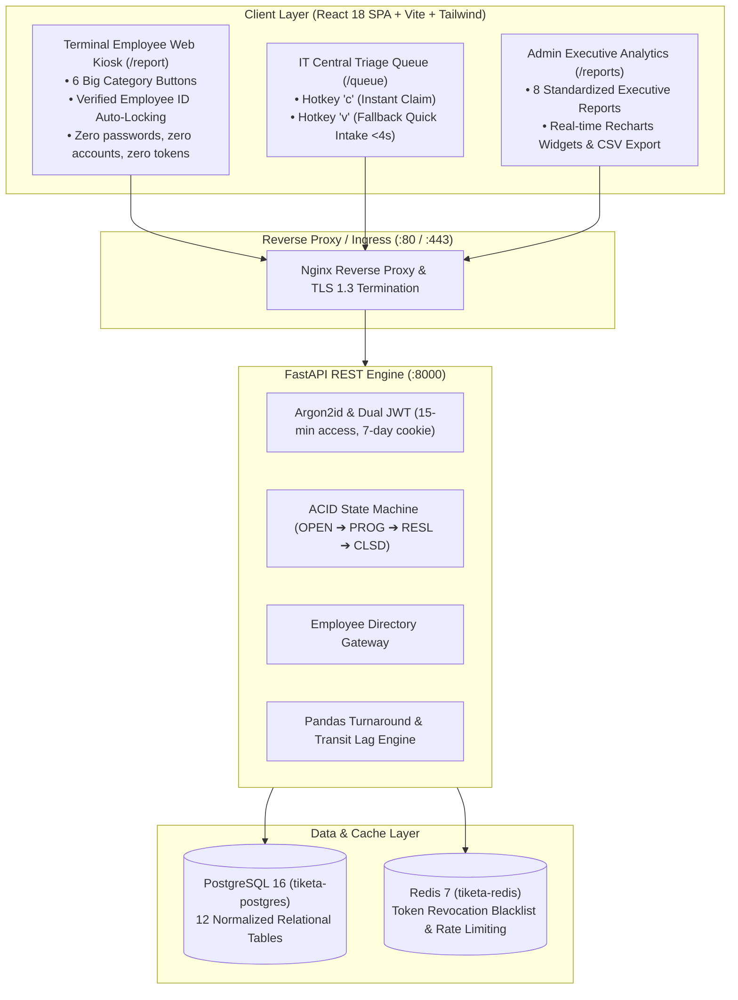

# Tiketa 2.0 — Enterprise IT Service & Operational Velocity Platform


**Tiketa 2.0** is the next-generation, high-performance IT Service Management (ITSM), terminal maintenance dispatch, and operational velocity analytics platform built specifically for the regional transit depots, terminals, and corporate headquarters of **Pangasinan Five Star Bus Co.** and affiliate transit fleets (*Bataan Transit, Cisco, First North Luzon*).

Replacing the legacy PHP 8.2 / Laravel 11 monolith, Tiketa 2.0 is re-architected from the ground up as a decoupled **Python 3.12+ (FastAPI) + React 18/19 SPA (Strict TypeScript 5+)** system running on containerized PostgreSQL 16 and Redis 7.

---

## 🏛️ System Architecture



---

## ⚡ Core Architectural Invariants

1. **Pure Employee ID Validated Intake (`/report`) (ADR-002)**:
   - General terminal staff (cashiers, mechanics, conductors, dispatchers) **never log in**.
   - Inputting a verified **Employee ID No.** (e.g. `FS-1042`) triggers debounced asynchronous directory validation, auto-populating and **hard-locking Location and Department** to eliminate 100% of human dropdown routing errors.
   - Guarded against rapid-typing race conditions; form submission remains strictly blocked until the active ID is verified.

2. **Simplified 2-Tier Authenticated RBAC**:
   - Authenticated user accounts in PostgreSQL `users` are strictly restricted to:
     - `it` (**IT Support Specialist**): Central triage queue (`/queue`), ticket claiming (`c`), active labor duration tracking, and walk-in quick intake (`v`).
     - `admin` (**IT Head / System Administrator**): 8 Standardized executive analytics reports, technician roster management, and system administration.

3. **High-Velocity IT Queue with Hotkeys**:
   - **Hotkey `c`**: Single-click atomic ticket claiming by technicians in <100ms.
   - **Hotkey `v`**: IT Fallback Quick Intake modal allowing technicians to log unavoidable Viber/walk-in requests in <4 seconds before troubleshooting, preserving 100% of executive labor metrics.

4. **Executive Analytics & Transit Lag Disaggregation**:
   - 8 Standardized operational reports powered by Pandas with streaming CSV exports:
     1. Monthly SLA & Resolution Compliance
     2. Staff Utilization & Velocity
     3. Department & Company Demand Matrix
     4. Aging Backlog Exception Report (>48h)
     5. Transit & Waiting Lag Disaggregation (separating hands-on labor from inter-terminal travel)
     6. Terminal Hardware Vulnerability & Breakdown Scoring
     7. Preventive Maintenance (PMS) Compliance Audit
     8. Chronic Repeat Requestor & Friction Index
   - 4 Dynamic Recharts visual widgets on supervisor dashboards.

5. **Pragmatic Scope Discipline (ADR-004)**:
   - Zero throwaway client-side Excel/CSV drag-and-drop uploader bloat in the React UI. Historical spreadsheet migration is executed deterministically via the backend developer CLI seeder (`backend/scripts/seed_historical_logs.py`).

---

## 📁 Repository Structure

```text
Tiketa/
├── docs/                           # Central In-Repository AI Context & Technical Docs
│   ├── AI-CONTEXT.md               # Primary Router & Navigation Guide for AI Agents
│   ├── 01-Architecture/            # System Topology, 9-Slice Store Map & Invariants
│   ├── 02-Database/                # Canonical Data Dictionary (15 Fields)
│   ├── 03-Contracts/               # OpenAPI REST Endpoints & Reporting Heuristics
│   ├── 04-Sprints/                 # Engineering Sprint Plans, Boards & Logs
│   └── 05-Standards/               # Git Rebase Policy & Backend Standards
├── backend/                        # Python 3.12+ (FastAPI) Backend Service
│   ├── app/
│   │   ├── api/                    # REST Route Controllers (auth, tickets, reports, directory)
│   │   ├── core/                   # Security (Argon2id, AES-256), Config, Redis Cache
│   │   ├── models/                 # SQLAlchemy 2.0 Async Declarative ORM Models
│   │   ├── schemas.py              # Pydantic v2 Validation Schemas
│   │   └── services/               # Core Business Engines (tickets, directory, reports, mail)
│   ├── migrations/                 # Alembic Async Database Migration Tree
│   ├── scripts/                    # Developer CLI Tools (seed_historical_logs, seed_demo_operations)
│   └── tests/                      # Pytest Suite (Integration, Security, Reporting)
├── frontend/                       # React 18/19 SPA (Strict TypeScript 5+)
│   ├── src/
│   │   ├── api/                    # Axios API Clients & Token Interceptors
│   │   ├── components/             # Reusable UI Primitives, Layouts, Drawer
│   │   ├── constants/              # Five Star Fleet Domain Constants
│   │   ├── features/               # Modular Domain Views & Sub-components
│   │   │   ├── analytics/          # Executive Analytics Cards & Visual Recharts
│   │   │   ├── kiosk/              # Public Intake (/report) & useEmployeeIntake Hook
│   │   │   ├── reports/            # 8 Standardized Multi-Tab Reports & Mappers
│   │   │   ├── tickets/            # IT Queue Data Tables & Kanban Board
│   │   │   └── workbench/          # Technician Workbench & Team Administration
│   │   ├── store/
│   │   │   ├── slices/             # Zustand 9 Domain Slices (Atomic Selectors)
│   │   │   ├── types.ts            # AppState & AppSliceCreator Contracts
│   │   │   └── useAppStore.ts      # 44-Line Central Store Aggregator
│   │   └── types/                  # Strict Domain TypeScript Models
├── deploy/                         # Production Nginx Config, Setup Scripts & Backup Crons
└── docker-compose.yml              # Multi-Container Development Orchestration
```

---

## 🚀 Getting Started

> [!TIP]
> **Complete Backend Onboarding & Troubleshooting Guide**: For detailed prerequisites, step-by-step Windows/macOS instructions, built-in test accounts, and troubleshooting common pitfalls (Pydantic validation, base64 encryption keys, Docker networking), see the [Backend Developer Setup Guide](docs/05-Standards/BACKEND-SETUP-GUIDE.md).

### Prerequisites
- [Docker Engine & Docker Compose](https://docs.docker.com/get-docker/)
- [Node.js 20 LTS](https://nodejs.org/) & `npm`
- [Python 3.12+](https://www.python.org/)

---

### Option A: Run Full Stack via Docker Compose

1. **Clone the repository**:
   ```bash
   git clone https://github.com/jfflpz/Tiketa2.0.git
   cd Tiketa2.0
   ```

2. **Launch all services**:
   ```bash
   docker compose up -d --build
   ```

3. **Run database migrations and demo seed**:
   ```bash
   docker compose exec backend alembic upgrade head
   docker compose exec backend python -m scripts.seed_dictionaries
   docker compose exec backend python -m scripts.seed_demo_operations
   ```

4. **Access the application**:
   - **Terminal Web Kiosk**: `http://localhost:5173/report`
   - **IT Operations Queue**: `http://localhost:5173/queue`
   - **FastAPI Interactive Docs**: `http://localhost:8000/docs`
   - **API Health Check**: `http://localhost:8000/health/ready`

---

### Option B: Hybrid Local Development Setup (Recommended for Developers)

1. **Start PostgreSQL 16 & Redis 7 in Docker**:
   ```powershell
   docker compose up -d db redis
   ```

2. **Configure & Run Backend Service (`backend/`)**:
   ```powershell
   cd backend

   # Create and configure local environment
   Copy-Item .env.example .env

   # Create virtual environment and activate (Windows PowerShell)
   python -m venv .venv
   Set-ExecutionPolicy -Scope Process -ExecutionPolicy Bypass
   .\.venv\Scripts\Activate.ps1
   # (On macOS/Linux: source .venv/bin/activate)

   # Install development dependencies
   pip install -r requirements-dev.txt

   # Run migrations & seed demo operations
   alembic upgrade head
   python -m scripts.seed_dictionaries
   python -m scripts.seed_demo_operations

   # Start FastAPI development server
   uvicorn app.main:app --host 127.0.0.1 --port 8000 --reload
   ```

3. **Configure & Run Frontend SPA (`frontend/`)**:
   ```powershell
   cd ../frontend

   # Install dependencies
   npm ci

   # Start Vite dev server on port 5173
   npm run dev
   ```
---

## 🧪 Testing & Verification

### Frontend Verification
```powershell
cd frontend
npm run type-check  # Validates strict TypeScript with 0 errors
npm run build       # Compiles optimized production Vite bundle
```

### Backend Test Suite
```powershell
cd backend
# Runs integration tests, Alembic migrations check, and enforces >=80% coverage
pytest -q --cov=app --cov=scripts --cov-report=term-missing --cov-fail-under=80
```

### Code Formatting & Linting
```powershell
# Backend (Ruff)
python -m ruff check backend
python -m ruff format --check backend

# OpenAPI Schema Validation
python -m scripts.export_openapi --check
```

---

## 🧭 In-Repository AI Context Navigation

All AI coding assistants (Antigravity, Cursor, Copilot, Claude) and developers working in this repository must consult [`docs/AI-CONTEXT.md`](docs/AI-CONTEXT.md) as the primary entry point:
- **System Architecture & 9-Slice Map**: [`docs/01-Architecture/SYSTEM-ARCHITECTURE.md`](docs/01-Architecture/SYSTEM-ARCHITECTURE.md)
- **Database Schema (15 Canonical Fields)**: [`docs/02-Database/DATA-DICTIONARY.md`](docs/02-Database/DATA-DICTIONARY.md)
- **REST API Specifications**: [`docs/03-Contracts/OPENAPI-CONTRACTS.md`](docs/03-Contracts/OPENAPI-CONTRACTS.md)
- **Master Sprint Plan & Runbook**: [`docs/04-Sprints/MASTER-SPRINT-PLAN.md`](docs/04-Sprints/MASTER-SPRINT-PLAN.md)
- **Git Rebase & Review Policy**: [`docs/05-Standards/GIT-REBASE-WORKFLOW.md`](docs/05-Standards/GIT-REBASE-WORKFLOW.md)
- **Master SRS**: Archived permanently in Obsidian ARCH vault (`01-Projects/Tiketa/SRS.md`, v2.1.0).

---

## 👥 Contributors & Core Team

- **Jefferson Lopez** (`@jfflpz`): Backend Lead, System Architecture, Database Schema, IEEE 830 Specification.
- **Rafael Emmanuel Codiñera**: Frontend Lead, React/TS SPA Architecture, Zustand State Modeling.
- **Supervisors & Stakeholders**:
  - **Sir Stephen Miralles** (Senior IT Analyst)
  - **Sir Nathaniel Esguerra** (Junior IT Specialist)
  - **Sir Raefael** (Business Process Manager)
- **Organization**: Pangasinan Five Star Bus Co. & Regional Affiliate Fleets.
