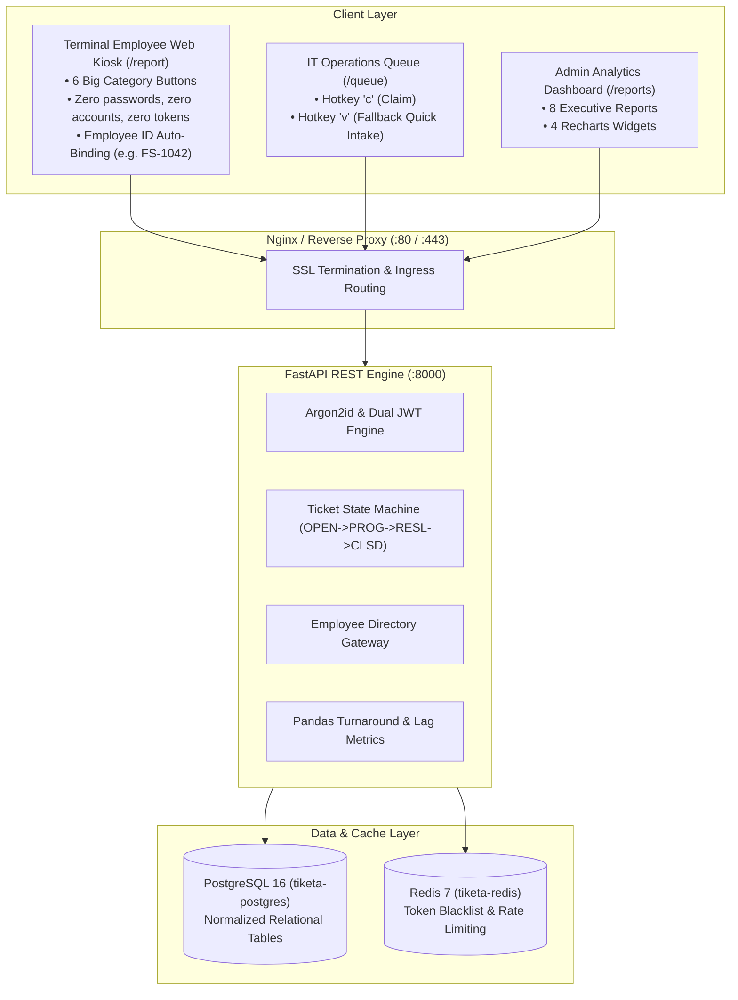

# System Architecture & Identity Governance

**System**: Tiketa 2.0  
**Status**: Approved Specification  
**Reference**: [[ARCH/01-Projects/Tiketa/SRS.md|SRS v2.1.0]] & [[ARCH/01-Projects/Tiketa/Tiketa-Employee-Access-Decision-Report.pdf|Employee Access Decision Report]]

---

## 1. High-Level Architectural Topology

---

## 2. The 3 Account & Intake Pillars

### Pillar 1: Zero Workforce Accounts (`/report`)
- Field employees (cashiers, mechanics, conductors, dispatchers) **never log in**.
- Entering an **Employee ID No.** (e.g., `FS-1042`) triggers an auto-lookup against PostgreSQL.
- Verified records **hard-lock Location and Department** as read-only fields, preventing 100% of human dropdown routing mistakes.

### Pillar 2: Simplified 2-Tier RBAC
The authenticated `users` table is restricted to two roles:
1. `it` (**IT Technician**): Access to `/queue`, one-click ticket claiming (`c`), status/labor updates, and fallback quick intake (`v`).
2. `admin` (**IT Head / System Admin**): Access to all 8 executive analytics reports, employee directory management, and system administration.

### Pillar 3: IT Fallback Quick Intake (Hotkey `v`)
- Technicians on the IT Queue tap **`v`** to open a quick modal for walk-in or Viber requests.
- Entering the Employee ID auto-populates the staff profile in <1 second, allowing logging in <4 seconds before troubleshooting.
