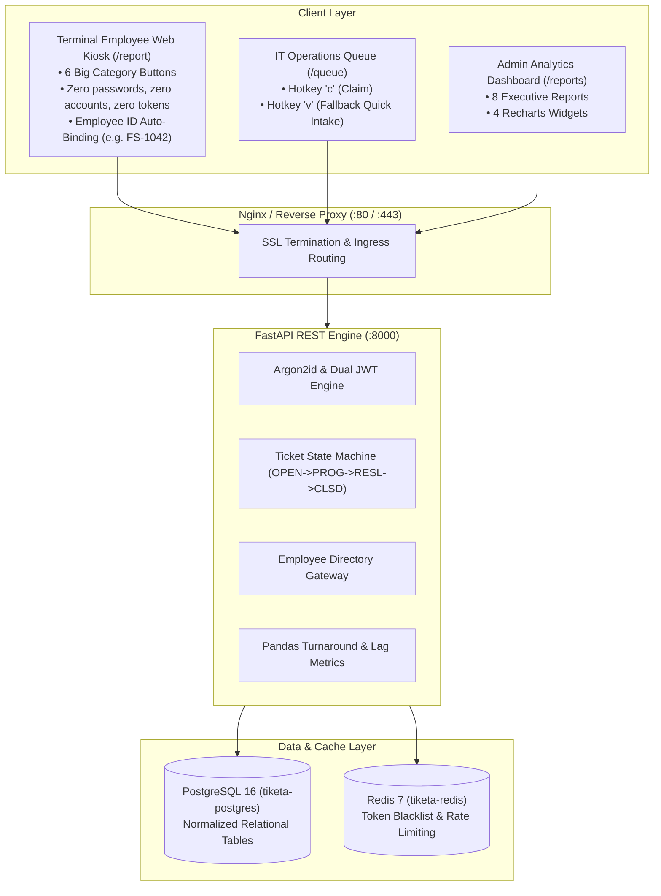

# System Architecture & Identity Governance

**System**: Tiketa 2.0  
**Status**: Approved Specification  
**Reference**: [[ARCH/01-Projects/Tiketa/SRS.md|SRS v2.1.0]] & [[ARCH/01-Projects/Tiketa/Tiketa-Employee-Access-Decision-Report.pdf|Employee Access Decision Report]]

---

## 1. High-Level Architectural Topology



---

## 2. The 3 Account & Intake Pillars

### Pillar 1: Zero Workforce Accounts (`/report`)
- Field employees (cashiers, mechanics, conductors, dispatchers) **never log in**.
- Entering an **Employee ID No.** (e.g., `FS-1042`) triggers an auto-lookup against PostgreSQL.
- Verified records **hard-lock Location and Department** as read-only fields, preventing 100% of human dropdown routing mistakes.

### Pillar 2: Simplified 2-Tier RBAC
The authenticated `users` table is restricted to two roles:
1. `it` (**IT Technician**): Access to `/queue`, one-click ticket claiming (`c`), status/labor updates, and fallback quick intake (`v`).
2. `admin` (**IT Head / System Admin**): Access to all 8 executive analytics reports, employee directory management, and system administration.

### Pillar 3: IT Fallback Quick Intake (Hotkey `v`)
- Technicians on the IT Queue tap **`v`** to open a quick modal for walk-in or Viber requests.
- Entering the Employee ID auto-populates the staff profile in <1 second, allowing logging in <4 seconds before troubleshooting.

---

## 3. Frontend Modular State & Component Architecture

To prevent regressions, large monoliths have been decomposed into isolated domain modules. AI agents modifying frontend code must adhere strictly to these structures:

### 3.1 Zustand 9-Slice Pattern (`src/store/`)
The centralized store (`src/store/useAppStore.ts`, 44 lines) assembles 9 typed slices via `create<AppState>()` using `AppSliceCreator<T>` defined in `src/store/types.ts`:

| Slice File | Interface | Primary Responsibility |
| :--- | :--- | :--- |
| `slices/uiSlice.ts` | `UISlice` | View navigation (`activeView`), sidebar toggling, active office location code, toast notifications (`addToast`, `removeToast`). |
| `slices/authSlice.ts` | `AuthSlice` | Authenticated session (`currentUser`), login modal role, auth hydration, login API integration, and clean logout (`logoutToKiosk`). |
| `slices/ticketQueueSlice.ts` | `TicketQueueSlice` | Triage queue tickets, active filters (tab, status, location, date range), and selected ticket selection. |
| `slices/ticketOperationsSlice.ts` | `TicketOperationsSlice` | Lifecycle operations: ticket claiming (`claimTicketApi`), status transitions (`updateTicketStatusApi`), priority editing, and deletion. |
| `slices/publicIntakeSlice.ts` | `PublicIntakeSlice` | Kiosk ticket submission (`submitTicketApi`) and intake dialog state. |
| `slices/notesSlice.ts` | `NotesSlice` | Standard Operating Procedure (SOP) repair guides and technician knowledge base articles. |
| `slices/reportsSlice.ts` | `ReportsSlice` | 8 Executive reports, executive KPIs, CSV streaming export, and request sequence tracking with `resetReportsState()`. |
| `slices/teamSlice.ts` | `TeamSlice` | IT technician roster, on-duty status, and availability management. |
| `slices/ticketVerificationSlice.ts` | `TicketVerificationSlice` | Resolution token confirmation and user closure verification. |

### 3.2 Feature Component Decomposition (`src/features/`)
Views over 200 lines are factored into sub-components and custom hooks:
- **Kiosk Intake (`features/kiosk/`)**:
  - `EmployeeTicketScreen.tsx`: Kiosk layout entry (198L).
  - `hooks/useEmployeeIntake.ts`: Asynchronous validation, employee ID debouncing, and submission handler.
  - `components/EmployeeProfileCard.tsx`, `CategoryGrid.tsx`, `SubmissionConfirmation.tsx`.
- **IT Workbench & Queue (`features/workbench/`, `features/tickets/`)**:
  - `ITWorkbenchBoardView.tsx`: Kanban and active repair tracking.
  - `features/team/TeamAdministrationView.tsx`: Technician workload and roster (re-exported via `TeamWorkbenchView.tsx` for backward compatibility).
  - `features/tickets/TicketListsView.tsx` (152L): Partitioned into `TicketFilterToolbar.tsx`, `TicketDataTable.tsx`, `TicketKanbanBoard.tsx`.
  - `components/tickets/JobLogDrawer.tsx` (148L): Sub-divided into `JobLogHeader.tsx`, `JobLogChatFeed.tsx`, `JobLogRecordForm.tsx`.
- **Executive Analytics & Reports (`features/analytics/`, `features/reports/`)**:
  - `ExecutiveAnalyticsView.tsx` (175L): Partitioned into `AnalyticsKPICards.tsx`, `TurnaroundLagChart.tsx`, `SupportModeDonutChart.tsx`, `HourlyPeakChart.tsx`.
  - `StandardizedReportsView.tsx` (157L): Supported by typed report mappers (`utils/reportFormatters.ts`) and modular tables.
- **Application Shell & Layout (`components/layout/`)**:
  - `TopHeader.tsx` (115L): Partitioned into `HeaderSearchBar.tsx`, `LocationSelectorPopover.tsx`, `NotificationsPopover.tsx`, `UserProfileMenu.tsx`.

---

## 4. Asynchronous State Invariants & AI Agent Rules

AI assistants and developers extending Tiketa frontend must enforce the following non-negotiable rules:

1. **Zero Whole-Store Subscriptions**:
   - `const { ... } = useAppStore();` is **strictly prohibited**.
   - Always bind components to targeted atomic selectors:
     ```typescript
     const activeLocation = useAppStore((state) => state.activeOfficeLocationCode);
     const submitTicketApi = useAppStore((state) => state.submitTicketApi);
     ```
2. **Asynchronous Lookup Race Protection**:
   - In any form performing live network lookups (e.g. Employee ID in `useEmployeeIntake.ts`), track sequence with a persistent `useRef(0)` and an effect cleanup flag (`isCancelled = true`).
   - Responses arriving after a subsequent keystroke or component unmount must be discarded.
3. **Immediate Input Invalidation**:
   - When a validated identifier (such as Employee ID) is edited, set verification state to `false` immediately and synchronously before debouncing.
   - Guard form submission handlers with `if (!employeeVerified || isSubmitting) return;` so unverified inputs cannot be submitted.
4. **Session Invalidation on Logout**:
   - Analytical queries and in-flight promises must never leak past session boundaries. `logoutToKiosk` in `authSlice` must invoke `get().resetReportsState()`.
   - `resetReportsState()` must increment both report and KPI sequence IDs (`activeReportRequestId++`, `activeKpisRequestId++`) and clear state (`kpis: null`, `activeReportData: null`, `isFetchingKPIs: false`, `isFetchingReport: false`).
5. **Strict TypeScript & Export Preservation**:
   - Never introduce untyped JavaScript. All additions must compile cleanly under `npm run type-check`.
   - `useAppStore.ts` must maintain all public re-exports to preserve compatibility with existing view consumers.
