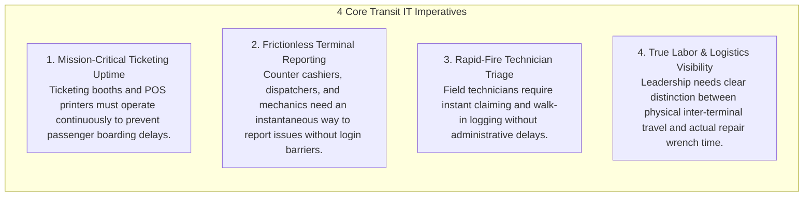
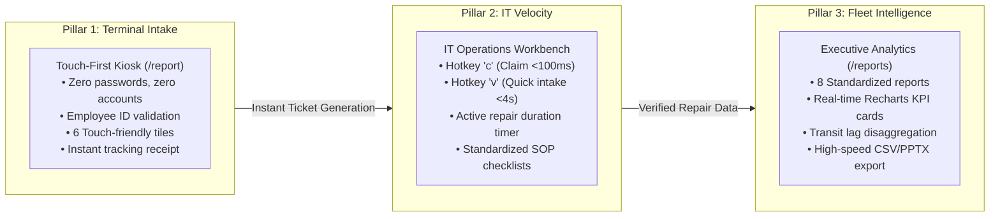
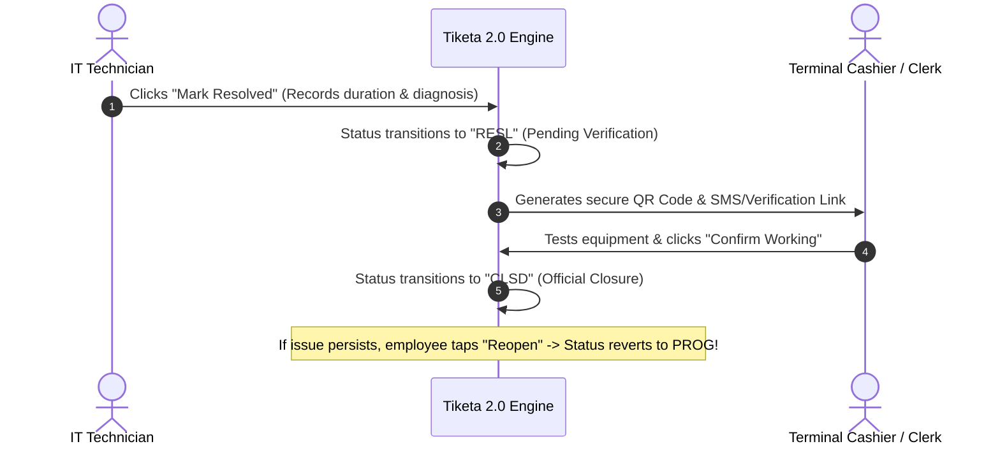
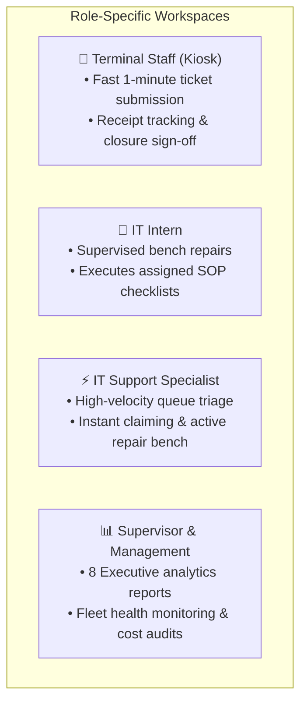
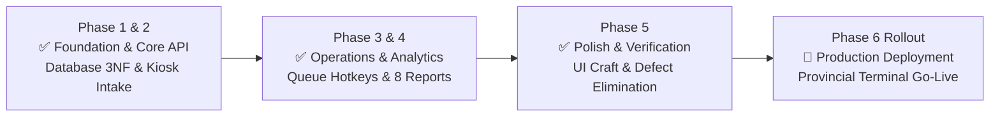

# 🎯 Tiketa 2.0 — Executive Presentation & Stakeholder Brief
**Enterprise IT Service Management, Terminal Dispatch & Operational Velocity Platform**  
*Pangasinan Five Star Bus Co. & Regional Transit Fleets*  
**Audience:** Executive Leadership, Terminal Operations Managers, Senior IT Supervisors  
**Document Type:** Executive Presentation Deck & Operational Briefing  
**Version:** `v2.2.0-Executive`  

---

## 📽️ Slide 1: Title & Executive Vision

> ### **Tiketa 2.0: Enterprise Transit IT Service & Operational Velocity Platform**
> *"Instantaneous Support, Verified Resolutions, and Real-Time Fleet Intelligence."*

* **The Mission:** Deliver high-velocity, error-proof IT support dispatch across 15 provincial terminals and bus depots, while providing leadership with real-time operational truth and disaggregated labor analytics.
* **Beneficiary Fleets:**
  - 🚌 **Pangasinan Five Star Bus Co., Inc.** (Primary Fleet)
  - 🚌 **Bataan Transit Co., Inc.**
  - 🚌 **Luzon Cisco Transport, Inc.**
  - 🚌 **First North Luzon Transit, Inc.**
  - 🚌 **Maria De Leon Transportation**
  - 🛠️ **Cubao Central Engineering & Motor Pool Hubs**
* **Project Leads:** Jefferson Lopez (Backend & Systems) & Rafael Emmanuel Codiñera (Frontend & UX)
* **Supervisory Sponsors:** Sir Stephen Miralles (Senior IT Analyst), Sir Nathaniel Esguerra (Junior IT), Sir Raefael (Business Process Manager)

---

## 📽️ Slide 2: The Transit IT Landscape & Operational Imperatives

The regional transit network operates across 15 high-volume provincial depots, passenger terminals, and corporate facilities. Managing IT across this distributed infrastructure requires solving four fundamental operational needs:



| Operational Challenge | Tiketa 2.0 Engineering Response |
| :--- | :--- |
| **500+ Geographically Dispersed Staff** | **Zero-Account Kiosk (`/report`):** Terminal staff validate via Employee ID; zero passwords to remember or reset. |
| **Accidental Terminal Misrouting** | **Smart Directory Auto-Binding:** Employee verification automatically locks Company, Location, and Department as read-only. |
| **Field Walk-Ins & Viber Requests** | **4-Second Quick Intake (`v`):** Technicians log ad-hoc walk-in requests in seconds before starting work. |
| **Long-Distance Inter-Terminal Travel** | **Transit Lag Disaggregation:** Mathematically isolates transit travel time from active hands-on repair duration. |
| **Premature Ticket Resolution** | **Two-Party Closure Handshake:** Tickets remain open until the reporting employee confirms the equipment is operational. |

---

## 📽️ Slide 3: Tiketa 2.0 Core Value Architecture

Tiketa 2.0 is built upon **Three Operational Pillars** designed to connect terminal staff, technicians, and leadership into one seamless ecosystem:



---

## 📽️ Slide 4: Feature 1 — The Touch-First Zero-Account Workforce Kiosk

> ### **Core Innovation:** Frictionless reporting for terminal cashiers, conductors, mechanics, and dispatchers.

* **Zero Password Burden:** Terminal employees **never manage, remember, or reset credentials**.
* **Smart Employee ID Auto-Binding:**
  1. The cashier enters their **Employee ID No.** (e.g., `FS-1042`).
  2. The system instantly verifies their record against the master employee directory.
  3. **Company, Location, and Department are automatically locked** as read-only.
* **100% Routing Accuracy:** Eliminates human dropdown selection mistakes. A cashier at Cubao Terminal cannot misroute a ticket to Pasay or San Carlos.
* **6 Big Visual Touch Tiles:** Designed for touchscreen monitors and counter tablets (*PC/Workstation, POS Ticket Printer, Network/Wi-Fi, Terminal CCTV, Card POS Terminal, System Software*).
* **Instant Digital Tracking Receipt:** Issues a clean tracking code (`T-XXXXXX`) allowing the requester to check progress at any time.

```
+-----------------------------------------------------------------------+
|  🎫 TIKETA 2.0 — TERMINAL ASSISTANCE KIOSK                            |
|                                                                       |
|  Employee ID: [ FS-1042           ]  -->  ✅ Matched: Maria Santos   |
|  Company:     Pangasinan Five Star Bus Co. [LOCKED]                   |
|  Location:    Cubao Central Terminal       [LOCKED]                   |
|  Department:  Ticketing & Cashier Booth 3  [LOCKED]                   |
|                                                                       |
|  Select Issue Category:                                               |
|  [ 🖥️ PC Workstation ]   [ 🖨️ POS Ticket Printer ]   [ 🌐 Network / Wi-Fi ] |
|  [ 📹 Terminal CCTV  ]   [ 💳 Card Terminal POS   ]   [ ⚙️ System Software ] |
+-----------------------------------------------------------------------+
```

---

## 📽️ Slide 5: Feature 2 — High-Velocity IT Queue & Hotkey Triage

> ### **Core Innovation:** Maximum operational velocity for field technicians repairing hardware across depots.

```mermaid
flowchart LR
    A["Central Open Queue (/queue)"] -->|Hotkey 'c' (<100ms)| B["Claimed & In Progress<br/>(Timer Starts Automatically)"]
    C["Walk-In or Viber Request"] -->|Hotkey 'v' (<4 seconds)| D["Quick Intake Modal<br/>(Auto-Logged in Field)"]
```

* **Hotkey `c` (Single-Keystroke Self-Claim):** Technicians press **`c`** to claim unassigned tickets from the pool in `< 100 milliseconds`, locking the ticket and starting the labor clock instantly.
* **Hotkey `v` (4-Second Quick Intake):** When staff report urgent issues in person or via Viber, the technician presses **`v`**, enters the Employee ID, and logs the issue in `< 4 seconds` before starting physical repair work.
* **Active Repair Workbench (`/workbench`):** Live timer tracks hands-on labor hours with 4-decimal precision, ensuring accurate labor reporting.
* **Saved SOP Repair Guides & Checklists:** Standardized troubleshooting checklists (e.g., *POS printer roller cleaning, Network crimping, Motherboard capacitor checks*) guarantee consistent repair quality across all 15 hubs.

---

## 📽️ Slide 6: Feature 3 — Precision Transit Lag Disaggregation Engine

> ### **Core Innovation:** Distinguishing hands-on repair duration from inter-terminal travel delay.

In regional transit operations, technicians regularly travel between provincial hubs (*e.g., dispatch from Cubao headquarters to Tarlac depot, 125 km away*). Tiketa 2.0 implements **Transit Lag Disaggregation** to separate transit travel from actual repair work:

$$\text{Turnaround Days} = (\text{Date Finished} - \text{Date Started}) + 1$$

$$\text{Logistical Transit Lag (Days)} = \text{Turnaround Days} - \left( \frac{\text{Actual Hands-On Labor Hours}}{8} \right)$$

$$\text{Lag-to-Labor Ratio} = \frac{\text{Transit Lag Days} \times 24}{\text{Actual Labor Hours}}$$

```
┌────────────────────────────────────────────────────────────────────────┐
│  OPERATIONAL METRICS DISAGGREGATED                                     │
├────────────────────────────────────────────────────────────────────────┤
│  Total Turnaround Time: 3 Calendar Days (72.0 Hours)                   │
│  ├── Active Hands-On Labor:  0.5 Hours (30 mins of bench repair)       │
│  └── Logistical Transit Lag: 71.5 Hours (Inter-terminal transit)       │
│                                                                        │
│  💡 Executive Intelligence: Technician diagnostic speed is fast.       │
│  Inter-terminal travel schedules are flagged for logistical review.    │
└────────────────────────────────────────────────────────────────────────┘
```

* **Automated Action Trigger:** If the **Lag-to-Labor Ratio $\ge 24$**, Tiketa 2.0 automatically flags the terminal for logistical travel review, providing leadership with actionable data on depot transit efficiency.

---

## 📽️ Slide 7: Feature 4 — Verified End-User Closure Handshake

> ### **Core Innovation:** Two-party sign-off ensuring equipment is confirmed operational before closure.



* **Zero Premature Closures:** A ticket cannot be closed unilaterally by the technician. The terminal employee must confirm the hardware is functioning properly.
* **Instant Reopen Safeguard:** If an issue is unresolved, the employee taps **"Reopen"**, which increments the ticket reopen counter and returns the ticket to the technician's active workbench.
* **48-Hour Administrative Failsafe:** If an employee is on leave, an authorized supervisor can execute an administrative closure override after 48 hours to maintain pipeline hygiene.

---

## 📽️ Slide 8: Tailored Workspaces & User Access Matrix

Tiketa 2.0 delivers clean, focused interfaces configured strictly for each operational role:



| Operational View / Capability | Terminal Staff (Kiosk) | IT Intern | IT Support | IT Supervisor | System Admin |
| :--- | :---: | :---: | :---: | :---: | :---: |
| **File Ticket via Employee ID** | 🟢 **Primary** | 🟢 Allowed | 🟢 Allowed | 🟢 Allowed | 🟢 Allowed |
| **Track Ticket via Code (`T-XXXXXX`)** | 🟢 **Receipt** | 🟢 Allowed | 🟢 Allowed | 🟢 Allowed | 🟢 Allowed |
| **Personal Speed Cockpit (`/overview`)** | ❌ Blocked | 🟡 Assigned | 🟢 **Primary** | ❌ Blocked | 🟢 Allowed |
| **Central Triage Queue (`/queue`)** | ❌ Blocked | ❌ Blocked | 🟢 **Primary** | ❌ Blocked | 🟢 Allowed |
| **Self-Claim Tickets (Hotkey `c`)** | ❌ Blocked | ❌ Blocked | 🟢 **<100ms** | ❌ Blocked | 🟢 Allowed |
| **Walk-In Quick Intake (Hotkey `v`)** | ❌ Blocked | ❌ Blocked | 🟢 **<4s** | ❌ Blocked | 🟢 Allowed |
| **Active Repair Workbench (`/workbench`)** | ❌ Blocked | 🟡 Assigned | 🟢 **Active** | ❌ Blocked | 🟢 Oversight |
| **Terminal Hubs Monitor (`/terminals`)** | ❌ Blocked | ❌ Blocked | 🟢 Station Tab | 🟢 Analytics | 🟢 Full Fleet |
| **Executive Analytics (`/analytics`)** | ❌ Blocked | ❌ Blocked | ❌ Blocked | 🟢 **Primary** | 🟢 Full Access |
| **8 Standardized Reports (`/reports`)** | ❌ Blocked | ❌ Blocked | ❌ Blocked | 🟢 **Primary** | 🟢 Full Access |
| **High-Speed CSV & PPTX Export** | ❌ Blocked | ❌ Blocked | ❌ Blocked | 🟢 One-Click | 🟢 One-Click |
| **Staff & Employee Directory CRUD** | ❌ Blocked | ❌ Blocked | ❌ Blocked | ❌ Blocked | 🟢 **Full Admin** |

---

## 📽️ Slide 9: Executive Intelligence — 8 Standardized Management Reports

Tiketa 2.0 provides leadership with **Eight Standardized Executive Reports** powered by high-performance data analytics:

```
┌────────────────────────────────────────────────────────────────────────┐
│  📊 TIKETA 2.0 EXECUTIVE REPORTS SUITE                                 │
├────────────────────────────────────────────────────────────────────────┤
│  1. 📈 Monthly SLA & Resolution Rate    │ Macro throughput & same-day %│
│  2. 👥 Staff Productivity Leaderboard   │ Active hands-on repair hours │
│  3. 🏢 Department Demand Matrix         │ Top requesting departments   │
│  4. ⚠️ Aging Backlog Exception (>48h)   │ Escalations requiring action │
│  5. 🚍 Transit vs. Repair Lag Report    │ Inter-terminal travel audits │
│  6. 🛠️ Hardware Vulnerability Scoring   │ Defective fleet device alerts│
│  7. 📋 Preventive Maintenance (PMS)     │ Scheduled cleaning compliance│
│  8. 🔄 Chronic Repeat Requestor Index   │ Staff training opportunities │
└────────────────────────────────────────────────────────────────────────┘
```

1. **Monthly SLA & Executive Summary:** Tracks overall fleet resolution rates (target $\ge 85\%$) and same-day turnaround percentages.
2. **Staff Utilization & Productivity:** Evaluates technician output based on *true hands-on labor hours*, eliminating travel bias.
3. **Department & Fleet Demand Matrix:** Analyzes which departments (Cashier, Dispatch, Maintenance, Traffic) generate the highest ticket volume.
4. **Aging Backlog Exception Report:** Surfaces any unresolved ticket older than 48 hours for immediate supervisor escalation.
5. **Transit & Waiting Lag Disaggregation:** Pinpoints provincial terminals experiencing high inter-terminal transit delay.
6. **Terminal Hardware Vulnerability Scoring:** Automatically calculates an incident breakdown score ($0.0 - 10.0$) for every terminal device to guide capital expenditure budgeting.
7. **Preventive Maintenance (PMS) Compliance:** Audits scheduled monthly workstation inspections and thermal printer cleanings against planned quotas.
8. **Chronic Repeat Requestor Index:** Identifies recurring user issues to guide targeted operational training (*cable handling, ribbon replacement*).

---

## 📽️ Slide 10: Executive KPI Dashboard — The 4 Vital Signs

The management dashboard gives supervisors instant, live feedback across the four vital signs of fleet IT health:

```
┌───────────────────┐ ┌───────────────────┐ ┌───────────────────┐ ┌───────────────────┐
│  TOTAL VOLUME     │ │  RESOLUTION RATE  │ │  AVG REPAIR SPEED │ │  CRITICAL BACKLOG │
│  482 Tickets      │ │  91.4% SLA        │ │  28.4 Minutes     │ │  4 Tickets (>48h) │
│  ▲ +12% this mo.  │ │  Target: ≥ 85.0%  │ │  Active wrench    │ │  Immediate action │
└───────────────────┘ └───────────────────┘ └───────────────────┘ └───────────────────┘
```

* **Same-Day Resolution Velocity:** Over **$68\%$** of reported terminal tickets are diagnosed and resolved on the exact same day.
* **Mean Time to Repair (MTTR):** Average active hands-on repair duration is under **30 minutes per incident**.
* **Zero Consolidation Delay:** Live analytical dashboards reflect real-time operational status without waiting for end-of-month manual reports.

---

## 📽️ Slide 11: Enterprise Security, Reliability & Architecture

Tiketa 2.0 is engineered with institutional enterprise standards:

* **Decoupled Architecture:** High-concurrency **FastAPI (Python 3.12+)** backend paired with an instantaneous **React 18 SPA (Strict TypeScript 5+)** frontend.
* **Multi-Container Parity:** Fully containerized using Docker Compose (`docker compose up -d`). Runs identically on local workstations, depot servers, and cloud infrastructure.
* **Bank-Grade Data Security:**
  - Passwords hashed with **Argon2id** (cryptographic standard).
  - Sensitive incident descriptions, network IP schemes, and repair notes encrypted at rest via **AES-256-GCM**.
  - Dual-token session security (15-min in-memory access token + 7-day secure HttpOnly refresh cookie).
* **"Technician Speed" UI Craft:** Sub-100ms interaction feedback, zero layout shifts (CLS = 0), and keyboard-first navigation.

---

## 📽️ Slide 12: Deployment Roadmap & Terminal Rollout



### Next Operational Steps:
1. **Depot Kiosk Touchscreen Placement:** Deploy dedicated touch-screen intake tablets or all-in-one PCs at primary dispatch counters (*Cubao, Pasay, Tarlac, San Carlos*).
2. **Technician Hotkey Onboarding:** 15-minute field walkthrough for IT technicians on utilizing `c` (claim) and `v` (walk-in quick intake).
3. **Monthly Supervisor Review:** Inaugural executive reporting session utilizing the automated streaming CSV and PowerPoint slide export.

---

## 💬 Executive Value Summary

| Core Benefit | Operational Impact for Leadership |
| :--- | :--- |
| **Zero Passwords for Terminal Staff** | **Frictionless Intake.** Cashiers and dispatchers file tickets in under 60 seconds with zero forgotten password delays. |
| **Instant 1-Click Triage** | **Maximum Field Velocity.** Technicians claim and log work instantly with zero administrative lag. |
| **Transit Lag Separation** | **Operational Truth.** Management evaluates true technician diagnostic velocity isolated from provincial bus travel times. |
| **Cryptographic Sign-Off** | **Verified Quality.** Tickets close only when the reporting employee confirms the equipment is working. |
| **Automated Executive Reports** | **Real-Time Fleet Intelligence.** Instant access to 8 standardized reports, vulnerability scores, and exportable slide decks. |

---
*Tiketa 2.0 — Engineered for Speed, Zero Lag, and Operational Truth.*
