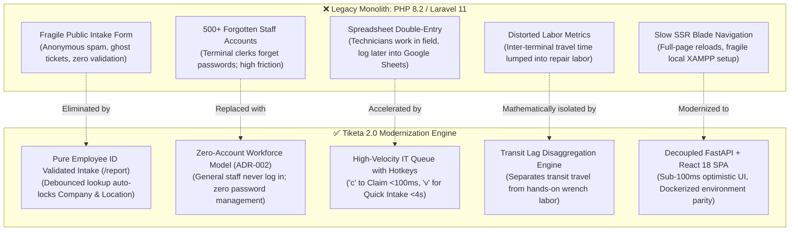
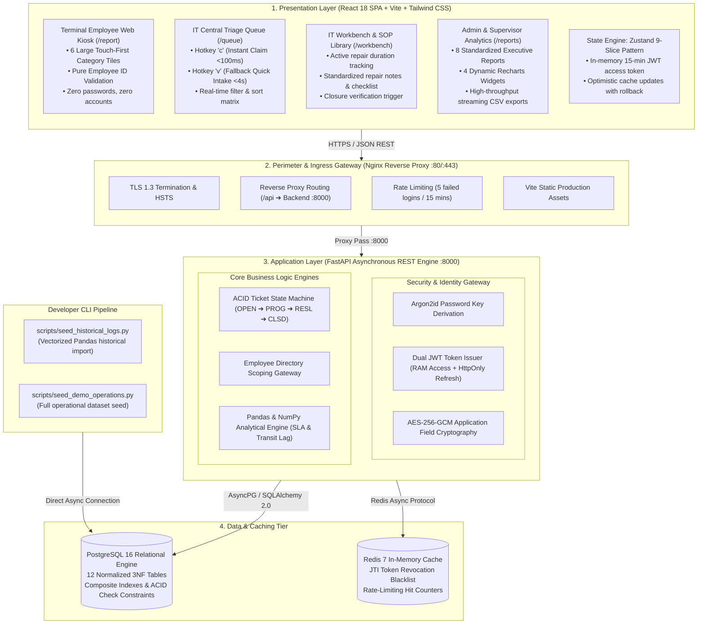
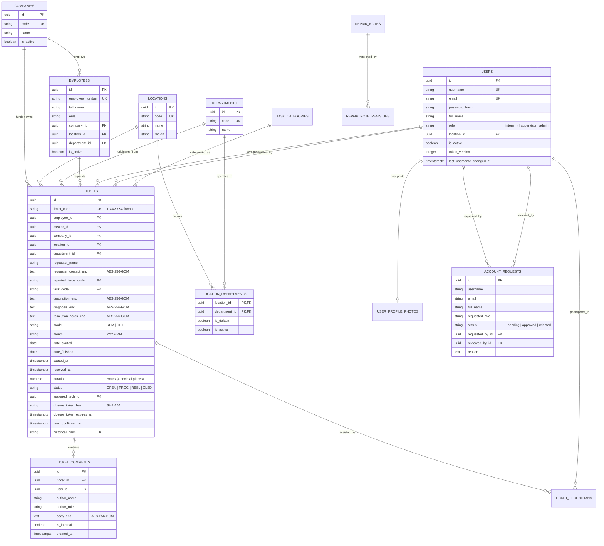
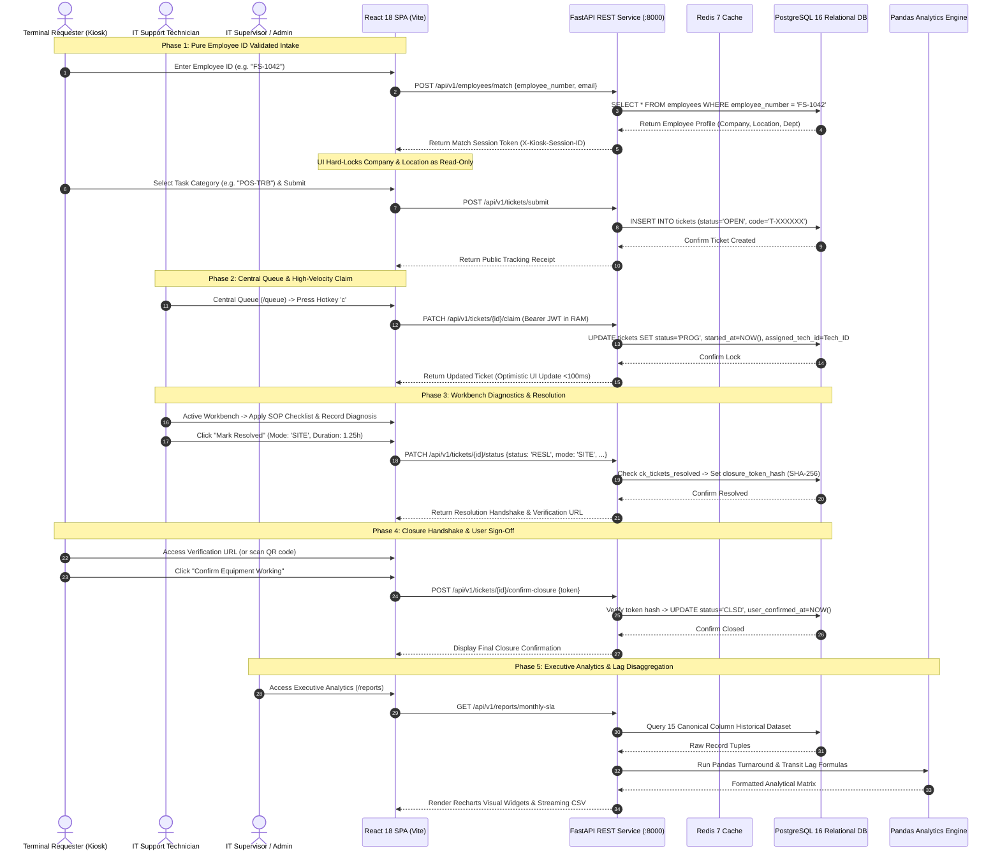
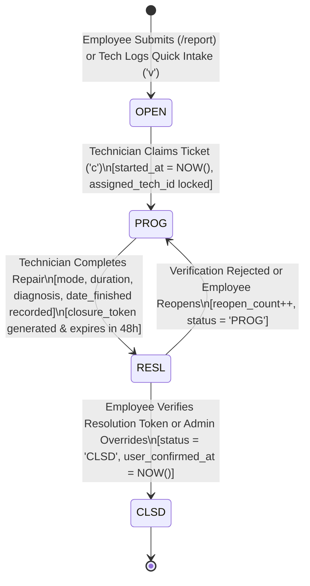
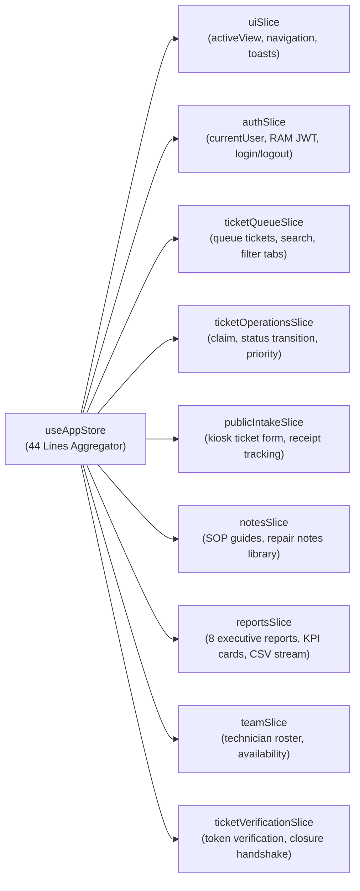
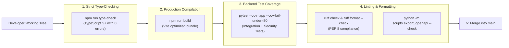

# Tiketa 2.0 — Definitive Master Project Documentation
**Next-Generation IT Service Management, Terminal Dispatch & Operational Velocity Platform**  
*Pangasinan Five Star Bus Co. & Regional Affiliate Fleets*  
**Document Revision:** `v2.2.0` | **Status:** `Approved & Production-Synchronized`  

---

## 📌 Executive Summary

**Tiketa 2.0** (internally designated **Omnitick 2.0**) is an enterprise-grade, high-velocity IT Service Management (ITSM), terminal maintenance dispatch, and operational velocity analytics platform. It was custom-engineered to govern the IT infrastructure across provincial terminals, bus maintenance depots, ticketing booths, and corporate headquarters of **Pangasinan Five Star Bus Co.** and its regional transport affiliates:
- **Pangasinan Five Star Bus Company Inc.** (Primary Fleet)
- **Bataan Transit Co., Inc.**
- **Luzon Cisco Transport, Inc.**
- **First North Luzon Transit, Inc.**
- **Maria De Leon Transportation**
- **Cubao Motor Pool & Engineering Hubs**

Tiketa 2.0 completely replaces the legacy PHP 8.2 / Laravel 11 Blade monolith, eliminating synchronous bottlenecks, full-page browser reloads, fragile local XAMPP environments, unauthenticated public intake vulnerabilities, and double-entry spreadsheet tracking. It is re-architected as a decoupled, multi-container system powered by **Python 3.12+ (FastAPI)**, **React 18 SPA (Strict TypeScript 5+)**, **PostgreSQL 16**, and **Redis 7**.

---

## 🧭 The Field Reality: Legacy Problems & Modern Solutions

Field audits conducted across provincial terminals with **Sir Stephen Miralles** (Senior IT Analyst), **Sir Nathaniel Esguerra** (Junior IT), and **Sir Raefael** (Business Process Manager) uncovered 5 operational failure modes in the legacy workflow:



---

## ⚡ Core Architectural Invariants ("The Iron Laws")

Every subsystem, database table, and UI view in Tiketa 2.0 strictly adheres to five non-negotiable architectural invariants:

### 1. Pure Employee ID Validated Intake (`/report`) — ADR-002
- **Zero General Accounts:** Terminal clerks, cashiers, dispatchers, mechanics, and conductors **never log in or register passwords**.
- **Hard-Locked Scoping:** Entering a verified **Employee ID Number** (e.g., `FS-1042`) triggers debounced validation against the master `employees` directory.
- **Error Eradication:** A matched record **hard-locks Location and Department** as read-only. This eliminates 100% of human dropdown routing errors (e.g., selecting "Tarlac Terminal" while assigned to "Cubao Cash Office").
- **Race Condition Immunity:** Form submission is strictly blocked until asynchronous validation returns a cryptographically valid match session token (`X-Kiosk-Session-ID`).

### 2. 4-Tier Authenticated RBAC & User Access Matrix
The system enforces strict multi-tier access control across 5 distinct user classes: **Terminal Employee (Zero-Account Kiosk)**, **IT Intern (`intern`)**, **IT Support (`it`)**, **IT Supervisor (`supervisor`)**, and **System Administrator (`admin`)**:

| Application Screen / Action / Endpoint | Terminal Employee (Public Kiosk) | IT Intern (`intern`) | IT Support (`it`) | IT Supervisor (`supervisor`) | System Admin (`admin`) | Technical Enforcement & Contract Rule |
| :--- | :---: | :---: | :---: | :---: | :---: | :--- |
| **Public Kiosk Portal (`/report`)** | 🟢 **Full Access** | 🟢 View Only | 🟢 View Only | 🟢 View Only | 🟢 View Only | Zero-account intake. Debounced match auto-locks Company/Location/Department. |
| **Public Tracking Receipt (`/track/{code}`)** | 🟢 **Public Receipt** | 🟢 Read Receipt | 🟢 Read Receipt | 🟢 Read Receipt | 🟢 Read Receipt | Returns `{ticket_code, status, created_at}` only. Zero sensitive data leakage. |
| **IT Overview Cockpit (`/overview`)** | ❌ **Denied** | 🟡 **Assigned KPIs Only** | 🟢 **Primary Landing** | ❌ **Hidden / Denied** | 🟢 **Full Fleet View** | Personal bench metrics: My Resolved, My Active Bench, My Avg Repair Speed. |
| **Central Ticket Queue (`/queue`)** | ❌ **Denied** | ❌ **Hidden / Denied** | 🟢 **Primary Operational** | ❌ **Hidden / Denied** | 🟢 **Full Oversight** | Unassigned open pool. Hotkeys `j`/`k` for fast keyboard ticket scanning. |
| **One-Click Self-Claim (Hotkey `c`)** | ❌ **Denied** | ❌ **Denied** | 🟢 **<100ms Atomic Claim** | ❌ **Denied** | 🟢 **Allowed** | `PATCH /tickets/{id}/claim`: locks `assigned_tech_id`, sets `started_at = NOW()`, status `PROG`. |
| **Fallback Quick Intake (Hotkey `v`)** | ❌ **Denied** | ❌ **Denied** | 🟢 **<4s Logging Modal** | ❌ **Denied** | 🟢 **Allowed** | `POST /tickets/quick-intake`: Staff lookup auto-populates walk-in / Viber requests. |
| **Admin Ticket Dispatch & Assignment** | ❌ **Denied** | ❌ **Denied** | ❌ **Denied** | ❌ **Denied** | 🟢 **Allowed (All Techs/Interns)** | `PATCH /tickets/{id}/assign`: Reassigns ticket to any IT Support or Intern. |
| **Active Repair Workbench (`/workbench`)** | ❌ **Denied** | 🟡 **Assigned Tickets Only** | 🟢 **Core Operational View** | ❌ **Hidden / Denied** | 🟢 **Supervisory View** | Active repair timer, hardware diagnostics, and service notes recording. |
| **Update Service Record & Diagnosis** | ❌ **Denied** | 🟡 **Assigned Tickets Only** | 🟢 **Full Edit (Assigned)** | ❌ **Denied** | 🟢 **Full Override** | Updates `diagnosis_enc`, `resolution_notes_enc`, `task_code`. AES-256-GCM encrypted. |
| **Mark Resolved (`PATCH /status`)** | ❌ **Denied** | 🟡 **Assigned Tickets Only** | 🟢 **Full Resolution** | ❌ **Denied** | 🟢 **Full Override** | Enforces `ck_tickets_resolved` (duration, mode, diagnosis, date_finished). Generates closure token. |
| **Repair Notes Library (`/notes`)** | ❌ **Denied** | 🟡 **Read-Only SOPs** | 🟢 **Author & Apply** | ❌ **Hidden / Denied** | 🟢 **Full CRUD Management** | Diagnostic knowledge base, Standard Operating Procedures, and checklist templates. |
| **Execute Job Log Checklists** | ❌ **Denied** | 🟢 **Execute Steps** | 🟢 **Execute Steps** | ❌ **Denied** | 🟢 **Full Override** | Checks off technical verification steps on active workbench tickets. |
| **15-Column Job Log Sheet (`/joblogs`)** | ❌ **Denied** | 🟡 **Read-Only (Assigned)** | 🟢 **Read-Only (All)** | 🟢 **Audit Scoped View** | 🟢 **Full Audit & Adjustment** | Canonical 15-column compliance dispatch log preserving legacy physical records. |
| **Terminal Hubs Oversight (`/terminals`)** | ❌ **Denied** | ❌ **Hidden / Denied** | 🟢 **Station Tickets Tab** | 🟢 **Terminal Analytics Tab** | 🟢 **Full Fleet Management** | Hardware station health, network status, and terminal ticketing counters. |
| **Executive Analytics (`/analytics`)** | ❌ **Denied** | ❌ **Hidden / Denied** | ❌ **Hidden / Denied** | 🟢 **Primary Landing** | 🟢 **Full Access** | 4 Recharts visual widgets (Monthly Volume, Resolution Rate, Avg Labor, Backlog). |
| **8 Standardized Reports (`/reports`)** | ❌ **Denied** | ❌ **Hidden / Denied** | ❌ **Hidden / Denied** | 🟢 **Full Access** | 🟢 **Full Access** | Monthly SLA, Staff Productivity, Transit Lag, Hardware Vulnerability, PMS Compliance, etc. |
| **Streaming CSV Report Export** | ❌ **Denied** | ❌ **Denied** | ❌ **Denied** | 🟢 **High-Speed Stream** | 🟢 **High-Speed Stream** | Backend Pandas streaming export. Bypasses client-side memory limits. |
| **Automated PPTX Slide Deck Export** | ❌ **Denied** | ❌ **Denied** | ❌ **Denied** | 🟢 **Executive Deck** | 🟢 **Executive Deck** | Generates monthly C-level review PowerPoint presentation slides. |
| **Employee Closure Sign-Off (Token)** | 🟢 **Authorized (Token)** | ❌ **Denied** | ❌ **Denied** | ❌ **Denied** | ❌ **Denied (Cannot Self-Sign)** | Staff accounts cannot sign off for employees. Requires cryptographic token handshake. |
| **Employee Reopen Ticket** | 🟢 **Authorized (Token)** | ❌ **Denied** | ❌ **Denied** | ❌ **Denied** | ❌ **Denied** | Reopens unresolved repair into `PROG` status with `reopen_count++`. |
| **Emergency Closure Override** | ❌ **Denied** | ❌ **Denied** | ❌ **Denied** | ❌ **Denied** | 🟢 **Admin 48h Override** | Bypasses unconfirmed employee verification after 48h SLA expiration window. |
| **Submit Staff Account Request** | ❌ **Denied** | ❌ **Denied** | 🟢 **Submit Request (`POST`)** | 🟢 **Submit Request (`POST`)** | 🟢 **Direct Provisioning** | Submits request for new `intern` or `it` account creation. |
| **Approve / Reject Account Request** | ❌ **Denied** | ❌ **Denied** | ❌ **Denied** | 🟢 **Approve / Reject** | 🟢 **Approve / Reject** | Atomically provisions user upon approval with hashed password; 0 duplicate accounts. |
| **Direct Staff Provisioning (`/admin/users`)** | ❌ **Denied** | ❌ **Denied** | ❌ **Denied** | ❌ **Denied** | 🟢 **Full CRUD Provisioning** | Admin directly creates, edits, or soft-deactivates staff across all 4 tiers. |
| **Employee Directory CRUD (`/admin/employees`)** | ❌ **Denied** | ❌ **Denied** | ❌ **Denied** | ❌ **Denied** | 🟢 **Full CRUD Management** | Maintains master employee roster, badge IDs, and company/department bindings. |
| **Location-Department Mapping** | ❌ **Denied** | ❌ **Denied** | ❌ **Denied** | ❌ **Denied** | 🟢 **Full Scoping Control** | Configures valid operational department pairings per terminal hub. |
| **Data Scope & Isolation Boundary** | **Own Submissions Only** | **Assigned Tickets Only (`assigned_tech_id == me`)** | **Shared Active Queue + Assigned Tickets** | **Aggregated Fleet Analytics & Reports** | **Unrestricted Fleet-Wide Visibility** | Strictly enforced at SQL query level (`WHERE` clause guards). |

### 3. Technician Velocity & Keyboard-First Triage
- **Hotkey `c` (Claim):** Single-keystroke atomic claiming of unassigned tickets in `< 100ms`.
- **Hotkey `v` (Quick Intake):** IT Fallback Quick Intake dialog allows technicians to log walk-in, phone, or Viber requests in `< 4 seconds` before troubleshooting, ensuring 100% capture of field work logs.
- **List Navigation:** `j`/`k` keyboard shortcuts for rapid ticket scanning without touching the mouse.

### 4. Operational Transit Lag Disaggregation
- Distinguishes **Active Hands-On Labor** (active repair minutes) from **Logistical Transit Lag** (traveling between distant provincial depots such as Cubao to San Carlos).
- Ensures that technician velocity is evaluated on real diagnostic speed, while logistics managers receive transparent travel delay indicators.

### 5. Pragmatic Scope Discipline & Zero Throwaway UI (ADR-004)
- **Elimination of Web CSV Drag-and-Drop:** Historical spreadsheet imports are executed via the high-speed backend developer CLI seeder (`python -m scripts.seed_historical_logs`), processing 5,000+ historical rows in `< 1.5 seconds`.
- Zero throwaway file-uploader components bloating the production client bundle.

---

## 🏛️ System Architecture & Technology Topology

Tiketa 2.0 is engineered with a decoupled 4-tier micro-architecture ensuring sub-100ms response latencies, cryptographic defense-in-depth, and 100% environment parity:



---

## 🗄️ Relational Database Architecture (PostgreSQL 16)

The data model unifies the 15 canonical operational job log fields, hardware location scoping, technician assignments, and cryptographic verification tokens across 12 normalized tables:



### The 15 Canonical Operational Job Log Columns
The legacy Five Star daily physical dispatch log requires 15 canonical operational attributes preserved with mathematical fidelity:

| No. | Column Name | Database Mapping | Type / Constraint | Description & Validation Rules |
| :---: | :--- | :--- | :--- | :--- |
| **1** | **Company** | `tickets.company_id` | `UUID` (FK) | Transit entity (*Pangasinan Five Star, Bataan Transit, Cisco, etc.*). |
| **2** | **Support Mode** | `tickets.mode` | `VARCHAR(20)` | `'REM'` (Remote Phone/Viber/AnyDesk) or `'SITE'` (Physical On-Site Depot Visit). |
| **3** | **Department** | `tickets.department_id` | `UUID` (FK) | Operating department (*Cash, Dispatch, Maintenance, Traffic, HR, Accounting*). |
| **4** | **Requestor** | `tickets.requester_name` | `VARCHAR(150)` | Full name auto-inferred from matched `employees` record. |
| **5** | **Task Category** | `tickets.task_code` | `VARCHAR(50)` (FK) | Primary classification (*PC-REP, PRN-FIX, NET-CON, POS-TRB, etc.*). |
| **6** | **Description** | `tickets.description_enc`| `TEXT` (Encrypted) | Initial problem statement, encrypted at rest via AES-256-GCM. |
| **7** | **Date Started** | `tickets.date_started` | `DATE` | Calendar date when work commenced (Asia/Manila). |
| **8** | **Time Started** | `tickets.started_at` | `TIMESTAMPTZ` | Timestamp when technician claimed or initiated work. |
| **9** | **Time Finished** | `tickets.resolved_at` | `TIMESTAMPTZ` | Timestamp when technician marked issue resolved. |
| **10**| **Duration (Hrs)** | `tickets.duration` | `NUMERIC(10, 4)` | Active hands-on labor duration calculated in fractional hours. |
| **11**| **Date Finished** | `tickets.date_finished` | `DATE` | Calendar date when resolution completed (`>= date_started`). |
| **12**| **Status** | `tickets.status` | `VARCHAR(20)` | State machine lifecycle: `'OPEN'`, `'PROG'`, `'RESL'`, `'CLSD'`. |
| **13**| **Location / Hub** | `tickets.location_id` | `UUID` (FK) | Physical terminal or garage (*Cubao, Pasay, San Carlos, Tarlac, etc.*). |
| **14**| **Worked By** | `tickets.assigned_tech_id`| `UUID` (FK) | Primary IT Support Specialist or Intern assigned to ticket. |
| **15**| **Closure Verification**| `tickets.closure_token_hash`| `VARCHAR(64)` | Cryptographic SHA-256 hash verifying end-user closure sign-off. |

---

## 🔄 6. End-to-End Operational Lifecycle & Flowcharts

The operational lifecycle of every issue—from terminal intake to administrative analytics aggregation—follows a strictly governed multi-phase workflow:

### 6.1 Master Operational Lifecycle Flowchart

```mermaid
flowchart TD
    subgraph Phase1 ["1. Ticket Ingestion & Validation Gate"]
        K1["Terminal Employee at Kiosk (/report)"] --> K2["Enter Employee ID No. (e.g. FS-1042)"]
        K2 --> K3{"PostgreSQL Directory Match?"}
        K3 -- "No Match / Invalid" --> K4["Display Error Prompt<br/>Submission Strictly Blocked"]
        K3 -- "Verified Match" --> K5["Hard-Lock Company, Location & Dept<br/>Issue Match Session Token"]
        K5 --> K6["Select 1 of 6 Task Categories & Problem Details"]
        K6 --> K7["Submit Ticket (POST /tickets/submit)<br/>Status: OPEN | Generate T-XXXXXX Receipt"]

        Alt1["Walk-In / Viber Request"] --> Alt2["IT Technician on /queue taps Hotkey 'v'"]
        Alt2 --> Alt3["Quick Intake Modal Auto-Populates via Directory Lookup"]
        Alt3 --> Alt4["Submit Quick Intake (<4s)<br/>Status: OPEN | Generate T-XXXXXX"]
    end

    subgraph Phase2 ["2. Central Queue Triage & Work Claiming"]
        K7 --> Q1["Central Triage Queue (/queue)<br/>Status: OPEN Pool"]
        Alt4 --> Q1
        
        Q1 --> Q2{"Triage Action"}
        Q2 -- "Technician Self-Claim<br/>(Hotkey 'c' <100ms)" --> Q3["PATCH /tickets/{id}/claim<br/>started_at = NOW()<br/>assigned_tech_id = User.id<br/>Status: PROG"]
        Q2 -- "Supervisor / Admin Dispatch" --> Q4["PATCH /tickets/{id}/assign<br/>Assign to Intern or Support<br/>Status: PROG"]
    end

    subgraph Phase3 ["3. Active Repair Bench & SOP Execution"]
        Q3 --> W1["Technician Active Workbench (/workbench)"]
        Q4 --> W1
        W1 --> W2["Active Repair Duration Timer Running"]
        W1 --> W3["Consult / Apply SOP Checklist (/notes)"]
        W1 --> W4["Record Diagnosis & Troubleshooting Actions"]
        W4 --> W5["Select Operational Mode (REM vs SITE)"]
    end

    subgraph Phase4 ["4. Resolution & Verification Token Handshake"]
        W5 --> R1["Technician Clicks 'Mark Resolved'"]
        R1 --> R2{"Validate ACID Constraints<br/>(ck_tickets_resolved)"}
        R2 -- "Missing Duration / Mode / Diagnosis" --> R3["Validation Rejection<br/>Enforce Complete Labor Data"]
        R2 -- "Valid Labor Metadata" --> R4["PATCH /tickets/{id}/status<br/>resolved_at = NOW()<br/>duration = computed (hours)<br/>Status: RESL"]
        R4 --> R5["Generate Cryptographic Closure Token<br/>(SHA-256 Hash, 48h TTL)"]
        R5 --> R6["Generate Verification URL & QR Code Modal"]
    end

    subgraph Phase5 ["5. Employee Sign-Off & Closure Decision"]
        R6 --> V1["Employee Opens Verification Link (/track or /verify)"]
        V1 --> V2{"Employee Verification Decision"}
        V2 -- "Confirmed: Equipment Operational" --> V3["POST /tickets/{id}/confirm-closure<br/>status = CLSD<br/>user_confirmed_at = NOW()"]
        V2 -- "Rejected: Issue Persists" --> V4["POST /tickets/{id}/reopen<br/>reopen_count++<br/>status = PROG<br/>Return to Workbench"]
        V4 --> W1
        
        R5 -. "No Response > 48h" .-> V5["Admin Emergency Closure Override<br/>status = CLSD<br/>admin_override = TRUE"]
    end

    subgraph Phase6 ["6. Executive Analytics & Fleet Governance"]
        V3 --> A1["Pandas Analytics Calculation Engine"]
        V5 --> A1
        A1 --> A2["Compute Operational Transit Lag:<br/>Lag Days = Turnaround - (Labor / 8)<br/>Ratio = (Lag * 24) / Labor"]
        A2 --> A3["Populate 8 Standardized Executive Reports (/reports)"]
        A2 --> A4["Update 4 Supervisor Dashboard KPI Widgets (/analytics)"]
        A3 --> A5["Export Streaming CSV & PPTX Decks"]
    end
```



### 6.2 System Interaction Sequence Diagram



### 6.3 Ticket State Machine & Database Invariants

Every ticket transitions through a strictly validated finite state machine governed by ACID database constraints:



### State Transition Validation Constraints
- **`ck_tickets_started`**: Ensures `status = 'OPEN'` OR (`started_at IS NOT NULL` AND `assigned_tech_id IS NOT NULL`). A ticket cannot be in progress without an assigned technician and timestamp.
- **`ck_tickets_resolved`**: Ensures `status NOT IN ('RESL','CLSD')` OR (`resolved_at IS NOT NULL` AND `duration IS NOT NULL` AND `mode IS NOT NULL` AND `date_finished IS NOT NULL`). Complete labor metadata is enforced before a ticket can be closed.
- **`ck_tickets_time_order`**: Requires `resolved_at >= started_at`.
- **`ck_tickets_dates`**: Requires `date_finished >= date_started`.

---

## 💻 Frontend State Architecture (Zustand 9-Slice Pattern)

The frontend SPA avoids monolithic state by decomposing client responsibilities into **9 typed Zustand slices**, aggregated cleanly in `src/store/useAppStore.ts`:



### Feature Module Directory Breakdown
Views exceeding 200 lines are modularized under `frontend/src/features/`:
- `features/kiosk/`: `EmployeeTicketScreen.tsx`, `useEmployeeIntake.ts`, `EmployeeProfileCard.tsx`, `CategoryGrid.tsx`.
- `features/tickets/`: `TicketListsView.tsx`, `TicketFilterToolbar.tsx`, `TicketDataTable.tsx`, `TicketKanbanBoard.tsx`.
- `features/workbench/`: `ITWorkbenchBoardView.tsx`, `TeamWorkbenchView.tsx`, `JobLogDrawer.tsx`.
- `features/reports/`: `StandardizedReportsView.tsx`, `reportFormatters.ts`, `ReportTableContainer.tsx`.
- `features/analytics/`: `ExecutiveAnalyticsView.tsx`, `AnalyticsKPICards.tsx`, `TurnaroundLagChart.tsx`, `SupportModeDonutChart.tsx`.
- `features/notes/`: `RepairNotesLibraryView.tsx`, `RepairNoteDetailModal.tsx`.
- `features/overview/`: `ITOverviewDashboard.tsx`.
- `features/terminals/`: `TerminalHubsView.tsx`.

---

## 📊 Executive Analytics Suite (8 Standardized Reports)

Engineered directly to satisfy the operational reporting mandates of **Sir Raefael** and **Sir Stephen**, Tiketa 2.0 provides 8 standardized reporting engines powered by Pandas:

### 1. Mathematical Formulas
$$\text{Completion Rate (\%)} = \frac{N_{\text{RESL}} + N_{\text{CLSD}}}{N_{\text{Total}}} \times 100$$

$$\text{Same-Day Resolution (\%)} = \frac{N_{\text{date\_finished} == \text{date\_started}}}{N_{\text{Completed}}} \times 100$$

$$\text{Turnaround Days} = (\text{date\_finished} - \text{date\_started}) + 1$$

$$\text{Logistical Transit Lag (Days)} = \text{Turnaround Days} - \left( \frac{\text{Labor Hours}}{8} \right)$$

$$\text{Lag-to-Labor Ratio} = \frac{\text{Transit Lag Days} \times 24}{\text{Labor Hours}}$$

$$\text{Hardware Breakdown Score} = \min\left(10,\, \text{Incidents} \times 0.2 + \text{Completed Labor Hours} \times 0.05\right)$$

### 2. Report Catalog Matrix
| # | Report Identifier | Name | Scope & Grouping | Operational Value & Decisions |
| :---: | :--- | :--- | :--- | :--- |
| **1** | `monthly-sla` | **Monthly SLA & Resolution Compliance** | Group by creation month | Macro throughput, same-day resolution velocity, 48-hour SLA compliance rate. |
| **2** | `staff-productivity`| **Staff Utilization & Velocity** | Group by primary technician | Hands-on repair hours, primary terminal hub, most frequent diagnostic task. |
| **3** | `department-demand` | **Department & Company Demand Matrix** | Group by Company + Department + Hub | Identifies organizational demand spikes and hardware failure hotspots. |
| **4** | `backlog-exception` | **Aging Backlog Exception Report** | Filtered by open tickets `> 48h` | Escalation audit for stale or blocked tickets requiring supervisor dispatch. |
| **5** | `transit-lag` | **Transit & Waiting Lag Disaggregation**| Group by Terminal Hub + Support Mode | Isolates inter-terminal travel delay from active labor; triggers travel schedule review if ratio $\ge 24$. |
| **6** | `hardware-vulnerability`| **Terminal Hardware Breakdown Score** | Group by Hub + Company + Task | Scores repeat device failure ($0.0 - 10.0$ scale) to trigger fleet hardware replacement. |
| **7** | `pms-compliance` | **Preventive Maintenance (PMS) Audit** | Group by Location + Task (`PC-PMS`/`PRN-PMS`) | Tracks scheduled monthly workstation and printer cleaning versus planned quotas. |
| **8** | `chronic-requestors`| **Chronic Repeat Requestor Index** | Filtered by employees with $\ge 3$ tickets | Recommends targeted end-user training (*printer handling, network cables, basic software*). |

---

## 🔌 API Contracts & REST Integration Map

All backend REST endpoints are prefixed under `/api/v1` and documented automatically via OpenAPI (`http://localhost:8000/docs`):

### 1. Identity & Session Endpoints
- `POST /api/v1/auth/login`: Authenticates staff using Argon2id. Returns 15-min JWT access token in response body and sets 7-day secure HttpOnly refresh cookie.
- `POST /api/v1/auth/refresh`: Silently refreshes access token using the HttpOnly cookie.
- `POST /api/v1/auth/logout`: Blacklists active JTI token in Redis and invalidates the session.
- `GET /api/v1/auth/me`: Retrieves the currently authenticated staff profile and active role.

### 2. Public Kiosk & Directory Endpoints
- `POST /api/v1/employees/match`: Validates `employee_number` + registered email. Emits public receipt session token.
- `GET /api/v1/employees/lookup`: Authenticated staff lookup for Employee ID profile auto-population.
- `POST /api/v1/tickets/submit`: Public ticket intake with verified employee match session.
- `GET /api/v1/tickets/track/{code}`: Returns public receipt status (`ticket_code`, `status`, `created_at`).

### 3. Ticket Operations & Velocity Endpoints
- `GET /api/v1/tickets`: Paginated ticket query with dynamic filters (`status`, `company_id`, `location_id`, `date_from`, `date_to`).
- `POST /api/v1/tickets/quick-intake`: Technician fallback intake for walk-in / Viber requests (`v` hotkey).
- `PATCH /api/v1/tickets/{id}/claim`: 1-click atomic claiming by active technician (`c` hotkey).
- `PATCH /api/v1/tickets/{id}/assign`: Administrative technician dispatch and assignment.
- `PATCH /api/v1/tickets/{id}/status`: Advances ticket through state machine (`OPEN ➔ PROG ➔ RESL ➔ CLSD`).
- `PATCH /api/v1/tickets/{id}/service-record`: Updates diagnosis, resolution notes, and task classification.
- `POST /api/v1/tickets/{id}/confirm-closure`: Validates end-user closure token and marks ticket `CLSD`.
- `POST /api/v1/tickets/{id}/reopen`: Employee verification rejection reopening ticket into `PROG`.
- `GET /api/v1/tickets/{id}/comments`: Retrieves public requester conversation and internal IT notes.
- `POST /api/v1/tickets/{id}/comments`: Appends public comment or encrypted internal note.

### 4. Executive Analytics & Reporting Endpoints
- `GET /api/v1/reports/kpis`: Retrieves executive top-line KPI widgets (Volume, SLA %, Avg Duration, Backlog).
- `GET /api/v1/reports/{report_name}`: Returns structured data rows for any of the 8 standardized reports.
- `GET /api/v1/reports/{report_name}/export`: High-performance streaming CSV export for Excel analysis.

---

## 🚀 Developer Setup & Operations Runbook

### Prerequisites
- **Docker Engine & Docker Compose** (v24.0+)
- **Node.js 20 LTS** & `npm`
- **Python 3.12+** (with virtual environment support)

### Option A: One-Command Bootstrap (Recommended)
From repository root (`Tiketa2.0/`):

```powershell
# Windows PowerShell
powershell -ExecutionPolicy Bypass -File .\scripts\setup-local.ps1
```

```bash
# macOS / Linux
chmod +x scripts/setup-local.sh
./scripts/setup-local.sh
```

### Option B: Full-Stack Containerized Orchestration
```bash
# 1. Build and boot all 4 containers
docker compose up -d --build

# 2. Execute database migrations
docker compose exec backend alembic upgrade head

# 3. Seed reference dictionaries and demo operational data
docker compose exec backend python -m scripts.seed_dictionaries
docker compose exec backend python -m scripts.seed_demo_operations

# 4. Access live endpoints:
# Web Kiosk: http://localhost:5173/report
# IT Queue:  http://localhost:5173/queue
# API Docs:  http://localhost:8000/docs
```

### Option C: Hybrid Developer Setup (Rapid Local Iteration)
```powershell
# 1. Launch PostgreSQL and Redis via Docker
docker compose up -d db redis

# 2. Setup and run Backend (FastAPI)
cd backend
Copy-Item .env.example .env
python -m venv .venv
.\.venv\Scripts\Activate.ps1
pip install -r requirements-dev.txt
alembic upgrade head
python -m scripts.seed_dictionaries
python -m scripts.seed_demo_operations
uvicorn app.main:app --host 127.0.0.1 --port 8000 --reload

# 3. Setup and run Frontend SPA (Vite + React)
cd ../frontend
npm ci
npm run dev
```

---

## 🧪 Testing, Quality Gates & Pre-PR Verification

Tiketa 2.0 enforces strict quality gates before any commit or pull request is merged:



### Pre-PR Single Command Runner
```powershell
powershell -ExecutionPolicy Bypass -File .\scripts\pre-pr.ps1
```

---

## 👥 Project Team & Stakeholder Governance

- **System Architecture & Backend Lead:** **Jefferson Lopez** (`@jfflpz`)
  - Primary Designer of IEEE 830 Specification, Database Normalization, FastAPI REST API, and Pandas Analytics Engine.
- **Frontend SPA & UX Craft Lead:** **Rafael Emmanuel Codiñera**
  - Architect of Zustand 9-Slice Pattern, React 18 SPA, Hotkey Navigation, and "Technician Speed" Micro-Interactions.
- **Supervisors & Enterprise Stakeholders:**
  - **Sir Stephen Miralles** (Senior IT Analyst) — System Governance & Hardware Infrastructure Direction.
  - **Sir Nathaniel Esguerra** (Junior IT Specialist) — Field Operations & Terminal Triage Workflows.
  - **Sir Raefael** (Business Process Manager) — Operational SLA Metrics & Transit Lag Disaggregation Models.
- **Enterprise Beneficiary:** **Pangasinan Five Star Bus Co.** & Regional Affiliate Transit Fleets.

---
*Tiketa 2.0 — Engineered for Speed, Zero Lag, and Operational Truth.*
