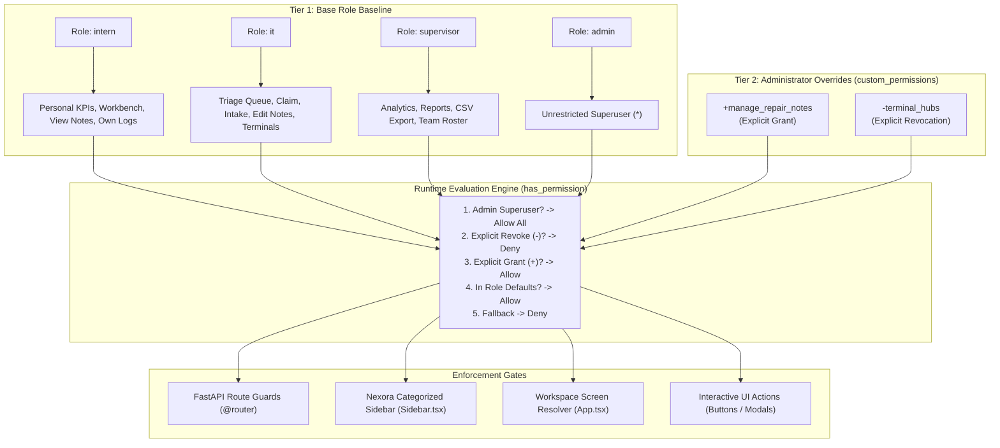
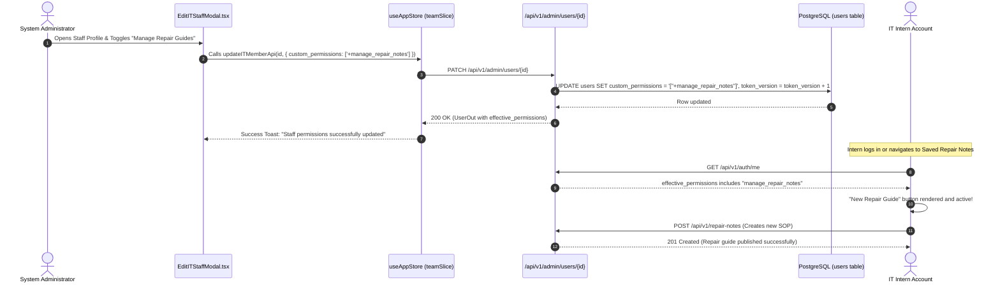

# 🛡️ Tiketa 2.0: Granular Feature Permissions & Role Overrides

> [!NOTE] Architecture & Implementation Specification
> **Spec IDs:** `@spec FR-RBAC-04` (Engine & Security) & `@spec UI-TEAM-04` (IT Roster Permissions Checklist)  
> **Status:** 🟡 Proposed & Ready for Execution  
> **Target Release:** Sprint 5.1 / RBAC Governance Upgrade  
> **Related Documentation:** [[Tiketa_2.0_Master_Project_Documentation|Tiketa 2.0 Master Project Documentation]], [[00_SRS_Master|IEEE 830 Master SRS]], [[Target_Architecture_Overview|Target Architecture Overview]]

---

## 🎯 1. Executive Summary & Problem Context

In Tiketa 2.0, access control was initially built around four static system roles:
- **`intern`**: Minimal workbench, read-only saved repair notes, assigned personal job logs.
- **`it`**: Full unassigned ticket triage, ticket claiming, workbench, repair guide authoring, terminal hubs.
- **`supervisor`**: System KPI analytics, operational incident reports, CSV exports, IT roster view, terminals.
- **`admin`**: Superuser with unrestricted access across all views and administration settings.

### Operational Problem
In day-to-day IT terminal operations, technicians and interns frequently receive supervisor approval to perform specialized tasks that cross base role boundaries:
> *"For example, an intern with an `intern` account is tasked to create and edit SOPs in the Saved Repair Notes library. Under static RBAC, the intern is completely blocked by hardcoded role guards. The administrator needs the capability to open the IT Team Roster, select that intern, and check a feature in an interactive checklist to immediately enable that capability without altering their base contract or governance status."*

### Proposed Architectural Solution: Two-Tier Hybrid RBAC
We introduce an explicit **Two-Tier Hybrid RBAC Engine**:
1. **Tier 1 (Base Role Defaults):** Every user inherits a standard baseline feature set based on their `StaffRole` (`intern`, `it`, `supervisor`, `admin`).
2. **Tier 2 (Per-User Feature Overrides):** An administrator can toggle specific capabilities on/off for any user in the IT Team Roster. Overrides take precedence over role defaults:
   $$\text{Effective Permissions} = (\text{Role Defaults} \cup \text{Explicit Grants}) \setminus \text{Explicit Revocations}$$



---

## 📋 2. Standardized Feature Permission Registry

Every controllable capability in the application is registered with a canonical key, category, human-readable label, description, and default role assignments:

| Domain Category | Canonical Feature Key | Display Label | Description | Default Roles |
| :--- | :--- | :--- | :--- | :--- |
| **🛠️ Workbench & SOPs** | `manage_repair_notes` | Manage Repair Guides | Author, edit, update, and publish saved repair guides and SOP checklists | `it`, `admin` |
| **🛠️ Workbench & SOPs** | `view_repair_notes` | View Repair Guides | Reference and view published repair guides and troubleshooting SOPs | `intern`, `it`, `admin` |
| **📋 Queue & Dispatch** | `triage_queue` | Access Triage Queue | View general unassigned pool and filter incoming incident queue | `it`, `admin` |
| **📋 Queue & Dispatch** | `claim_tickets` | Self-Claim Tickets | Claim unassigned tickets from the pool to personal workbench | `it`, `admin` |
| **📋 Queue & Dispatch** | `quick_intake` | Quick Ticket Intake | Dispatch new tickets via header quick intake modal | `it`, `admin` |
| **🖥️ Operations** | `terminal_hubs` | Terminal Operations | Access Terminal Hubs & live PMS operational monitoring | `it`, `supervisor`, `admin` |
| **🖥️ Operations** | `job_logs_all` | View All Job Logs | Access full-facility 15-column job log sheet vs personal only | `supervisor`, `admin` |
| **📊 Analytics & Reports** | `view_analytics` | KPI Analytics | View SLA compliance, volume trends, and technician metrics | `supervisor`, `admin` |
| **📊 Analytics & Reports** | `view_reports` | Operational Reports | View historical incident reports and audit trails | `supervisor`, `admin` |
| **📊 Analytics & Reports** | `export_reports` | Export CSV Reports | Download official 15-column job log CSVs and metrics | `supervisor`, `admin` |
| **👥 Team & Accounts** | `manage_team` | Manage IT Team Roster | View staff accounts, assign roles, and edit permissions | `supervisor` (read-only), `admin` (full) |
| **👥 Team & Accounts** | `submit_account_requests` | Propose Account Changes | Submit employee onboarding/deactivation proposals | `it`, `admin` |

---

## 🗄️ 3. Database Schema & Migration Specification

### Alembic Migration: `0014_users_custom_permissions.py`
The `users` table is augmented with a native `JSONB` column on PostgreSQL (with a fallback to `JSON` for cross-environment compatibility):

```python
"""Add custom_permissions to users for granular RBAC overrides

Revision ID: 0014_custom_permissions
Revises: 0013_username_cooldown
Create Date: 2026-11-11 12:00:00.000000
"""

from collections.abc import Sequence
import sqlalchemy as sa
from sqlalchemy.dialects import postgresql
from alembic import op

revision: str = "0014_custom_permissions"
down_revision: str | None = "0013_username_cooldown"
branch_labels: str | Sequence[str] | None = None
depends_on: str | Sequence[str] | None = None

def upgrade() -> None:
    op.add_column(
        "users",
        sa.Column(
            "custom_permissions",
            postgresql.JSONB(astext_type=sa.Text()).with_variant(sa.JSON(), "sqlite"),
            nullable=False,
            server_default=sa.text("'[]'::jsonb"),
        ),
    )

def downgrade() -> None:
    op.drop_column("users", "custom_permissions")
```

### SQLAlchemy Model Definition
In `Tiketa2.0/backend/app/models/user.py`:
```python
# @spec FR-RBAC-04: User Custom Permissions Storage
from sqlalchemy import JSON
from sqlalchemy.dialects.postgresql import JSONB

class User(Base, TimestampMixin):
    __tablename__ = "users"
    ...
    custom_permissions: Mapped[list[str]] = mapped_column(
        JSON().with_variant(JSONB, "postgresql"),
        default=list,
        server_default="[]",
        nullable=False,
    )
```

---

## ⚙️ 4. Backend Permission Evaluation Engine

We create a pure, high-performance evaluation module at `Tiketa2.0/backend/app/core/permissions.py`:

```python
# @spec FR-RBAC-04: Centralized Permission Evaluation Engine
from typing import Final
from app.models.user import User

ROLE_DEFAULT_PERMISSIONS: Final[dict[str, set[str]]] = {
    "admin": {"*"},  # Superuser wildcard bypass
    "supervisor": {
        "view_analytics",
        "view_reports",
        "export_reports",
        "manage_team",
        "job_logs_all",
        "terminal_hubs",
    },
    "it": {
        "triage_queue",
        "claim_tickets",
        "quick_intake",
        "manage_repair_notes",
        "view_repair_notes",
        "terminal_hubs",
        "submit_account_requests",
    },
    "intern": {
        "view_repair_notes",
    },
}

def user_has_permission(user: User, perm: str) -> bool:
    """Evaluate whether a user has access to a specific capability.
    
    Precedence:
    1. Admin role always returns True.
    2. Explicit revocation '-<perm>' returns False.
    3. Explicit grant '+<perm>' or '<perm>' returns True.
    4. Base role default presence returns True.
    5. Returns False.
    """
    if user.role == "admin":
        return True

    overrides = set(user.custom_permissions or [])
    if f"-{perm}" in overrides:
        return False
    if f"+{perm}" in overrides or perm in overrides:
        return True
    return perm in ROLE_DEFAULT_PERMISSIONS.get(user.role, set())

def get_effective_permissions(user: User) -> list[str]:
    """Compute the full set of effective permissions for client serialization."""
    if user.role == "admin":
        return ["*"]
    
    defaults = set(ROLE_DEFAULT_PERMISSIONS.get(user.role, set()))
    overrides = user.custom_permissions or []
    
    effective = set(defaults)
    for rule in overrides:
        if rule.startswith("-"):
            effective.discard(rule[1:])
        elif rule.startswith("+"):
            effective.add(rule[1:])
        else:
            effective.add(rule)
            
    return sorted(list(effective))
```

---

## 🔌 5. API Contracts & Synchronization

### 1. Pydantic Schemas (`backend/app/schemas.py`)
```python
class UserUpdate(Input):
    full_name: str | None = Field(default=None, min_length=2, max_length=150)
    email: EmailStr | None = Field(default=None, max_length=150)
    role: StaffRole | None = None
    location_id: UUID | None = None
    is_active: bool | None = None
    password: str | None = Field(default=None, min_length=12, max_length=128)
    custom_permissions: list[str] | None = None  # <-- NEW

class UserOut(BaseModel):
    model_config = ConfigDict(from_attributes=True)
    id: UUID
    username: str
    email: str
    full_name: str
    role: StaffRole
    is_active: bool
    closed_repairs: int = 0
    active_bench: int = 0
    avatar_url: str | None = None
    avatar_updated_at: datetime | None = None
    custom_permissions: list[str] = Field(default_factory=list)      # <-- NEW
    effective_permissions: list[str] = Field(default_factory=list)  # <-- NEW
```

### 2. API Endpoints
- `GET /api/v1/admin/permissions/catalog`: Returns dynamic JSON catalog of all feature keys, grouped by category with labels, descriptions, and role defaults.
- `PATCH /api/v1/admin/users/{user_id}`: Accepts `custom_permissions` in body. Automatically persists and increments `user.token_version` to flush stale JWT caches.
- `GET /api/v1/auth/me`: Returns `UserOut` populated with both `custom_permissions` and computed `effective_permissions`.

---

## 🎨 6. Frontend Craft & UI Implementation

### 1. TypeScript Types (`frontend/src/types/permissions.ts`)
```typescript
// @spec UI-TEAM-04: Permission Types & Helper Utilities
export type FeatureKey =
  | 'manage_repair_notes'
  | 'view_repair_notes'
  | 'triage_queue'
  | 'claim_tickets'
  | 'quick_intake'
  | 'terminal_hubs'
  | 'job_logs_all'
  | 'view_analytics'
  | 'view_reports'
  | 'export_reports'
  | 'manage_team'
  | 'submit_account_requests';

export interface PermissionFeature {
  key: FeatureKey;
  label: string;
  description: string;
  category: 'workbench' | 'queue' | 'operations' | 'reports' | 'team';
  defaultRoles: StaffRole[];
}

export function hasPermission(
  user: { role: StaffRole; custom_permissions?: string[]; effective_permissions?: string[] } | null,
  feature: FeatureKey
): boolean {
  if (!user) return false;
  if (user.role === 'admin') return true;
  if (user.effective_permissions) {
    return user.effective_permissions.includes('*') || user.effective_permissions.includes(feature);
  }
  // Fallback local evaluation if effective_permissions not pre-computed
  const overrides = user.custom_permissions ?? [];
  if (overrides.includes(`-${feature}`)) return false;
  if (overrides.includes(`+${feature}`) || overrides.includes(feature)) return true;
  return ROLE_DEFAULT_PERMISSIONS[user.role]?.has(feature) ?? false;
}
```

### 2. UI Checklist in `EditITStaffModal.tsx`
Below the standard profile fields, an interactive checklist allows the Admin to grant or revoke specific capabilities:

```
┌────────────────────────────────────────────────────────────────────────┐
│  🔐 Feature Permissions & Role Overrides                              │
│  Base Role: INTERN  |  Active Capabilities: 5 Features                │
├────────────────────────────────────────────────────────────────────────┤
│  [↻ Reset to Role Defaults]                                           │
│                                                                        │
│  ▼ 🛠️ Workbench & Repair Operations                                   │
│  ┌──────────────────────────────────────────────────────────────────┐  │
│  │ [✓] Manage Repair Guides (SOPs)           [CUSTOM GRANTED] ✨    │  │
│  │     Create, edit, and publish repair guides & SOP checklists       │  │
│  │                                                                  │  │
│  │ [✓] View Repair Guides                    [ROLE DEFAULT]         │  │
│  │     Read and reference published repair guides                   │  │
│  │                                                                  │  │
│  │ [ ] Self-Claim Tickets from Pool          [LOCKED]               │  │
│  │     Claim unassigned tickets from queue to workbench             │  │
│  └──────────────────────────────────────────────────────────────────┘  │
│                                                                        │
│  ▼ 📋 Queue & Terminal Operations                                      │
│  ┌──────────────────────────────────────────────────────────────────┐  │
│  │ [ ] Access Triage Queue                   [LOCKED]               │  │
│  │ [ ] Terminal Operations Hub               [LOCKED]               │  │
│  └──────────────────────────────────────────────────────────────────┘  │
└────────────────────────────────────────────────────────────────────────┘
```

### 3. Dynamic Allowed Views (`App.tsx` & `Sidebar.tsx`)
Rather than relying on static `ROLE_ALLOWED_VIEWS[role]`, views are unlocked dynamically:
```typescript
export function getEffectiveAllowedViews(user: CurrentUser | null): ActiveView[] {
  if (!user) return ['overview'];
  if (user.role === 'admin') return ALL_VIEWS;

  const views = new Set<ActiveView>(ROLE_ALLOWED_VIEWS[user.role] ?? ['overview']);

  if (hasPermission(user, 'triage_queue')) views.add('tickets');
  if (hasPermission(user, 'terminal_hubs')) views.add('terminals');
  if (hasPermission(user, 'view_analytics')) views.add('analytics');
  if (hasPermission(user, 'view_reports')) views.add('reports');
  if (hasPermission(user, 'manage_team')) views.add('team');

  return Array.from(views);
}
```

### 4. Action Gating in `RepairNotesLibraryView.tsx`
The hardcoded check `currentUser?.role === 'intern'` is replaced with:
```typescript
const canManageNotes = hasPermission(currentUser, 'manage_repair_notes');

// Enables "New Repair Guide" button and edit controls if permission is granted!
{canManageNotes && (
  <button type="button" onClick={startCreateNote} className="...">
    <Plus className="w-4 h-4" />
    <span>New Repair Guide</span>
  </button>
)}
```

---

## 🔄 7. End-to-End Operational Lifecycle



---

## 🧪 8. Test Verification & Acceptance Criteria

| ID | Test Scenario | Execution Step | Expected Verifiable Result |
| :--- | :--- | :--- | :--- |
| **AC-01** | Default Intern Guard | Intern attempts to call `POST /repair-notes` or view create button. | Button hidden; API returns `403 Forbidden`. |
| **AC-02** | Admin Custom Grant | Admin opens intern profile in IT Roster, checks "Manage Repair Guides", clicks Save. | `PATCH /admin/users/{id}` returns `200`; `token_version` incremented. |
| **AC-03** | Intern Access Unlocked | Intern loads Repair Notes page. | "New Repair Guide" button is visible and active; `POST /repair-notes` succeeds with `201 Created`. |
| **AC-04** | Reset to Role Defaults | Admin clicks "Reset to Role Defaults" and saves. | `custom_permissions` cleared to `[]`; intern immediately loses guide editing permissions. |
| **AC-05** | Default Revocation | Admin unchecks "Terminal Operations" for an IT Technician (`-terminal_hubs`). | Terminal operations nav item removed from sidebar; direct route access redirects to fallback home. |
| **AC-06** | Superuser Invariance | Admin account permissions inspected. | Admin retains wildcard `*` access regardless of custom permissions array. |

---

## 🗺️ 9. Implementation Roadmap

- [ ] **Phase 1: Database Migration & Model Definition**
  - Create Alembic revision `0014_users_custom_permissions.py`.
  - Update `User` model in `Tiketa2.0/backend/app/models/user.py`.
- [ ] **Phase 2: Backend Permission Engine & Endpoints**
  - Implement `app/core/permissions.py`.
  - Update `schemas.py` (`UserOut`, `UserUpdate`).
  - Add `GET /api/v1/admin/permissions/catalog` in `directory.py`.
  - Update `update_user` in `directory.py` to persist overrides.
  - Update `backend/app/services/repair_notes.py` permission checks.
- [ ] **Phase 3: Frontend Type System & Store**
  - Implement `src/types/permissions.ts` and `hasPermission` utility.
  - Update `TeamMember` and `CurrentUser` interfaces.
  - Update `teamSlice.ts` to pass `custom_permissions`.
- [ ] **Phase 4: UI Checklist in IT Roster**
  - Build `PermissionChecklist` section in `EditITStaffModal.tsx`.
  - Implement status badges (`ROLE DEFAULT`, `CUSTOM GRANTED`, `REVOKED`) and Reset button.
- [ ] **Phase 5: Navigation & Action Gating**
  - Dynamic allowed views in `App.tsx` and `Sidebar.tsx`.
  - Gate "New Repair Guide" in `RepairNotesLibraryView.tsx`.
- [ ] **Phase 6: Automated Verification**
  - Run backend pytest suite: `pytest backend/tests/test_custom_permissions.py`.
  - Run frontend type check: `npm run type-check`.
