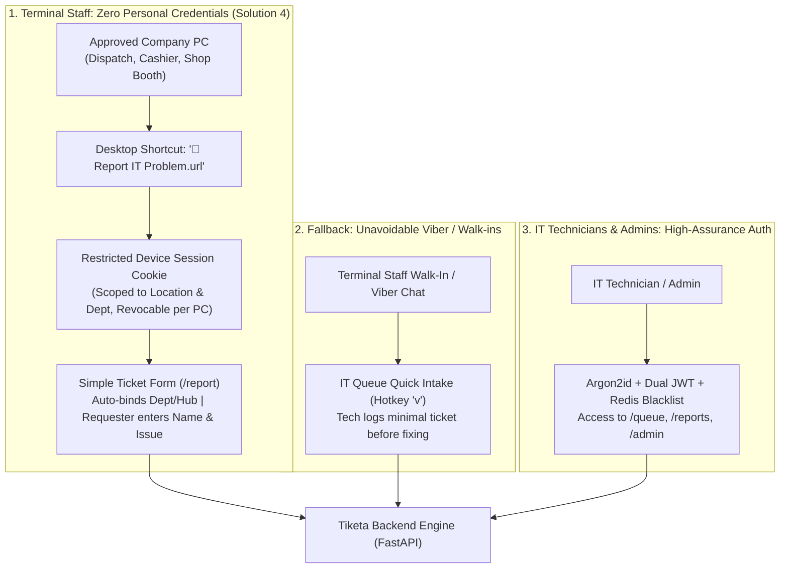

# Tiketa 2.0 — Backend & DevOps Engineering Sprint Plan (Dockerized + Solution 4 Device Access)

## Goal Description
Formulate a dedicated, production-grade **Backend & DevOps Sprint Plan** for **Tiketa 2.0**, combining **Docker Engine (v29.8.2)**, **Docker Compose (v5.6.0)**, **GitHub Actions CI**, **In-Repo Second Brain**, and the approved **Solution 4: Automatic Department Access on Company PCs** from the management decision report ([`Tiketa-Employee-Access-Decision-Report.pdf`](file:///C:/Users/Kanor/Documents/ARCH/01-Projects/Tiketa/Tiketa-Employee-Access-Decision-Report.pdf)).

**Lead**: Jefferson Lopez (Backend & DevOps)  
**Peer Reviewer**: Rafael Emmanuel Codiñera (Frontend)  
**Target Repository**: `C:\Users\Kanor\Documents\FS_Projects\Tiketa`  

---

## 1. Account Setup Architecture: Solution 4 (Automatic PC Access + IT Fallback)

As established in [`Tiketa-Employee-Access-Decision-Report.pdf`](file:///C:/Users/Kanor/Documents/ARCH/01-Projects/Tiketa/Tiketa-Employee-Access-Decision-Report.pdf), Tiketa rejects workforce-wide individual employee accounts (avoiding 500+ forgotten passwords across non-technical terminal staff). Instead, it implements a **hybrid 2-tier access model**:



### 1.1 How Accounts & PC Sessions Are Set Up (Technical Workflow)
1. **IT Technicians & Supervisors**:
   - Provisioned via Admin governance (`POST /api/v1/admin/users`).
   - Authenticate with personal credentials via Argon2id hashing and dual-token JWT (`/queue`, `/reports`).
2. **Terminal Company PCs (Solution 4)**:
   - **One-Time IT Setup**: When IT deploys or services a company PC at a terminal (e.g. Pasay Dispatch PC 1), the IT technician logs into the Device Enrollment endpoint (`POST /api/v1/auth/enroll-device`).
   - **Restricted Device Session**: The server issues a long-lived, restricted `device_session_token` stored in an `HttpOnly; Secure; SameSite=Strict` cookie tied to that machine's `location_id` and `department_id`.
   - **Zero Password in Shortcut**: The desktop shortcut is simply `http://tiketa.local/report` (or company intranet URL). No secrets, passwords, or tokens exist inside the `.url` shortcut file.
   - **Restricted Scope (Shared Safeguards)**: The device session can ONLY submit tickets for that provisioned department. It has zero access to read IT notes, other employees' private histories, or supervisor dashboards.
   - **Per-PC Revocation**: If a terminal PC is reassigned or retired, IT revokes that individual device session in `POST /api/v1/admin/devices/{id}/revoke` without changing any passwords.
3. **Fallback Intake (Viber & Walk-ins)**:
   - For phone calls, walk-ins, or emergency Viber chats, the IT technician taps hotkey `v` on the IT Queue to execute a 4-second Quick Intake, capturing the requester name, issue, and location before resolving.

---

## 2. In-Repository Second Brain & GitHub CI Pipeline

```
Tiketa/
├── AGENTS.md                                 # Root agent rules: Ponytail minimalism, strict TS, non-goals
├── docs/
│   ├── AI-CONTEXT.md                         # Primary in-repo context router
│   ├── 01-Architecture/                      # SYSTEM-ARCHITECTURE.md, DEVICE-ACCESS-SOLUTION4.md
│   ├── 02-Database/                          # DATA-DICTIONARY.md (15 canonical fields), Alembic guide
│   ├── 03-Contracts/                         # OPENAPI-CONTRACTS.md, DEVICE-SESSION-SPEC.md
│   ├── 04-Sprints/                           # Active sprint logs
│   └── 05-Standards/                         # GIT-REBASE-WORKFLOW.md, LOCAL-SETUP-RUNBOOK.md
├── .github/
│   ├── PULL_REQUEST_TEMPLATE.md              # Enforces SRS/Report requirement linking
│   └── workflows/backend-ci.yml              # CI: Ruff lint, Alembic check, Pytest + Coverage
├── backend/                                  # FastAPI + SQLAlchemy 2.0 Async + Redis + Docker
└── frontend/                                 # React 18/19 SPA + Strict TypeScript + Tailwind + Recharts
```

---

## 3. Phased Backend Sprint Breakdown

### Sprint 1: Second Brain, GitHub Scaffolding, Docker & Schema (Weeks 1–2)
*SRS Grounding: Section 2 (Architecture), Section 3 (Database Architecture & Canonical Schema), ADR-001*

* **B1.0 (In-Repo Second Brain Setup)**: Author root `AGENTS.md`, `docs/AI-CONTEXT.md`, `docs/01-Architecture/DEVICE-ACCESS-SOLUTION4.md`, `docs/02-Database/DATA-DICTIONARY.md`.
* **B1.1 (GitHub Repo & Branch Protection)**: Initialize `git init -b main`, configure `.gitignore`, `.github/PULL_REQUEST_TEMPLATE.md`, and `.github/workflows/backend-ci.yml`. Enforce linear rebase history and PR reviews.
* **B1.2 (Docker Compose Stack)**: `docker-compose.yml` defining `backend` (FastAPI), `db` (Postgres 16 Alpine), and `redis` (Redis 7 Alpine) with healthchecks.
* **B1.3 (PostgreSQL 16 Relational Schema)**:
  - Core tables: `COMPANIES` (11 entities), `LOCATIONS` (15 hubs), `DEPARTMENTS` (19 depts), `LOCATION_DEPARTMENTS`, `USERS` (IT/Admin roles), `DEVICES` (Enrolled company PC sessions for Solution 4), `TICKETS` (15 canonical columns), `TICKET_COMMENTS`, `TICKET_ATTACHMENTS`.
* **B1.4 (Alembic Migrations & Seeding)**: Initialize async Alembic, run baseline migration, seed dictionaries (`scripts/seed_dictionaries.py`).
* **B1.5 (OpenAPI Export)**: Generate `openapi.json` for frontend TypeScript typing.

---

### Sprint 2: Authentication, Solution 4 Device Provisioning & Redis JTI (Weeks 3–4)
*SRS Grounding: Section 4 (Auth & Gatekeeper), Decision Report Solution 4, ADR-002, ADR-005*

* **B2.1 (Argon2id Hasher Utility)**: Implement `app/core/security.py` using Argon2id (`m=64MiB, t=3, p=4`).
* **B2.2 (IT Dual JWT & Session Engine)**:
  - 15-minute access token + long-lived HTTP-Only refresh cookie for IT technicians.
  - Redis JTI blacklist revocation (`POST /api/v1/auth/logout`).
* **B2.3 (Solution 4 Device Session Enrollment API)**:
  - `POST /api/v1/auth/enroll-device`: Authenticated IT technician authorizes a company PC, binding `mac_address_hint`, `device_name` (e.g. `Pasay-Booth-02`), `location_id`, and `department_id`.
  - Issues restricted `device_session_token` (HTTP-Only cookie) with 1-year revocable lifecycle.
* **B2.4 (Solution 4 Session Auth Middleware)**:
  - `get_current_reporting_context`: Inspects device cookie on `/api/v1/tickets/report`, returns bound location/department without requiring user credentials.
* **B2.5 (Per-Device Revocation API)**:
  - `POST /api/v1/admin/devices/{id}/revoke`: Immediately invalidates compromised or retired PC sessions in Redis/DB.
* **B2.6 (GitHub PR & Review)**: PR `feat/backend-auth-device-sessions` reviewed by Rafael.

---

### Sprint 3: Ticket State Machine, AES-256 & CLI Seeder (Weeks 5–6)
*SRS Grounding: Section 6 (Functional Requirements), Section 7 (CLI Historical Seeder), ADR-004*

* **B3.1 (Developer CLI Historical Seeder `scripts/seed_historical_logs.py` / `DEV-ETL-01`)**:
  - Pandas pipeline ingesting 2024–2026 Five Star historical Excel logs, normalizing 15 canonical columns, executed inside Docker.
* **B3.2 (Solution 4 Direct Ticket Submission API)**:
  - `POST /api/v1/tickets/report`: Endpoint consumed by the desktop shortcut; accepts `requester_name`, task category, problem description; auto-attaches verified device location/department.
* **B3.3 (Fallback IT Quick Intake API - Hotkey `v`)**:
  - `POST /api/v1/tickets/quick-intake`: Streamlined endpoint for technicians to log unavoidable walk-in or Viber requests before troubleshooting.
* **B3.4 (Ticket State Engine & Single-Click Claiming `c`)**:
  - `PATCH /api/v1/tickets/{id}/claim`: Single-click claiming.
  - `PATCH /api/v1/tickets/{id}/status`: Progression (`OPEN` $\to$ `PROG` $\to$ `RESL` $\to$ `CLSD`), auto-computing labor duration and transit lag.
* **B3.5 (AES-256-GCM Field Encryption & Closure Tokens)**:
  - Protects network credentials in ticket bodies; generates cryptographic closure token for resolution sign-off.

---

### Sprint 4: Executive Analytics Engine & Reporting Suite (Weeks 7–8)
*SRS Grounding: Section 8 (Standardized Executive Reports Suite FR-REPT-01 to 08)*

* **B4.1 (Real-Time Executive KPI Summary)**: `GET /api/v1/reports/kpis` (Active Tickets, Overdue Backlog >48h, Avg Labor Minutes, Same-Day Resolution %).
* **B4.2 (8 Standardized Executive Reports API `GET /api/v1/reports/*`)**:
  - SLA Compliance (`FR-REPT-01`), Tech Velocity (`FR-REPT-02`), Dept Demand (`FR-REPT-03`), Backlog Exceptions (`FR-REPT-04`), Transit Lag Disaggregation (`FR-REPT-05`), Hardware Vulnerability (`FR-REPT-06`), PMS Audit (`FR-REPT-07`), Chronic Requestors (`FR-REPT-08`).
* **B4.3 (Streaming CSV Data Exporter)**: High-speed Pandas `to_csv()` generator.

---

### Sprint 5: Production Docker Hardening, Backups & Cutover (Weeks 9–10)
*SRS Grounding: Section 10 (Non-Functional Requirements), Section 12 (Migration Roadmap)*

* **B5.1 (Production Docker Stack)**: `docker-compose.prod.yml` with restart policies and resource caps.
* **B5.2 (Nginx Reverse Proxy & SSL)**: TLS 1.3, HSTS headers, rate-limiting.
* **B5.3 (Automated Backup & Restore Scripts)**: `deploy/backup_db.sh` (daily PostgreSQL gzip dump) and `deploy/restore_db.sh`.
* **B5.4 (Zero-Downtime Deployment Runbook)**: `deploy/deploy_prod.sh`.
* **B5.5 (Pytest Suite & Coverage Verification)**: `docker compose run --rm backend pytest tests/ -v --cov=app --cov-fail-under=80`.

---

## 4. Verification Plan

### Automated Docker & CI Checks
```powershell
# 1. CI Pipeline Test
# Executed automatically by .github/workflows/backend-ci.yml on Pull Requests

# 2. Local Container Orchestration Check
docker compose up -d db redis backend
docker compose ps

# 3. Automated Pytest Execution
docker compose run --rm backend pytest tests/ -v --cov=app
```

### Manual Verification Gates
1. **Solution 4 Device Enrollment**: Enroll a mock company PC via `POST /api/v1/auth/enroll-device` $\to$ verify cookie issuance $\to$ visit `/report` $\to$ verify location/department auto-fills.
2. **Device Revocation Test**: Revoke device in admin API $\to$ verify subsequent requests from that PC are rejected.
3. **Fallback Intake**: Simulate walk-in request via hotkey `v` $\to$ verify ticket appears in IT Queue with full attribution.
