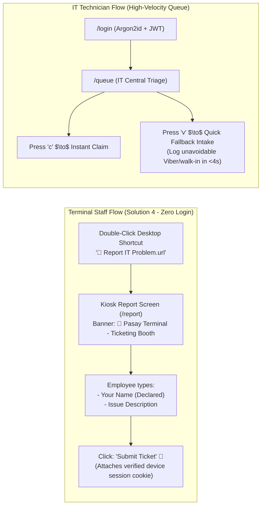

# Tiketa 2.0 — Frontend Engineering Sprint Plan (Strict TypeScript + Solution 4 Device Access)

## Goal Description
Formulate a dedicated, production-grade **Frontend Sprint Plan** for **Tiketa 2.0**, strictly synchronized with the **Backend Sprint Plan ([`backend_sprint_plan_docker.md`](file:///C:/Users/Kanor/.gemini/antigravity-cli/brain/3ed00225-4d3a-4947-92b2-b423ca9042b5/backend_sprint_plan_docker.md))** and grounded on the management-approved **Solution 4: Automatic Department Access on Company PCs** from [`Tiketa-Employee-Access-Decision-Report.pdf`](file:///C:/Users/Kanor/Documents/ARCH/01-Projects/Tiketa/Tiketa-Employee-Access-Decision-Report.pdf).

**Lead**: Rafael Emmanuel Codiñera (Frontend)  
**Peer Reviewer**: Jefferson Lopez (Backend & DevOps)  
**Target Repository**: `C:\Users\Kanor\Documents\FS_Projects\Tiketa\frontend`  
**Tech Stack**: React 18/19 SPA, Strict TypeScript 5+, Tailwind CSS, Zustand, Axios, Recharts, Lucide React, Vite, Nginx Alpine  

---

## 1. User Interaction Models: Solution 4 PC Kiosk vs. IT Queue



---

## 2. Phased Frontend Sprint Breakdown

### Sprint 1: Second Brain Alignment, Scaffolding & Strict Typing (Weeks 1–2)
* **F1.0 (In-Repo Second Brain Sync)**: Read `docs/AI-CONTEXT.md` and `docs/01-Architecture/DEVICE-ACCESS-SOLUTION4.md`. Confirm non-goals: zero `.jsx`/`.js` files, zero drag-and-drop Excel uploaders.
* **F1.1 (Vite & Strict TS Tooling)**: Vite React SPA with `"strict": true`, `"noImplicitAny": true`. Verified by `npm.cmd run type-check`.
* **F1.2 (Tailwind Corporate Tokens)**: Five Star Blue (`#1E3A8A`), Emerald Green (`#059669`), Amber Warning (`#D97706`), Crimson Alert (`#DC2626`).
* **F1.3 (TypeScript Domain Models)**: Author interfaces matching backend models (`types/auth.ts`, `types/ticket.ts`, `types/device.ts`, `types/reports.ts`).
* **F1.4 (Axios HTTP Client Core)**: Base Axios instance with `withCredentials: true` to send device cookies.
* **F1.5 (Shell Layout)**: `AppLayout.tsx`, `Sidebar.tsx`, `Navbar.tsx`.

---

### Sprint 2: IT Authentication, Solution 4 Kiosk Route & Device Admin (Weeks 3–4)
* **F2.1 (Zustand In-Memory Store `useAuthStore.ts`)**: Access token in RAM for IT technicians; tracks authenticated role.
* **F2.2 (IT Login Page `src/pages/LoginPage.tsx`)**: Secure login form for IT Technicians and Administrators redirecting to `/queue` and `/admin`.
* **F2.3 (Solution 4 Kiosk Reporting Page `src/pages/ReportIssuePage.tsx`)**:
  - Accessible directly at `/report` via desktop shortcut.
  - Automatically fetches provisioned department context from backend (`GET /api/v1/auth/device-session`).
  - Displays prominent terminal hub banner: e.g. `🏢 Pasay Terminal — Dispatch Office`.
  - Clean, distraction-free input: *Your Name* (`requester_name`), *Task Category* dropdown, *Description*, optional photo.
  - Zero password prompts, zero account registration forms (ADR-002, Solution 4).
* **F2.4 (IT Device Provisioning Modal `src/components/admin/EnrollDeviceModal.tsx`)**:
  - Modal accessible only to IT technicians in `/admin` to enroll a newly deployed terminal PC.
  - Generates desktop shortcut template file (`Report-IT-Problem.url`).
* **F2.5 (Axios 401 Interceptor)**: Transparent silent token refresh for IT technician sessions.

---

### Sprint 3: High-Velocity IT Queue & Fallback Quick Intake (Weeks 5–6)
* **F3.1 (Central IT Triage Queue `src/pages/ITQueuePage.tsx`)**:
  - High-density data grid displaying all unassigned and active tickets across terminals.
  - Displays tickets originating from Solution 4 desktop shortcuts with a verified `[ 🖥️ PC Kiosk ]` badge.
  - **Single-Click Claiming**: `[ Claim Ticket ]` button.
  - **Keyboard Shortcut (`c`)**: Pressing `c` immediately claims the selected ticket.
  - Color-coded badges: `[ OPEN ]`, `[ PROG ]`, `[ RESL ]`, `[ CLSD ]`.
* **F3.2 (Optimistic UI Updates via `useTicketStore.ts`)**: Instant sub-100ms feedback on claiming and status progression.
* **F3.3 (Fallback Quick Intake Modal - Hotkey `v`)**:
  - Pressing `v` in the IT Queue opens a 4-second Quick Intake modal.
  - Technicians enter walk-in or Viber requests (Requester, Hub, Dept, Issue) before troubleshooting to satisfy the management fallback logging rule.
* **F3.4 (Resolution & Duration Modal)**: Form capturing hands-on repair minutes vs. travel lag.

---

### Sprint 4: Executive Analytics Dashboard & Recharts Suite (Weeks 7–8)
* **F4.1 (Real-Time KPI Banner)**: Active Tickets, Overdue Backlog (>48 hrs), Avg Labor Minutes, Same-Day Resolution %.
* **F4.2 (8 Standardized Executive Reports Multi-Tab Viewer `src/pages/ReportsPage.tsx`)**:
  - All 8 standardized reports (`FR-REPT-01` to `FR-REPT-08`) with multi-hub filters and CSV streaming triggers.
* **F4.3 (4 Reactive Recharts Visual Widgets)**:
  1. `TurnaroundLagChart.tsx`: Repair minutes vs transit lag across terminal hubs.
  2. `SupportModeChart.tsx`: Remote vs Site visit ratio.
  3. `TechVelocityChart.tsx`: Closed tickets and labor hours per technician.
  4. `PeakDemandChart.tsx`: Ticket submission volume across hours of the day.

---

### Sprint 5: Production Dockerization, Bundle Polish & UAT (Weeks 9–10)
* **F5.1 (Production Multi-Stage Dockerfile & Nginx)**: Multi-stage build (Node 24 $\to$ Nginx Alpine) with HTML5 History API fallback.
* **F5.2 (Vite Production Optimization)**: Bundle chunking target `< 250 KB` gzipped.
* **F5.3 (Type Safety Verification)**: `npm.cmd run type-check` passes with 0 errors.
* **F5.4 (End-to-End Pilot Verification)**:
  - Verify terminal staff double-click desktop shortcut $\to$ submit issue $\to$ ticket arrives in IT Queue $\to$ tech claims via `c` $\to$ resolves $\to$ reports reflect metrics.
  - Verify IT logs walk-in via hotkey `v`.

---

## 3. Verification Plan

```powershell
cd C:\Users\Kanor\Documents\FS_Projects\Tiketa\frontend
npm.cmd run type-check
npm.cmd run build
```

### Manual Verification
1. **Desktop Shortcut Experience**: Test `/report` route without user login; verify correct terminal location/department banner is displayed.
2. **IT Queue Hotkeys**: Test hotkey `c` (instant claim) and hotkey `v` (quick fallback intake modal).
