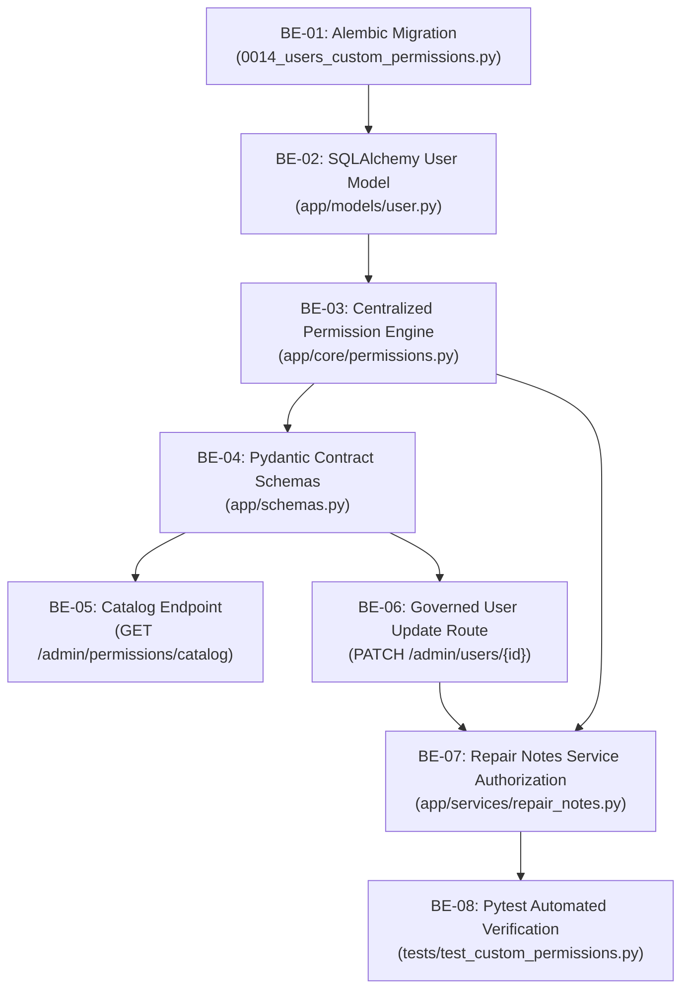

# ⚙️ Tiketa 2.0: Granular Feature Permissions — Backend Responsibilities Guide

> [!IMPORTANT] 🌟 Development Track Metadata
> - **Specification Tag:** `@spec FR-RBAC-04` (Granular RBAC Engine & Security Invalidation)
> - **Parent Architecture:** [[Tiketa_2.0_Granular_Feature_Permissions_Plan|🛡️ Granular Feature Permissions & Role Overrides Plan]]
> - **Target Repository:** `Tiketa2.0/backend/`
> - **Tech Stack:** Python 3.12+, FastAPI, SQLAlchemy 2.0 (Async), PostgreSQL 16 (JSONB), Alembic, Pytest
> - **Owner:** **Backend Developer**

---

## 🎯 1. Overview & Objective

The backend responsibility is to build the authoritative data persistence, evaluation engine, and API endpoints for **Granular Feature Permissions & Role Overrides**.

The backend ensures that:
1. `custom_permissions` is version-controlled in PostgreSQL as a JSONB array on the `users` table.
2. A centralized pure evaluation function (`user_has_permission`) determines capability access with strict precedence.
3. When an administrator updates custom permissions, `user.token_version` is automatically incremented to invalidate existing JWT claims and force fresh permissions on subsequent requests.
4. Services (such as `repair_notes.py`) enforce permission checks rather than static role checks.

---

## 🗺️ 2. Backend Task Breakdown



---

### 📝 Task BE-01: Alembic Database Migration
- **Target File:** [`backend/alembic/versions/0014_users_custom_permissions.py`](file:///C:/Users/Rain/Documents/Ominitick/Tiketa2.0/backend/alembic/versions/0014_users_custom_permissions.py) *(Create New)*

#### Implementation:
```python
"""Add custom_permissions to users for granular RBAC overrides

Revision ID: 0014_custom_permissions
Revises: 0013_username_cooldown
Create Date: 2026-11-11 12:00:00.000000
"""

from collections.abc import Sequence
import sqlalchemy as sa
from sqlalchemy.dialects import postgresql
from alembic import op

revision: str = "0014_custom_permissions"
down_revision: str | None = "0013_username_cooldown"
branch_labels: str | Sequence[str] | None = None
depends_on: str | Sequence[str] | None = None


def upgrade() -> None:
    op.add_column(
        "users",
        sa.Column(
            "custom_permissions",
            postgresql.JSONB(astext_type=sa.Text()).with_variant(sa.JSON(), "sqlite"),
            nullable=False,
            server_default=sa.text("'[]'::jsonb"),
        ),
    )


def downgrade() -> None:
    op.drop_column("users", "custom_permissions")
```

---

### 📝 Task BE-02: SQLAlchemy User Model Update
- **Target File:** [`backend/app/models/user.py`](file:///C:/Users/Rain/Documents/Ominitick/Tiketa2.0/backend/app/models/user.py#L42-L52)

#### Implementation Steps:
1. Import `JSON` from `sqlalchemy` and `JSONB` from `sqlalchemy.dialects.postgresql`.
2. Add the `custom_permissions` column to the `User` model:
   ```python
   from sqlalchemy import JSON
   from sqlalchemy.dialects.postgresql import JSONB

   class User(Base, TimestampMixin):
       __tablename__ = "users"
       # ... existing columns ...

       custom_permissions: Mapped[list[str]] = mapped_column(
           JSON().with_variant(JSONB, "postgresql"),
           default=list,
           server_default="[]",
           nullable=False,
       )
   ```

---

### 📝 Task BE-03: Centralized Permission Evaluation Engine
- **Target File:** [`backend/app/core/permissions.py`](file:///C:/Users/Rain/Documents/Ominitick/Tiketa2.0/backend/app/core/permissions.py) *(Create New)*

#### Implementation:
```python
# @spec FR-RBAC-04: Centralized Pure Permission Engine
from typing import Final
from app.models.user import User

ROLE_DEFAULT_PERMISSIONS: Final[dict[str, set[str]]] = {
    "admin": {"*"},  # Superuser wildcard
    "supervisor": {
        "view_analytics",
        "view_reports",
        "export_reports",
        "manage_team",
        "job_logs_all",
        "terminal_hubs",
        "view_repair_notes",
    },
    "it": {
        "triage_queue",
        "claim_tickets",
        "quick_intake",
        "manage_repair_notes",
        "view_repair_notes",
        "terminal_hubs",
        "submit_account_requests",
    },
    "intern": {
        "view_repair_notes",
    },
}

FEATURE_CATALOG: Final[list[dict]] = [
    {
        "key": "manage_repair_notes",
        "label": "Manage Repair Guides",
        "description": "Create, edit, and publish repair guides and SOP checklists",
        "category": "workbench",
        "default_roles": ["it", "admin"],
    },
    {
        "key": "view_repair_notes",
        "label": "View Repair Guides",
        "description": "Read and reference published repair guides",
        "category": "workbench",
        "default_roles": ["intern", "it", "supervisor", "admin"],
    },
    {
        "key": "claim_tickets",
        "label": "Self-Claim Tickets",
        "description": "Claim unassigned tickets from queue to workbench",
        "category": "workbench",
        "default_roles": ["it", "admin"],
    },
    {
        "key": "quick_intake",
        "label": "Quick Ticket Intake",
        "description": "Dispatch tickets via header intake modal",
        "category": "workbench",
        "default_roles": ["it", "admin"],
    },
    {
        "key": "triage_queue",
        "label": "Access Triage Queue",
        "description": "View unassigned incident pool and filter triage queues",
        "category": "queue",
        "default_roles": ["it", "admin"],
    },
    {
        "key": "terminal_hubs",
        "label": "Terminal Operations",
        "description": "Access Terminal Hubs and operational device monitoring",
        "category": "queue",
        "default_roles": ["it", "supervisor", "admin"],
    },
    {
        "key": "view_reports",
        "label": "Operational Reports",
        "description": "View historical reports and facility incident metrics",
        "category": "reports",
        "default_roles": ["supervisor", "admin"],
    },
    {
        "key": "export_reports",
        "label": "Export CSV/XLSX Reports",
        "description": "Download 15-column job log workbooks and audits",
        "category": "reports",
        "default_roles": ["supervisor", "admin"],
    },
    {
        "key": "view_analytics",
        "label": "Supervisor KPI Analytics",
        "description": "View SLA compliance, lag disaggregation, and resolution speeds",
        "category": "reports",
        "default_roles": ["supervisor", "admin"],
    },
    {
        "key": "job_logs_all",
        "label": "View All Job Logs",
        "description": "View all technicians' 15-column job logs vs personal only",
        "category": "reports",
        "default_roles": ["supervisor", "admin"],
    },
    {
        "key": "manage_team",
        "label": "Manage IT Roster",
        "description": "View and manage staff accounts, credentials, and permissions",
        "category": "team",
        "default_roles": ["supervisor", "admin"],
    },
    {
        "key": "submit_account_requests",
        "label": "Submit Account Requests",
        "description": "Submit account creation and deactivation proposals",
        "category": "team",
        "default_roles": ["it", "admin"],
    },
]


def user_has_permission(user: User, perm: str) -> bool:
    """Evaluate whether a user has access to a feature.
    
    Precedence:
    1. Admin -> Always True
    2. Explicit Revoke ('-feature') -> False
    3. Explicit Grant ('+feature' or 'feature') -> True
    4. Base Role Default -> True
    5. Fallback -> False
    """
    if user.role == "admin":
        return True

    overrides = set(user.custom_permissions or [])
    if f"-{perm}" in overrides:
        return False
    if f"+{perm}" in overrides or perm in overrides:
        return True

    return perm in ROLE_DEFAULT_PERMISSIONS.get(user.role, set())


def get_effective_permissions(user: User) -> list[str]:
    """Compute the combined list of active permissions for client serialization."""
    if user.role == "admin":
        return ["*"]

    defaults = set(ROLE_DEFAULT_PERMISSIONS.get(user.role, set()))
    overrides = user.custom_permissions or []

    effective = set(defaults)
    for rule in overrides:
        if rule.startswith("-"):
            effective.discard(rule[1:])
        elif rule.startswith("+"):
            effective.add(rule[1:])
        else:
            effective.add(rule)

    return sorted(list(effective))
```

---

### 📝 Task BE-04: Pydantic Schemas Update
- **Target File:** [`backend/app/schemas.py`](file:///C:/Users/Rain/Documents/Ominitick/Tiketa2.0/backend/app/schemas.py#L30-L62)

#### Implementation Steps:
1. In `UserUpdate`, add `custom_permissions`:
   ```python
   class UserUpdate(Input):
       full_name: str | None = Field(default=None, min_length=2, max_length=150)
       email: EmailStr | None = Field(default=None, max_length=150)
       role: StaffRole | None = None
       location_id: UUID | None = None
       is_active: bool | None = None
       password: str | None = Field(default=None, min_length=12, max_length=128)
       custom_permissions: list[str] | None = None  # <-- ADD THIS
   ```
2. In `UserOut`, add `custom_permissions` and `effective_permissions`:
   ```python
   class UserOut(BaseModel):
       model_config = ConfigDict(from_attributes=True)
       id: UUID
       username: str
       email: str
       full_name: str
       role: StaffRole
       is_active: bool
       closed_repairs: int = 0
       active_bench: int = 0
       avatar_url: str | None = None
       avatar_updated_at: datetime | None = None
       custom_permissions: list[str] = Field(default_factory=list)      # <-- ADD THIS
       effective_permissions: list[str] = Field(default_factory=list)  # <-- ADD THIS
   ```

---

### 📝 Task BE-05: Catalog & User Update Endpoints
- **Target File:** [`backend/app/api/directory.py`](file:///C:/Users/Rain/Documents/Ominitick/Tiketa2.0/backend/app/api/directory.py#L275-L300)

#### Implementation Steps:
1. Add `GET /api/v1/admin/permissions/catalog`:
   ```python
   from app.core.permissions import FEATURE_CATALOG

   @router.get("/admin/permissions/catalog")
   async def get_permissions_catalog(admin: Admin):
       """Return all system features, categories, and role defaults for the checklist UI."""
       return {"features": FEATURE_CATALOG}
   ```
2. Verify `update_user` (`PATCH /api/v1/admin/users/{user_id}`):
   ```python
   # Line 292 of directory.py already dumps body exclude_none=True:
   for key, value in body.model_dump(
       exclude_none=True, exclude={"password", "role", "is_active"}
   ).items():
       setattr(user, key, value)
   user.token_version += 1  # FLUSHES STALE JWT SESSIONS
   await db.commit()
   return user
   ```
3. In `auth.py` (`GET /auth/me`) and user serializers, populate `user.effective_permissions = get_effective_permissions(user)`.

---

### 📝 Task BE-06: Repair Notes Service Authorization Refactor
- **Target File:** [`backend/app/services/repair_notes.py`](file:///C:/Users/Rain/Documents/Ominitick/Tiketa2.0/backend/app/services/repair_notes.py#L36-L55)
- **Target File:** [`backend/app/services/repair_notes.py`](file:///C:/Users/Rain/Documents/Ominitick/Tiketa2.0/backend/app/services/repair_notes.py#L210-L265)

#### Implementation Steps:
1. In `check_guide_edit_permission(user: User, note: RepairNote)`:
   ```python
   from app.core.permissions import user_has_permission

   def check_guide_edit_permission(user: User, note: RepairNote) -> bool:
       if user_has_permission(user, "manage_repair_notes"):
           return True
       return note.author_id == user.id
   ```
2. In `create_repair_note(db, payload, user)`:
   ```python
   if not user_has_permission(user, "manage_repair_notes"):
       raise HTTPException(403, "You do not have permission to create saved repair guides")
   ```

---

### 📝 Task BE-07: Pytest Automated Verification Suite
- **Target File:** `backend/tests/test_custom_permissions.py` *(Create New)*

#### Test Cases:
1. `test_default_intern_cannot_create_repair_note()`: Verify 403 Forbidden.
2. `test_admin_can_grant_repair_notes_to_intern()`: Calls `PATCH /admin/users/{intern_id}` with `["+manage_repair_notes"]`.
3. `test_intern_with_granted_permission_creates_note()`: Successfully creates note and gets 201 Created.
4. `test_admin_can_revoke_default_permission()`: IT Tech with `["-terminal_hubs"]` returns `False` on `user_has_permission`.
5. `test_admin_wildcard_bypass()`: Admin returns `True` for every feature regardless of `custom_permissions`.

---

## 🧪 3. Backend Verification Commands

Run these commands inside the backend container/environment:

```bash
# 1. Run Alembic upgrade
alembic upgrade head

# 2. Run RBAC pytest suite
pytest tests/test_custom_permissions.py -v
```
