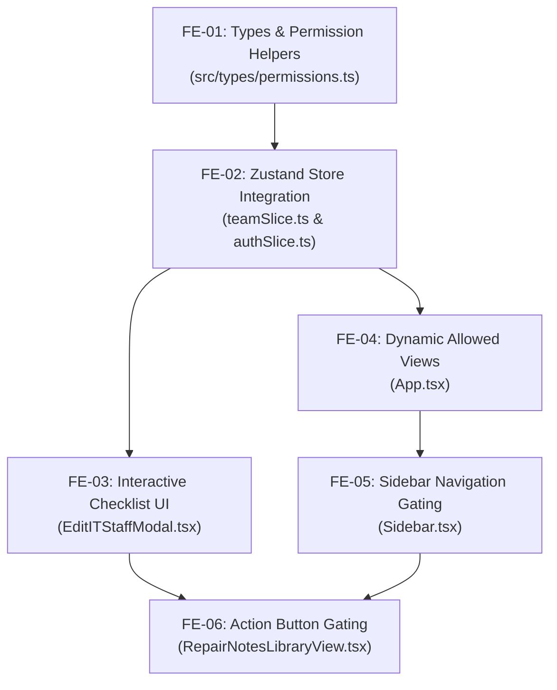

# 🎨 Tiketa 2.0: Granular Feature Permissions — Frontend Responsibilities Guide

> [!IMPORTANT] 🌟 Development Track Metadata
> - **Specification Tag:** `@spec UI-TEAM-04` (IT Roster Permissions Checklist & UI Gating)
> - **Parent Architecture:** [[Tiketa_2.0_Granular_Feature_Permissions_Plan|🛡️ Granular Feature Permissions & Role Overrides Plan]]
> - **Target Repository:** `Tiketa2.0/frontend/`
> - **Tech Stack:** React 18/19, TypeScript (Vite), Zustand, Tailwind CSS, Lucide React, Radix UI primitives
> - **Owner:** **Frontend Developer (You)**

---

## 🎯 1. Overview & Objective

Your primary objective is to build the client-side experience for **Granular Feature Permissions & Role Overrides**. 

Under this system, the base role (`intern`, `it`, `supervisor`, `admin`) gives a user default capabilities, but an administrator can open the IT staff edit modal on the **IT Team & Accounts** page (`/team`), inspect a categorized feature checklist, and toggle specific permissions on or off for that individual.

### Core User Scenario
> *"An Intern is assigned to author and update Saved Repair Notes (or triage tickets). The administrator opens their profile, ticks the 'Manage Repair Guides (SOPs)' checkbox, and saves. Instantly, the intern's session unlocks the 'New Repair Guide' action and edit controls without requiring a full system role promotion."*

---

## 📋 2. Standardized Feature Permission Registry

These are the 12 canonical feature keys returned by the backend catalog (`GET /api/v1/admin/permissions/catalog`). Your UI will organize them into 4 functional domain categories:

```typescript
export type FeatureKey =
  // 🛠️ Workbench & SOPs
  | 'manage_repair_notes'      // Author & edit repair guides/checklists
  | 'view_repair_notes'        // View published repair guides
  | 'claim_tickets'            // Self-claim tickets to workbench
  | 'quick_intake'             // Create tickets via header intake modal
  // 📋 Queue & Triage
  | 'triage_queue'             // Access unassigned triage pool
  | 'terminal_hubs'            // Access Terminal Hubs & operational monitoring
  // 📊 Reporting & Analytics
  | 'view_reports'             // View system incident logs & reports
  | 'export_reports'           // Download 15-column job log CSV/XLSX
  | 'view_analytics'           // Supervisor KPI metrics
  | 'job_logs_all'             // Access full facility job logs vs own only
  // 👥 Team & Governance
  | 'manage_team'              // Access IT staff roster & manage accounts
  | 'submit_account_requests'; // Submit account creation/deactivation requests
```

---

## 🗺️ 3. Frontend Task Breakdown



---

### 📝 Task FE-01: Type Definitions & Permission Helpers
- **Target File:** [`frontend/src/types/permissions.ts`](file:///C:/Users/Rain/Documents/Ominitick/Tiketa2.0/frontend/src/types/permissions.ts) *(Create New)*
- **Target File:** [`frontend/src/types/team.ts`](file:///C:/Users/Rain/Documents/Ominitick/Tiketa2.0/frontend/src/types/team.ts#L18-L35)
- **Target File:** [`frontend/src/types/index.ts`](file:///C:/Users/Rain/Documents/Ominitick/Tiketa2.0/frontend/src/types/index.ts)

#### Implementation Steps:
1. Update `TeamMember` in `src/types/team.ts`:
   ```typescript
   export interface TeamMember {
     // ... existing fields
     custom_permissions?: string[];
     effective_permissions?: string[];
   }
   ```
2. Update `CurrentUser` in `src/types/index.ts`:
   ```typescript
   export interface CurrentUser {
     // ... existing fields
     custom_permissions?: string[];
     effective_permissions?: string[];
   }
   ```
3. Create `src/types/permissions.ts` with the evaluation helper:
   ```typescript
   // @spec UI-TEAM-04: Centralized Frontend Permission Evaluation Helper
   import type { StaffRole } from './index';

   export const ROLE_DEFAULT_PERMISSIONS: Record<StaffRole, Set<FeatureKey>> = {
     admin: new Set([
       'manage_repair_notes', 'view_repair_notes', 'triage_queue', 'claim_tickets',
       'quick_intake', 'terminal_hubs', 'job_logs_all', 'view_analytics',
       'view_reports', 'export_reports', 'manage_team', 'submit_account_requests'
     ]),
     supervisor: new Set([
       'view_analytics', 'view_reports', 'export_reports', 'manage_team',
       'job_logs_all', 'terminal_hubs', 'view_repair_notes'
     ]),
     it: new Set([
       'triage_queue', 'claim_tickets', 'quick_intake', 'manage_repair_notes',
       'view_repair_notes', 'terminal_hubs', 'submit_account_requests'
     ]),
     intern: new Set([
       'view_repair_notes'
     ])
   };

   export function hasPermission(
     user: { role: StaffRole; custom_permissions?: string[]; effective_permissions?: string[] } | null,
     feature: FeatureKey
   ): boolean {
     if (!user) return false;
     if (user.role === 'admin') return true;

     // 1. If backend supplied pre-calculated effective_permissions:
     if (user.effective_permissions && user.effective_permissions.length > 0) {
       return user.effective_permissions.includes('*') || user.effective_permissions.includes(feature);
     }

     // 2. Client-side evaluation fallback:
     const overrides = user.custom_permissions ?? [];
     if (overrides.includes(`-${feature}`)) return false;
     if (overrides.includes(`+${feature}`) || overrides.includes(feature)) return true;

     return ROLE_DEFAULT_PERMISSIONS[user.role]?.has(feature) ?? false;
   }
   ```

---

### 📝 Task FE-02: Zustand Store Integration
- **Target File:** [`frontend/src/store/slices/teamSlice.ts`](file:///C:/Users/Rain/Documents/Ominitick/Tiketa2.0/frontend/src/store/slices/teamSlice.ts#L24-L38)

#### Implementation Steps:
1. In `teamSlice.ts`, update the payload type for `updateITMemberApi`:
   ```typescript
   updateITMemberApi: (
     id: string,
     payload: {
       name: string;
       email: string;
       username?: string;
       role: TeamRole;
       systemRole: StaffRole;
       department: string;
       primaryLocation: string;
       locationId?: string | null;
       is_active: boolean;
       password?: string;
       acting_admin_password?: string;
       custom_permissions?: string[]; // <-- ADD THIS
     }
   ) => Promise<boolean>;
   ```
2. Around line 235 of `teamSlice.ts`, forward `custom_permissions` to the backend:
   ```typescript
   const updateData: {
     full_name?: string;
     email?: string;
     role?: StaffRole;
     is_active?: boolean;
     location_id?: string | null;
     custom_permissions?: string[]; // <-- ADD THIS
   } = {
     full_name: payload.name,
     email: payload.email,
   };

   if (payload.custom_permissions !== undefined) {
     updateData.custom_permissions = payload.custom_permissions;
   }
   ```

---

### 📝 Task FE-03: Interactive Checklist in `EditITStaffModal.tsx`
- **Target File:** [`frontend/src/features/team/components/EditITStaffModal.tsx`](file:///C:/Users/Rain/Documents/Ominitick/Tiketa2.0/frontend/src/features/team/components/EditITStaffModal.tsx)

#### UI Architecture & Design Standards:
Build an interactive **"Feature Permissions & Role Overrides"** card beneath the general user inputs.

```
┌────────────────────────────────────────────────────────────────────────┐
│  🔐 Feature Permissions & Role Overrides                              │
│  Base Role: INTERN  |  Active Capabilities: 5 Features                │
├────────────────────────────────────────────────────────────────────────┤
│  [↻ Reset to Role Defaults]                                           │
│                                                                        │
│  ▼ 🛠️ Workbench & Repair Operations                                   │
│  ┌──────────────────────────────────────────────────────────────────┐  │
│  │ [✓] Manage Repair Guides (SOPs)           [CUSTOM GRANTED] ✨    │  │
│  │     Create, edit, and publish repair guides & SOP checklists       │  │
│  │                                                                  │  │
│  │ [✓] View Repair Guides                    [ROLE DEFAULT]         │  │
│  │     Read and reference published repair guides                   │  │
│  │                                                                  │  │
│  │ [ ] Self-Claim Tickets from Pool          [LOCKED]               │  │
│  │     Claim unassigned tickets from queue to workbench             │  │
│  └──────────────────────────────────────────────────────────────────┘  │
│                                                                        │
│  ▼ 📋 Queue & Terminal Operations                                      │
│  ┌──────────────────────────────────────────────────────────────────┐  │
│  │ [ ] Access Triage Queue                   [LOCKED]               │  │
│  │ [ ] Terminal Operations Hub               [LOCKED]               │  │
│  └──────────────────────────────────────────────────────────────────┘  │
└────────────────────────────────────────────────────────────────────────┘
```

#### State Logic in Modal:
1. Maintain local state:
   ```typescript
   const [permissions, setPermissions] = useState<string[]>([]);

   useEffect(() => {
     if (member && isOpen) {
       setPermissions(member.custom_permissions ?? []);
     }
   }, [member, isOpen]);
   ```
2. Checklist toggle handler:
   - If feature is default for `systemRole`:
     - If checked: clear from `permissions` (or remove `-feature`).
     - If unchecked: add `-feature` (explicit revoke).
   - If feature is NOT default for `systemRole`:
     - If checked: add `+feature` (explicit grant).
     - If unchecked: remove `+feature`.
3. "Reset to Role Defaults" button:
   - Sets `setPermissions([])`.
4. Include `custom_permissions: permissions` in the `onSubmit` call.

---

### 📝 Task FE-04: Dynamic Allowed Views in `App.tsx`
- **Target File:** [`frontend/src/App.tsx`](file:///C:/Users/Rain/Documents/Ominitick/Tiketa2.0/frontend/src/App.tsx#L24-L40)

#### Implementation Steps:
1. Replace static `ROLE_ALLOWED_VIEWS[userRole]` with dynamic view calculation:
   ```typescript
   import { hasPermission } from './types/permissions';

   export function getEffectiveAllowedViews(user: CurrentUser | null): ActiveView[] {
     if (!user) return ['overview'];
     if (user.role === 'admin') return ALL_VIEWS;

     const views = new Set<ActiveView>(ROLE_ALLOWED_VIEWS[user.role] ?? ['overview']);

     if (hasPermission(user, 'triage_queue')) views.add('tickets');
     if (hasPermission(user, 'terminal_hubs')) views.add('terminals');
     if (hasPermission(user, 'view_analytics')) views.add('analytics');
     if (hasPermission(user, 'view_reports')) views.add('reports');
     if (hasPermission(user, 'manage_team')) views.add('team');

     return Array.from(views);
   }
   ```
2. Use `getEffectiveAllowedViews(currentUser)` in the route resolver and popstate listener.

---

### 📝 Task FE-05: Sidebar Navigation Gating in `Sidebar.tsx`
- **Target File:** [`frontend/src/components/layout/Sidebar.tsx`](file:///C:/Users/Rain/Documents/Ominitick/Tiketa2.0/frontend/src/components/layout/Sidebar.tsx#L127-L185)

#### Implementation Steps:
1. In `Sidebar.tsx`, retrieve allowed views:
   ```typescript
   const allowedViews = getEffectiveAllowedViews(currentUser);
   ```
2. When rendering navigation items for an intern or IT tech, render buttons whenever `allowedViews.includes('tickets')` or `allowedViews.includes('terminals')`, ensuring custom-granted views appear seamlessly in the sidebar navigation without layout jumps.

---

### 📝 Task FE-06: Action Gating in `RepairNotesLibraryView.tsx`
- **Target File:** [`frontend/src/features/notes/RepairNotesLibraryView.tsx`](file:///C:/Users/Rain/Documents/Ominitick/Tiketa2.0/frontend/src/features/notes/RepairNotesLibraryView.tsx#L50-L85)

#### Implementation Steps:
1. Replace line 50:
   ```typescript
   // OLD:
   const isIntern = currentUser?.role === 'intern';
   // NEW:
   const canManageNotes = hasPermission(currentUser, 'manage_repair_notes');
   ```
2. Replace line 83:
   ```typescript
   if (!canManageNotes) return;
   ```
3. Update the **"New Repair Guide"** button rendering:
   ```tsx
   {canManageNotes && (
     <button
       type="button"
       onClick={startCreateNote}
       className="px-4 py-2 bg-orange-600 hover:bg-orange-500 text-white font-semibold rounded-xl inline-flex items-center gap-1.5 shadow-sm transition-colors press-fx"
     >
       <Plus className="w-4 h-4" />
       <span>New Repair Guide</span>
     </button>
   )}
   ```
4. Update the note card `canManage` check (line 402) so interns with `manage_repair_notes` can edit guides.

---

## 🧪 4. Frontend Verification & Acceptance Criteria

Run these commands to verify code quality before signing off:

```bash
# 1. Verify strict TypeScript compliance (Zero errors)
npm run type-check

# 2. Run existing Vitest component suite
npm test
```

| ID | Test Scenario | Expected Outcome |
| :--- | :--- | :--- |
| **FE-AC-01** | Standard Intern View | "New Repair Guide" button is hidden. Tickets queue link is not shown. |
| **FE-AC-02** | Admin Custom Grant | Admin checks "Manage Repair Guides (SOPs)" in `EditITStaffModal`; clicks Save. Toast succeeds. |
| **FE-AC-03** | Intern Immediate Access | Intern loads Repair Notes page; "New Repair Guide" button is visible and clickable; creation modal opens. |
| **FE-AC-04** | Reset to Defaults | Admin clicks "Reset to Role Defaults"; permissions state resets to empty array `[]`; save succeeds. |
| **FE-AC-05** | No Layout Shift (CLS = 0) | Checklist items render with fixed dimensions and clear badges without jittering. |
