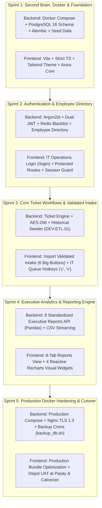

# Tiketa 2.0 — Master Engineering Sprint Plan & DevOps Runbook

> Current integration work follows the [shared integration sprint](INTEGRATION-SPRINT-PLAN.md) and [API integration map](../03-Contracts/API-INTEGRATION-MAP.md). This older roadmap remains historical context; conflicting endpoint examples, mock-data practices and handoff guidance are superseded.

**Pangasinan Five Star Bus Co. & Regional Affiliate Transit Fleets**  
*Internal IT Helpdesk, Terminal Maintenance Management, and Executive Velocity Analytics System*  
**Specification Baseline**: [[01-Projects/Tiketa/SRS|SRS.md (v2.1.0)]] & [[01-Projects/Tiketa/Tiketa-Employee-Access-Decision-Report.pdf|Employee Access Decision Report]]

---

## 1. Executive Summary & Core Architectural Invariants

Tiketa 2.0 replaces the legacy PHP 8.2 / Laravel 11 monolith with a modern, decoupled **Python 3.12+ (FastAPI) + React 18/19 SPA (Strict TypeScript 5+)** architecture running on **Docker Compose (PostgreSQL 16 Alpine, Redis 7 Alpine)**.

### Architectural Invariants:
1. **Zero Workforce Employee Accounts**: General terminal staff (cashiers, conductors, dispatchers, mechanics) do not have login accounts or passwords. They submit tickets via `/report` using verified **Employee ID No.** (auto-binding terminal location and department) (no device enrollment).
2. **Simplified 2-Tier RBAC**: Authenticated accounts in `users` are strictly reserved for **IT Technicians** (`role: 'it'`) and **Administrators** (`role: 'admin'`).
3. **IT Fallback Quick Intake (Hotkey `v`)**: Unavoidable Viber chats and walk-in requests are logged by technicians on the IT Queue in <4 seconds before troubleshooting, preserving 100% of executive labor metrics.
4. **In-Repository Second Brain**: `AGENTS.md` and `docs/AI-CONTEXT.md` ensure all human engineers and AI coding assistants remain synchronized with the single source of truth.
5. **YAGNI / Ponytail Scope Discipline**: Zero client-side Excel uploaders (ADR-004); historical ingestion is handled via the backend developer CLI seeder (`scripts/seed_historical_logs.py` / `DEV-ETL-01`).

---

## 2. Requirement Traceability Matrix (Sprints vs. SRS v2.1.0)

| Sprint & Track | Deliverables | SRS Section & Requirement ID | Deliverable Details |
| :--- | :--- | :--- | :--- |
| **Sprint 1: Foundation** *(Backend: Jefferson)* | B1.0 – B1.6 | **Section 2 & 3** • `SCHEMA-01` to `SCHEMA-12` • Docker Compose stack | Docker Compose (`backend`, `db`, `redis`), PostgreSQL 16 schema (migration-defined schema including `employees` and no `devices`), Alembic migrations, transit seeders. |
| **Sprint 1: Foundation** *(Frontend: Rafael)* | F1.0 – F1.5 | **Section 9** • Strict TypeScript standards • Tailwind corporate tokens | Vite React 18 SPA scaffold, `"strict": true`, TypeScript models mirroring backend Pydantic schemas, Axios client core. |
| **Sprint 2: Auth & RBAC** *(Backend: Jefferson)* | B2.1 – B2.7 | **Section 4 & 5** • `FR-AUTH-01` (Zero-account intake) • `FR-AUTH-02` (2-Tier RBAC) • `FR-SEC-01` (Argon2id + JWT) | Argon2id hasher, 15-min access tokens, HTTP-Only refresh cookies, Redis JTI token revocation, employee lookup API (`/api/v1/employees/lookup`). |
| **Sprint 2: IT Login** *(Frontend: Rafael)* | F2.1 – F2.5 | **Section 4.2 & 9.1** • IT Operations Login (`/login`) • Route guards (`ProtectedRoute`) | Simplified IT Operations Login (no dual tabs), Zustand RAM auth store, Axios 401 silent token refresh queue. |
| **Sprint 3: Ticket Engine** *(Backend: Jefferson)* | B3.1 – B3.6 | **Section 6 & 7** • `DEV-ETL-01` (Historical Seeder) • `FR-TICK-01` to `06` (State machine) • `FR-AUTH-03` (Quick Intake) | Ticket state machine (`OPEN` $\to$ `PROG` $\to$ `RESL` $\to$ `CLSD`), single-click claiming (`c`), fallback quick intake endpoint (`v`), AES-256 field encryption, Pandas seeder. |
| **Sprint 3: Kiosk & Queue** *(Frontend: Rafael)* | F3.1 – F3.4 | **Section 6.1 & 9.2** • `/report` 6-Button Intake Form • IT Triage Queue with hotkeys | Single-screen `/report` with 6 big category buttons and auto-locking employee profile; IT Queue with hotkey `c` (claim) and hotkey `v` (quick intake modal). |
| **Sprint 4: Analytics** *(Backend: Jefferson)* | B4.1 – B4.5 | **Section 8** • `FR-REPT-01` to `FR-REPT-08` • Streaming CSV generator | Real-time KPI summaries (`/api/v1/reports/kpis`), 8 standardized analytical reports, transit lag disaggregation calculations, Pandas CSV streaming. |
| **Sprint 4: Dashboard** *(Frontend: Rafael)* | F4.1 – F4.4 | **Section 8.2 & 9.3** • 4 Recharts visual widgets • 8-tab reports dashboard | Clustered bar chart (Repair Labor vs Transit Lag), donut chart (Remote vs Site), horizontal bar (Tech Velocity), peak demand histogram. |
| **Sprint 5: DevOps** *(Combined Track)* | 5.1 – 5.7 | **Section 10 & 12** • `NFR-01` to `NFR-08` • `deploy_prod.sh` & `backup_db.sh` | Production Compose stack (`docker-compose.prod.yml`), Nginx TLS 1.3 reverse proxy, automated daily backup cron, depot pilot at Pasay & Caloocan. |

---

## 3. Team Git Standards & GitHub Actions CI

### 3.1 Integration and merge custody
- **Protected `main` branch**: Direct git push is blocked.
- **Linear rebase protocol**: `git fetch origin develop && git rebase origin/develop`.
- **Merge method**: Always "Squash and merge" or "Rebase and merge".
- **Merge custody**: All feature PRs target `develop`. Only Jefferson Lopez may merge; no automatic merge or force-push.

### 3.2 GitHub Actions CI (`.github/workflows/backend-ci.yml`)
- Automatically runs on PRs to `develop`:
  1. Ruff linter and code formatting check.
  2. AI Context and Second Brain file integrity verification.
  3. Spin up PostgreSQL 16 & Redis 7 test containers.
  4. Run async Alembic migrations & test seeding.
  5. Run Pytest suite with code coverage enforcement ($\ge 80\%$).
  6. Verify Docker build succeeds.

---

## 4. Pure Employee ID Intake Protocol (Zero Setup, Zero Tokens)

To eliminate all manual client-side configuration and device management overhead:
- **Zero Client Scripts / Zero Setup**: No `.bat` scripts, no device cookies, and no `devices` database table.
- **Pure Employee ID Validation**: Employees navigate directly to `/report` from any terminal workstation or mobile browser.
- **Auto-Locked Branch Routing**: Typing a verified Employee ID (e.g., `FS-1042`) immediately locks Location and Department from the PostgreSQL `employees` table, preventing 100% of human misrouting errors.
- **IT Fallback Quick Intake (Hotkey `v`)**: Technicians capture walk-in and Viber requests in under 4 seconds on `/queue`, preserving 100% of executive operational metrics without employee resistance.

---

## 5. Related Vault Documents
- [[01-Projects/Tiketa/SRS|Tiketa 2.0 Master SRS (v2.1.0)]]
- [[01-Projects/Tiketa/Tiketa|Tiketa Project Overview]]
- [[01-Projects/Tiketa/UnangSiklab-Integration-Roadmap|UnangSiklab Integration Roadmap (Phase 2)]]
- [[04-System/AI-CONTEXT|ARCH AI Context Router]]

Backend evidence and release gates: [BACKEND-PROGRESS.md](BACKEND-PROGRESS.md). Reporting definitions: [REPORTING-RULES.md](../03-Contracts/REPORTING-RULES.md).
