# 🎯 Sprint 2.0: Master Sprint Plan — State Synchronization & 4-Tier RBAC Architecture

**Sprint Name:** Sprint 2.0 — End-to-End State Sync & 4-Tier RBAC Architecture  
**Created:** October 24, 2026  
**Status:** Ready for Execution (Single Sprint Architecture)  
**Author:** Senior Systems Analyst & Lead Full-Stack Architect  
**Specification Reference:** [`docs/audit-and-rbac-spec.md`](../audit-and-rbac-spec.md)  
**Track Links:**
- [Backend Track Responsibilities](SPRINT-2.0-BACKEND-RESPONSIBILITIES.md)
- [Frontend Track Responsibilities](SPRINT-2.0-FRONTEND-RESPONSIBILITIES.md)

---

## 1. Sprint Objective & Executive Scope

This single consolidated sprint resolves critical operational state desynchronization defects identified during comprehensive system QA, and executes the architectural upgrade to a **4-tier enterprise Role-Based Access Control (RBAC)** model for Five Star IT operations:

1. **Ticket Creation & Queue Sync:** Fix ascending database sorting bug and schema UUID omissions so newly created employee tickets appear immediately at index 0 of the IT Dashboard queue.
2. **Ticket Resolution & Lifecycle Integrity:** Wire the client `resolveTicket` mutation to the backend `PATCH /tickets/{id}/status` endpoint, eliminating state rollback upon background polling.
3. **4-Tier Staff RBAC:** Upgrade the access model from binary (`it`, `admin`) to 4 distinct tiers:
   - **`intern` (Intern / Part-time):** Restricted to KPI Overview, Active Workbench (assigned tickets only), Saved Repair Notes, and Personal Job Logs. Cannot browse fleet tickets or claim from the open pool.
   - **`it` (IT Support Specialist):** Full operational technician suite across all 15 bus terminals.
   - **`analyst` (IT Systems Analyst):** Scoped to Executive Analytics, Standardized 8 Reports Suite (with CSV exports), and Account Creation Approval review.
   - **`admin` (System Administrator):** Full superuser access across all modules, directory governance, and 72-hour closure overrides.
4. **Account Directory Governance:** Implement full profile editing and foreign-key-preserving soft deactivation (`is_active = False`) with immediate Redis session revocation.

---

## 2. Sprint Milestones & Cross-Track Sequence

```mermaid
flowchart TD
    subgraph M1 ["Milestone 1: Database Migration & Shared Contracts"]
        B1["B-01: Alembic Migration\n(Upgrade ck_users_role)"]
        B2["B-02: PublicTicket UUID\n& StaffRoleLiteral Contract"]
        F1["F-01: Synchronize TypeScript\nStaffRole & DTOs"]
    end

    subgraph M2 ["Milestone 2: State Synchronization & Queue Integrity"]
        B3["B-03: Queue Query Order Fix\n(created_at DESC)"]
        F2["F-02: Wire resolveTicket to\nBackend PATCH /status"]
        F3["F-03: Fix Ticket Reconciliation\n& Open Pool Dashboard Pill"]
    end

    subgraph M3 ["Milestone 3: 4-Tier RBAC Navigation & Route Guards"]
        B4["B-04: FastAPI Role Dependencies\n(require_roles, AnalystOrAdmin)"]
        F4["F-04: Role-Tailored Sidebar\n(Sidebar.tsx 4 Navigation Sets)"]
        F5["F-05: Strict Route Resolution\n& Guards in App.tsx"]
        F6["F-06: Intern Assigned-Only\nWorkbench Filtering"]
    end

    subgraph M4 ["Milestone 4: Account Governance & Soft Deactivation"]
        B5["B-05: Directory Soft Deactivation\n& Redis Session Revocation"]
        F7["F-07: EditITStaffModal &\nEditEmployeeModal"]
        F8["F-08: Wire Directory Actions\nin teamSlice & Tables"]
    end

    subgraph M5 ["Milestone 5: End-to-End Verification & QA Acceptance"]
        V1["V-01: Automated Tests\n(npm run type-check, pytest)"]
        V2["V-02: E2E Scenario Verification\n(Create -> Resolve -> RBAC -> Edit)"]
        V3["V-03: Knowledge Graph Sync\n(graphify update .)"]
    end

    M1 --> M2 --> M3 --> M4 --> M5
```

---

## 3. High-Level Track Responsibility Matrix

| Track | Primary Responsibilities | Target Files / Directories |
| :--- | :--- | :--- |
| **Backend Track** ([Details](SPRINT-2.0-BACKEND-RESPONSIBILITIES.md)) | • Alembic Migration 0004 (`ck_users_role`). • Invert queue query ordering to `created_at.desc()`. • Add `id: UUID` to `PublicTicket` schema. • Implement `require_roles`, `AnalystOrAdmin`, `SupportOrAdmin`. • Update `GET /reports/{report_name}` authorization. • Wire soft-deactivation in `/admin/users` and `/admin/employees`. | `backend/alembic/versions/` `backend/app/models/user.py` `backend/app/schemas.py` `backend/app/api/deps.py` `backend/app/api/tickets.py` `backend/app/api/reports.py` `backend/app/api/directory.py` |
| **Frontend Track** ([Details](SPRINT-2.0-FRONTEND-RESPONSIBILITIES.md)) | • Update `StaffRole` type across stores and components. • Wire `resolveTicket` mutation to `updateTicketStatusApi`. • Deduplicate tickets using server UUIDs in `ticketQueueSlice`. • Reorganize `Sidebar.tsx` into 4 distinct role-based navigation menus. • Enforce strict `ROLE_ALLOWED_VIEWS` route guards in `App.tsx`. • Restrict Intern workbench to assigned tickets only. • Implement `EditITStaffModal.tsx` and `EditEmployeeModal.tsx`. • Wire soft-deactivation confirmations in `TeamAdministrationView`. • Add 4-role switcher to `StaffLoginModal.tsx`. | `frontend/src/types/index.ts` `frontend/src/store/slices/` `frontend/src/api/client.ts` `frontend/src/components/layout/Sidebar.tsx` `frontend/src/App.tsx` `frontend/src/features/team/` `frontend/src/features/auth/` `frontend/src/features/overview/` |

---

## 4. Definition of Done (DoD)

To mark Sprint 2.0 complete, all acceptance criteria must be satisfied:
1. **Queue State Sync:** When an employee submits a ticket on the Kiosk (`/report`), it reflects at the top of the IT Dashboard queue (`/tickets`) on the next poll/refresh without manual database intervention.
2. **Resolution State Persistence:** When a technician clicks **Mark Resolved**, the ticket transitions to `RESL` in the backend database; background polling (15s) preserves the `RESL` state and does not revert to `PROG`.
3. **Intern Isolation:** Logging in as `intern` displays only KPI Overview, Active Workbench, Saved Repair Notes, and Personal Job Logs. Directly typing `/tickets`, `/terminals`, `/analytics`, or `/reports` redirects to `/overview`. The Workbench strictly shows tickets assigned to that intern.
4. **Analyst Access:** Logging in as `analyst` provides full access to Reports and Executive Analytics, while blocking operational workbench and ticket claiming.
5. **Account Editing & Audit Safety:** Admins can edit user and employee profiles via dedicated modals. Deactivating an account sets `is_active = False` in the database, terminates active sessions, and preserves all foreign keys on closed tickets and job log exports.
6. **Code Quality Gates:**
   - Frontend `npm run type-check`: 0 TypeScript errors.
   - Frontend `npm run build`: Production bundle compiles cleanly.
   - Backend `pytest backend/tests/`: All tests passing.
   - Codebase knowledge graph updated via `graphify update .`.
