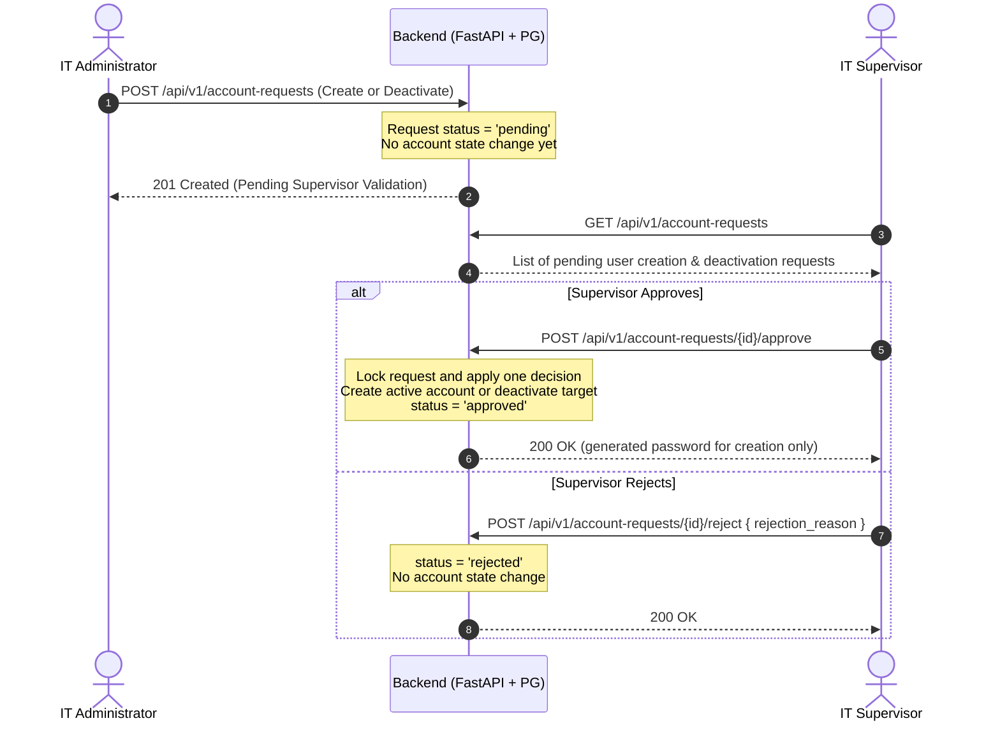
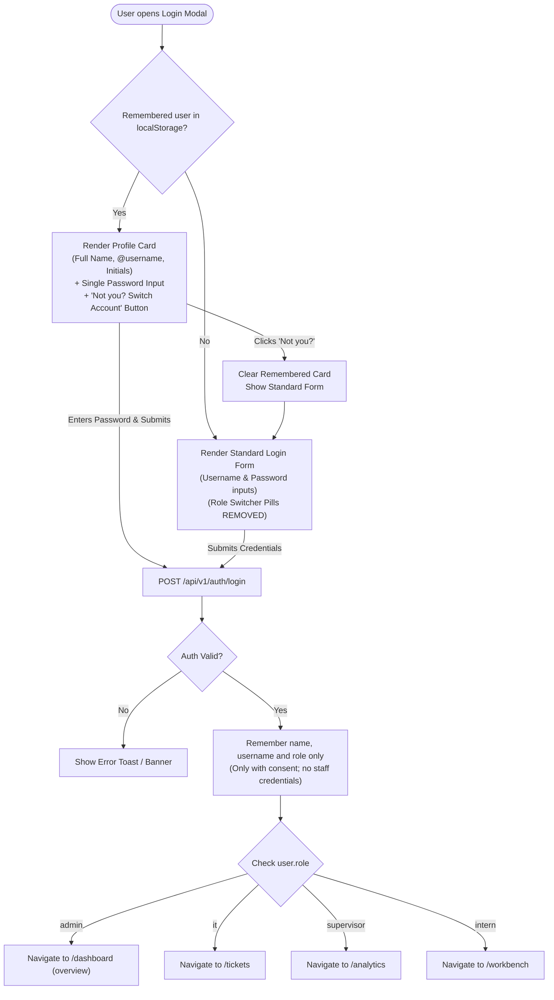

# Sprint 3.0 Implementation Plan: Governance, Security, Terminal Operations & Analytics Accuracy

**Status:** DRAFT for user review — implementation and GitHub publication await approval.

**Audited baseline:** `develop` at `5d0c14218e519a9b509409878ec4a88888c8e1ad` (2026-11-02). The older `docs/fe-be-sprint3.0` branch lacks newer backend changes.

**Split responsibilities:** [Backend — Jefferson](SPRINT-3.0-BACKEND-RESPONSIBILITIES.md) · [Frontend — Rafael](SPRINT-3.0-FRONTEND-RESPONSIBILITIES.md). These drafts define task IDs, shared contracts, handoffs, and acceptance.

**Audit:** [Ponytail report — 17 findings](Ponytail-Audit-2026-11-02.md). Fix access/session/data-integrity issues before marking feature work ready for release.

## Goal Description
Sprint 3.0 advances Tiketa from core 4-tier operational functionality into enterprise governance, robust authentication ergonomics, precision analytics reconciliation, and dynamic terminal configuration.

This plan addresses all items refined during the architectural interview:
1. **Account Governance**: Only IT Admins propose staff account creation or deactivation; IT Supervisors approve/reject them. Pending creation requests do not create an active login.
2. **Ergonomic & Secure Authentication**: Facebook-style single remembered staff profile (name, avatar, username) requiring password entry on return, a "Not you? Switch account" fallback, removal of the manual 4-role switcher buttons, and automatic post-login routing to dedicated role landing views.
3. **Analytics Accuracy**: Full mathematical reconciliation between backend report/KPI services (`backend/app/services/reports.py`) and frontend visual analytics (`Recharts` and Executive KPI cards).
4. **Editable PPTX Narratives**: An in-app editable explanation text box in the export modal allowing supervisors to modify the AI-generated commentary before PowerPoint generation.
5. **Live Chat Communication**: Two-way comments with active 3-second polling, complete latest/older history, auto-scroll, and server-enforced separation of employee messages from internal IT notes.
6. **Terminal Hubs & Locations Configuration**: A dedicated CRUD management interface for terminal stations and departments with confirmation dialogs and kiosk station confirmation.
7. **Viewport Clipping Bug Fix**: Fix CSS layout and flex alignment in `TerminalHubDetailModal` to eliminate top-edge browser clipping on smaller laptop screens.
8. **Lean Scope Reduction**: Completely eliminated Repair Notes image upload per Ponytail principles to avoid redundant storage architecture.
9. **Staff Profiles (added 2026-11-02)**: IT staff (`it`), Admins (`admin`), and Supervisors (`supervisor`) have a personal profile with initials as the default avatar and an optional uploaded profile photo.
10. **Historical Job-Log Migration (added 2026-11-03)**: Import past Excel/CSV logs through the existing developer CLI, with validation, source tracking, duplicate protection and reconciliation. New work is logged directly in Tiketa; no permanent web spreadsheet uploader.
11. **Monthly Reporting Filters (added 2026-11-03)**: Month and Year dropdowns above Standard Reports and Executive Analytics, defaulting to the current month and sharing one selected period across both screens, KPI cards, charts and exports. Cover all eight reports currently in code; do not remove reports based on the earlier reference to six.

---

## Shared API and PR Integration Contract (draft)

This section is the shared contract for both Sprint 3.0 tracks. It is proposed behavior, not a claim that these APIs are implemented or generated in OpenAPI. On approval, put the agreed wire details in the existing repository `docs/03-Contracts/API-INTEGRATION-MAP.md` and generate `backend/openapi.json` from code in the implementing PR. Replace conflicting old draft text rather than creating a second API specification.

### API changes and compatibility

All paths below start with `/api/v1`. Keep existing snake_case JSON, UUID identifiers, ISO date/timestamps, and FastAPI `detail` errors. Roles stay `intern | it | admin | supervisor`. Frontend DTOs, callers, fixtures, and error handling must change with the contract.

| Feature | New or changed contract | Owner and dependent task |
| --- | --- | --- |
| Profile photos | NEW `PUT /users/me/photo` (multipart `file`), `DELETE /users/me/photo`, authenticated `GET /users/{id}/photo`. ADD nullable `avatar_url` and `avatar_updated_at` to UserOut in login/refresh/me/directory responses. Existing users default to null. | B-04 → F-02 |
| Terminal configuration | NEW `POST /locations`, `PATCH /locations/{id}`, `POST /departments`, `PATCH /departments/{id}`; extend existing `POST /admin/location-departments` for reactivation and add `PATCH /admin/location-departments/{location_id}/{department_id}`. ADD active-state metadata to dictionaries and Admin-only `include_inactive=true`. | B-05 → F-04 |
| Hourly report | NEW `GET /reports/hourly-demand` with the existing date/company/location/department filters. Supervisor/Admin only; declare before the dynamic report-name route. | B-06 → F-05 |
| Job history | NEW `GET /tickets/history`, declared before the dynamic ticket-ID route; return TicketOut[] with bounded history, not the active queue. | B-01 → F-08 |
| Account governance | CHANGE existing account-request body/response fields and role permissions; keep existing create/list/approve/reject paths. Direct Admin creation/deactivation no longer bypasses Supervisor approval. | B-03 + F-03 in one cutover PR |
| Conversation history | ADD `order=asc|desc` to existing `GET /tickets/{id}/comments`, preserving its array response, offset/limit and default ascending order. New callers request the latest descending page. | B-07 → F-07 |
| Public intake and auth | No new endpoint. Tighten public match-token/session validation, ticket scope checks, and client staff/employee credential separation. Preserve existing valid login/refresh/logout response shapes. | B-01/B-02 + F-01 |
| PPTX export | No backend API change. Keep current report endpoints and ExportPptxModal caller props stable; commentary edits are passed locally into export assembly. | Jefferson F-06; Rafael reviews |
| Monthly report selection | Reuse existing `date_from`/`date_to` filters on reports, KPIs and CSV, plus the proposed hourly endpoint. No new period endpoint. | B-06 → F-05; F-06 export integration |
| Historical logs | Reuse `backend/scripts/seed_historical_logs.py` for developer-run CSV/XLSX migration; no upload API or frontend import screen. | B-09 → F-05/F-08 verification |

**Photos:** PUT returns 200 `{avatar_url, avatar_updated_at}`; DELETE returns 204; GET returns image bytes with the validated content type, private caching and nosniff, or 404 when absent. Writes are self-only for IT/Admin/Supervisor; reads require authenticated staff. Use 401/403 for access failures, 413 for the byte limit, 415 for unsupported format, and 422 for invalid decoded content/dimensions. Do not manually set JSON Content-Type for the multipart request; let the browser supply its boundary. Never include a bearer token in the image URL.

**Terminal records:** create body `{code,name,address?}` for a location, `{code,name}` for a department; create returns 201 with `{id,code,name,is_active}` (and address for a location). PATCH accepts only supplied editable fields and returns the saved record with 200; `is_active:false` means deactivation. Mapping writes take existing location/department UUIDs and return their saved active state. Duplicate identity or in-use deactivation returns 409, invalid scope/fields 422; no destructive deletion. Dictionary arrays retain their current names and ID fields, with active metadata added to location/department/membership entries.

**Hourly rows:** 200 `{date_from,date_to,timezone:"Asia/Manila",source_field:"started_at",rows:[{hour:"00:00",tickets:0},...]}`. Return all 24 ordered bins, using non-null actual repair-start timestamps and the documented date/scope filters. The UI labels repair starts accurately. PMS stays on the existing PMS report: aggregate planned coverage as `sum(min(completed_i,expected_i)) / sum(expected_i) * 100`; do not average row percentages or let excess on one plan cover missing work on another. No valid denominator, unplanned-only data, or company-filtered denominators means unavailable, not a fabricated percentage.

**Selected reporting month:** Use the first and last calendar dates of the selected month in Asia/Manila as explicit inclusive `date_from`/`date_to` values, including for the current month. This satisfies complete-month PMS validation. Preserve existing company/location/department filters and role permissions. Keep the selection in the existing report state across screen navigation; reset with session state. Do not add custom ranges, all-time queries or saved presets. Empty periods show "No records for this period"; failures remain errors. Refetch all affected data on period changes and fence late responses. CSV and PPTX requests, period labels and commentary use the same filter snapshot; preserve the export modal's existing validation and caller props.

**Job history:** query `status=ALL|OPEN|PROG|RESL|CLSD` (default ALL), `order=asc|desc` (default desc), `offset=0`, `limit=50` (max 200), optional location and technician UUID filters. Sort by `created_at,id` consistently. IT/Intern personal history is forced to the authenticated user's assignment UUID; an explicit different technician is denied. Admin/Supervisor may read fleet history with filters; the operational queue remains denied to Supervisor. Permission tests must cover all roles. Keep this query separate from active queue state and include scope in any cache key.

**Comments:** default limit 100, maximum 200. Sort by `created_at,id` in the requested direction and apply employee/internal-note filtering before paging. Canonical fields remain `id,body,is_internal,user_id,author_name,author_role,created_at`. The client requests newest pages and merges by server ID; the response is still CommentOut[], not a new envelope.

### Account contract and atomic policy cutover

- `POST /account-requests`, Admin only, returns 201 AccountRequestOut. Creation body: `{request_type:"create",username,email,full_name,role,location_id?,department?}`, where role is Intern/IT/Supervisor. Use the existing field `role`, not old documentation's `requested_role`. The request is pending; no active User exists until approval.
- Deactivation body: `{request_type:"deactivate",target_user_id:<UUID>}`; target identity/scope snapshots are supplied by the server. It does not disable the account before approval.
- AccountRequestOut retains existing fields and adds `request_type` and nullable `target_user_id`. Existing rows default to create/null; status remains `pending|approved|rejected`.
- `GET /account-requests` returns AccountRequestOut[]; add optional status and offset/limit (default 50, max 100). Keep the array shape. Admin/Supervisor may read their permitted governance scope; IT/Intern are denied by the final new policy.
- `POST /account-requests/{id}/approve`, Supervisor only, returns 200 `{request_type,user,temporary_password}`. Creation returns the newly active user and generated password; deactivation returns the inactive target user and `temporary_password:null`. Do not generate a deactivation password.
- `POST /account-requests/{id}/reject`, Supervisor only, takes `{rejection_reason}` and returns the saved AccountRequestOut with 200. It makes no account state change.
- Missing authentication is 401, forbidden role 403, missing request/target 404, duplicate or already-decided request 409, malformed input 422. Lock decision rows and update account/request in one transaction; a rejected outcome cannot leave a newly active account.
- Reuse the existing separate approve/reject endpoints. Do not implement the older map's proposed `/decision`, `/pending`, or `/admin/users/propose` routes.
- This is a breaking permission/behavior change for the current frontend. Backend B-03 and frontend F-03 must enter develop together in one reviewed feature PR. Do not merge a server policy that blocks the still-current account UI and plan to repair the UI later. Confirm an active Supervisor and last-privileged-account safeguards before the cutover.

### PR sequence and merge gates

Separate work ownership does not mean independently merging incompatible halves. Use feature-sized PRs from current develop; the broad track branch names are working branches, not a requirement for two large final PRs.

| Order | Merge unit | Rule for develop |
| --- | --- | --- |
| 0 | Contract + CI foundation (B-00/F-00) | Reconcile the existing API map with current code and this draft. Add existing frontend tests, a minimal real-browser flow and a required combined check before dependent feature merges. |
| 1 | Authorization/cache/session safety fixes | Preserve valid callers; include paired caller adjustments in the same PR if their behavior changes. Never retain an authorization hole solely for compatibility. |
| 2 | Additive backend APIs/schema | Photo metadata defaults null; new terminal/hourly/history routes and comment ordering are added without renaming existing fields/default shapes. Existing frontend must still type-check/build and pass its smoke flow. |
| 3 | Dependent frontend features | F-02/F-04/F-05/F-07/F-08 integrate only against APIs already merged in develop. Backend author provides the merged SHA, OpenAPI, sample payloads, errors and tested persisted IDs. |
| 4 | Account-governance cutover | Combine B-03 and F-03 commits into one integration feature branch/PR from current develop. Run both tiers and confirm old data plus new UI. Separate draft PRs for those halves must not both merge independently. |
| Independent | Jefferson's PPTX PR | F-06 may merge independently because it changes no backend API or modal caller contract; Rafael reviews export-specific changes and caller regression checks. |

Before every merge:
1. Update the candidate with the latest develop using the agreed repository Git workflow. Resolve overlaps on feature/integration branches; preserve unpublished work and do not force-push published history without separate authorization.
2. Test the same candidate tree for backend and frontend, including the PR merge result against current develop. Do not certify a feature that only works with an unmerged companion branch.
3. Run pytest with the existing coverage gate, Ruff, migration/drift checks, OpenAPI export check, frontend tests/type-check/build and the real-browser smoke. No path filters may skip the combined gate for either tier or deployment files.
4. Confirm one linear Alembic head, upgrades from representative existing data and an unchanged pre-existing frontend against additive API changes. Keep schema/OpenAPI/client fixtures together; no destructive reset.
5. Add changed-feature evidence: UI write → returned UUID/status → independent read → reload/second browser; include validation, permission, expiry, failure and relevant concurrency cases.
6. Obtain the other developer's review of shared contracts/caller changes. Only Jefferson performs merges; no automatic merge or deployment.
7. Repeat the smoke on develop after the merge. If it fails, stop dependent merges and make a focused repair; do not continue stacking features over a broken integration branch.

**Verified enforcement gap (2026-11-02):** GitHub reports develop `protected:false` and required status checks off. The visible ruleset does not require any status checks. The current Full-Stack Integration Gate runs backend checks and frontend type/build, but no frontend test suite or real-browser flow. Repository notes describing protection/integration are intentions, not current enforcement.

**S0 action after approval:** implement the combined test job, then configure/verify develop protection to require that exact check, an up-to-date tested candidate and peer review. Do not rely on an administrative bypass. Capture the actual settings and passing run links before the first implementation merge. Settings have not been changed during planning; if enforcement cannot be configured, stop the merge and report the gap.

Each PR records: task IDs; backend/frontend owner; candidate and develop SHAs; endpoint/schema/migration changes; check results; persisted test UUID; independent read/reload evidence; reviewer; blocker/status. Draft → API ready → Connected → Verified → Merged requires evidence at each step.

---


## Architecture & Workflows

### 1. Account Approval Workflow (Admin Propose $\rightarrow$ Supervisor Validate)



### 2. Facebook-Style Remembered Login & Automatic Role Navigation



---

## User Review Required

> [!IMPORTANT]
> **Account Approval Shift**: The draft makes Admin the proposer and Supervisor the reviewer, with no Admin approval bypass. Reuse existing account-request routes and statuses; remove legacy direct creation/deactivation bypasses. Verify an active Supervisor exists before activating the policy. See Backend B-03 for concurrency and last-privileged-account safeguards.

> [!NOTE]
> **No Repair Notes Image Upload**: Per your explicit instruction, image uploads for Repair Notes remain **cancelled**. Optional staff profile photos are included in Component 1 per the 2026-11-02 scope addition.

---

## Proposed Changes

### Component 1: Authentication, Staff Profiles & Facebook-Style Remembered Login

#### [MODIFY] [`frontend/src/features/auth/StaffLoginModal.tsx`](file:///C:/Users/Kanor/Documents/FS_Projects/Tiketa/frontend/src/features/auth/StaffLoginModal.tsx)
- Remove the 4-pill role switcher buttons (`IT Support`, `Intern`, `Supervisor`, `Admin`).
- Implement Facebook-style remembered user mode:
  - Check `localStorage.getItem('tiketa_remembered_staff')`.
  - If present: render a clean user card with user's full name, `@username`, operational role badge, a single password input, and a "Not you? Switch account" button.
  - If "Not you?" is clicked, fall back to clean username + password inputs.
- On successful login, save `{ username, full_name, role }` (never store plain passwords in localStorage).

#### [MODIFY] [`frontend/src/store/slices/authSlice.ts`](file:///C:/Users/Kanor/Documents/FS_Projects/Tiketa/frontend/src/store/slices/authSlice.ts)
- Update `loginWithApi` to inspect `data.user.role` and automatically invoke `setActiveView`:
  - `admin` $\rightarrow$ `'overview'`
  - `it` $\rightarrow$ `'tickets'`
  - `supervisor` $\rightarrow$ `'analytics'`
  - `intern` $\rightarrow$ `'workbench'`
- Fix `logoutToKiosk`: remembering a profile must revoke the server session and clear `currentUser`, not retain staff access. Keep only the consented profile card in `localStorage`; show failed revocation honestly and prevent automatic restoration until sign-out is confirmed. See Frontend F-01.

#### Staff Profile & Avatar (added 2026-11-02)
- IT staff (`it`), Admins (`admin`), and Supervisors (`supervisor`) can open their own profile showing their name, username, role, and avatar.
- Default avatar: derive initials from the staff member's name (e.g. Jefferson Lopez → `JL`); use the available initial for a single name and the username initial if the name is missing.
- Provide an optional **Upload photo** action; allow replacing or removing the photo, with removal restoring initials. Missing or failed images also fall back to initials.
- Use the same avatar renderer in the authenticated profile, staff header and team directory. Logged-out remembered cards use initials so private photos need no public endpoint; never retain image bytes or credentials in `localStorage`.
- Add photo metadata to user responses and one encrypted photo row per user, using existing database/encryption conventions. Keep blobs out of ordinary auth/directory queries. Backend B-04 and Frontend F-02 define storage, API, and all affected mappings.
- Authorize profile-photo changes against the authenticated user's own account. Decode and validate JPEG/PNG/WebP server-side (maximum 2 MiB input, 4096 pixels per side), normalize to a bounded thumbnail, and reject invalid uploads without losing the previous photo. Photos remain behind staff authentication.
- Keep upload controls keyboard accessible, label them clearly, and announce validation errors. Avatars must retain an accessible staff name.

---

### Component 2: Account Governance & Validation (Admin $\rightarrow$ Supervisor)

#### [MODIFY] [`backend/app/api/account_requests.py`](file:///C:/Users/Kanor/Documents/FS_Projects/Tiketa/backend/app/api/account_requests.py)
- Update `submit_account_request`: restrict creator to `Admin` (`admin: Admin`), allowing admins to propose staff accounts (intern, it, supervisor) with existing request status `pending`. Create the active user only on approval.
- Add support for `request_type: Literal['create', 'deactivate']` so admins can also submit deactivation requests for supervisor sign-off.
- Restrict approval/rejection to Supervisor (`require_roles('supervisor')`); lock the request before checking status, return 409 for a competing decision, and commit the decision and account state together. See B-03 for normalization, pending uniqueness, revocation, and last-privileged-account protection.

#### [MODIFY] [`backend/app/models/account_request.py`](file:///C:/Users/Kanor/Documents/FS_Projects/Tiketa/backend/app/models/account_request.py)
- Add `request_type: Mapped[str] = mapped_column(String(20), default='create')` (supports `create` and `deactivate`).
- Add a nullable target-user UUID for deactivation requests, validated against server-owned account details.

#### [NEW] Forward Alembic revision after the actual migration head
- Add request type, target-user reference, role validation and pending uniqueness without deleting existing accounts/requests. Coordinate revision numbering with the photo/configuration changes; do not reuse old migration numbers or perform destructive downgrade cleanup.

#### [NEW] [`frontend/src/features/team/components/PendingApprovalsQueue.tsx`](file:///C:/Users/Kanor/Documents/FS_Projects/Tiketa/frontend/src/features/team/components/PendingApprovalsQueue.tsx)
- Dedicated table in `TeamAdministrationView` for Supervisors:
  - Displays pending accounts created by Admins.
  - **Approve** creates the active user and returns generated credentials for creation, or deactivates the target for a deactivation request. **Reject** requires a reason and leaves account state unchanged.
  - Admin view shows "Pending Supervisor Sign-Off" status badges.

---

### Component 3: Terminal Hubs, Departments & Locations CRUD & Confirmation

#### [NEW] [`frontend/src/features/terminals/TerminalConfigurationView.tsx`](file:///C:/Users/Kanor/Documents/FS_Projects/Tiketa/frontend/src/features/terminals/TerminalConfigurationView.tsx)
- Administrative CRUD view for Terminal Hubs, Station Codes, Locations, and Departments.
- Add Station Modal & Edit Department Modal with confirmation before deactivation or status changes. Preserve history and show in-use conflicts rather than deleting referenced records.

#### [MODIFY] [`backend/app/api/locations.py`](file:///C:/Users/Kanor/Documents/FS_Projects/Tiketa/backend/app/api/locations.py)
- Implement Admin configuration using existing models and mapping routes (Backend B-05):
  - `POST /api/v1/locations` (Create Terminal Hub)
  - `PATCH /api/v1/locations/{location_id}` (Update Hub/Code)
  - `POST /api/v1/departments` and `PATCH /api/v1/departments/{department_id}`
  - Reuse `POST /api/v1/admin/location-departments` for linking/reactivation; add `PATCH /api/v1/admin/location-departments/{location_id}/{department_id}` for active state.
  - Extend dictionaries with active-state metadata and an Admin-only inactive-record query; update scope validation and all affected intake/hub readers.

#### [MODIFY] [`frontend/src/features/kiosk/components/KioskIntakeForm.tsx`](file:///C:/Users/Kanor/Documents/FS_Projects/Tiketa/frontend/src/features/kiosk/components/KioskIntakeForm.tsx)
- Add a terminal hub station confirmation step when logging a ticket: clearly shows the designated station (e.g. `Pasay (PSY)`) with a prompt to confirm before final submission.

---

### Component 4: Terminal Hub Modal Viewport Clipping Fix

#### [MODIFY] [`frontend/src/features/terminals/TerminalHubDetailModal.tsx`](file:///C:/Users/Kanor/Documents/FS_Projects/Tiketa/frontend/src/features/terminals/TerminalHubDetailModal.tsx)
- Fix the backdrop container: change `items-center justify-center p-4` to `overflow-y-auto p-4 sm:p-6 flex items-start sm:items-center justify-center min-h-screen`.
- Change modal card: `max-h-[90vh]` $\rightarrow$ `max-h-[85vh] my-auto`.
- Ensure headers have `sticky top-0 z-20` and body tabs use `overflow-y-auto` so content never overflows past the top viewport boundary.

---

### Component 5: Analytics & Reports Precision Reconciliation

#### [MODIFY] [`backend/app/services/reports.py`](file:///C:/Users/Kanor/Documents/FS_Projects/Tiketa/backend/app/services/reports.py) & [`frontend/src/features/analytics`](file:///C:/Users/Kanor/Documents/FS_Projects/Tiketa/frontend/src/features/analytics)
- Follow Backend B-06 and Frontend F-05 with known-result data rather than rewriting established reporting rules:
  - Preserve negative transit lag and its existing data-review flag; never silently clamp it.
  - Replace the constant hourly sample series with server-grouped repair starts (`started_at`) in Asia/Manila, labelled accurately.
  - Remove fabricated fallback figures. Keep SLA compliance aligned with Report 1 (`Monthly SLA`), and source PMS coverage from Report 7 rather than same-day resolution.
  - Fetch each selected report's own data and keep the transit-lag widget's result separate; do not reinterpret one shared result as all eight report types.

#### Month and Year controls (added 2026-11-03; B-06/F-05/F-06)
- Rafael adds labelled, keyboard-accessible Month and Year dropdowns at the top of Standard Reports and Executive Analytics using the existing report-filter state and UI patterns. Default to the current Asia/Manila month; allow earlier years containing migrated records without a fixed recent-month cutoff.
- Label the current calendar month as in progress, even though its filter includes the full month.
- Refresh report tables, KPI cards, transit-lag and real hourly series together for the selected month. Clear or visibly mark stale content during loading/errors; never show previous-period figures under a new period label.
- Rafael owns screen/state/API wiring and CSV; Jefferson owns PPTX modal/export integration under F-06, with Rafael reviewing. Opening the modal starts from the selected month; export-only changes remain explicit and cannot silently relabel the screen.
- Acceptance: select a previous month and a previous year, navigate between both screens, and confirm API/UI/CSV/PPTX agree. Cover an empty month, leap-year February, December/January and rapid selection changes with delayed responses.

---

### Component 6: In-App Editable PPTX Narrative & Typography

**Implementation owner:** Jefferson Lopez (frontend task F-06). **Reviewer:** Rafael Emmanuel Codiñera. Use a separate `feat/frontend-pptx-export-fix` branch from current develop after approval, limited to export files/modal/tests with stable API and caller contracts. See the [explicit handoff and published overlap check](SPRINT-3.0-FRONTEND-RESPONSIBILITIES.md#f-06--editable-pptx-commentary-and-overlap-free-typography).

#### Typography Decision (2026-11-02; verified against GitHub)
- **Keep Arial for all exported slide text and chart labels.** Use Arial Bold for titles and key findings, and Arial Regular for periods, commentary, axes, and legends. This supersedes the earlier Aptos suggestion: Arial already matches both export renderers and avoids introducing another font installation/loading requirement. Arial is included in [Windows 10](https://learn.microsoft.com/en-us/typography/fonts/windows_10_font_list) and [Windows 11](https://learn.microsoft.com/en-us/typography/fonts/windows_11_font_list); verify availability on the actual export and presentation machines.
- **Verified baseline:** `develop` at [`5d0c142`](https://github.com/jfflpz/Tiketa2.0/commit/5d0c14218e519a9b509409878ec4a88888c8e1ad). [`pptxSlideBuilder.ts`](https://github.com/jfflpz/Tiketa2.0/blob/5d0c14218e519a9b509409878ec4a88888c8e1ad/frontend/src/features/reports/export/pptxSlideBuilder.ts) sets Arial at 44 pt for titles, 30 pt for periods, and 16 pt for commentary; title and period currently share one text box. [`ExportChartRenderer.tsx`](https://github.com/jfflpz/Tiketa2.0/blob/5d0c14218e519a9b509409878ec4a88888c8e1ad/frontend/src/features/reports/export/ExportChartRenderer.tsx) uses `Arial, sans-serif` with most chart labels at 16–19 px. These two files have identical blobs on `docs/fe-be-sprint3.0` at `61fa31d`. The app UI's configured Inter family is separate from the export font.
- **Target hierarchy:** 36 pt bold title, 22 pt regular reporting period in its own text box, and 18 pt regular commentary with bold key metrics. Retain the 16:9 slide and chart proportions; adjust text frames and chart clearances to fit the longest titles and edited commentary without overlap or silent truncation.
- **Chart readability:** target 14–16 pt on the final slide for axes, data labels, and legends. The current 1896 px image placed at 11.54 inches scales 16–19 px labels to about 7–8 pt, so PNG resolution alone does not make text readable. Start around 32–36 px in the export canvas, then verify dense and dual-panel reports and adjust tick wrapping, plot margins, and legend clearance.
- Keep native slide text editable. Charts remain PNG captures in this sprint; verify font readiness before capture using the existing `chartCapture.ts` flow.

#### [MODIFY] [`frontend/src/features/reports/components/ExportPptxModal.tsx`](https://github.com/jfflpz/Tiketa2.0/blob/5d0c14218e519a9b509409878ec4a88888c8e1ad/frontend/src/features/reports/components/ExportPptxModal.tsx)
- Render the generated commentary in an interactive `textarea` / editable card in the export modal preview.
- Allow the supervisor to edit, augment, or replace the narrative prior to clicking "Download Presentation".
- Pass the edited narrative directly to `exportPptx.ts`.

#### [MODIFY] [`frontend/src/features/reports/export/ExportChartRenderer.tsx`](file:///C:/Users/Kanor/Documents/FS_Projects/Tiketa/frontend/src/features/reports/export/ExportChartRenderer.tsx)
- Apply the Arial chart hierarchy above across all 8 reports, including wrapped ticks, legends, data labels, panel headings, and the empty state. Fix bottom margins so wrapped labels and legends remain separate.

#### Fix: Overlapping Text Below Graphs (2026-11-02)
- **Recorded issue:** category labels beneath the graph overlap each other and/or the legend. The [2026-10-29 diagnosis](../../02-Journal/Daily/2026-10-29.md) identified insufficient bottom clearance; the inspected renderer uses 25–30 px bottom margins, fixed 22 px tick line spacing, and bottom-aligned legends. Enlarging fonts must include a layout adjustment.
- In `ExportChartRenderer.tsx`, reserve separate vertical areas for the plot, X-axis labels, and legend. Set explicit X-axis height for the wrapped text; place the legend in its own row within the captured canvas so it cannot cover axis labels. Let the plot use the remaining height.
- Wrap category labels to the available tick width using the final Arial font size and matching line height. Prevent adjacent labels from touching, and remove the current silent two-line clipping where it hides label text; keep labels readable without shrinking below the planned slide size.
- Start with the previously recorded 75 px bottom-clearance baseline, then size the label area to the actual wrapped lines at the larger export font size. Reserve the legend's own height, including wrapped entries, plus at least 12 px separation from labels; do not treat 75 px as sufficient for every report.
- Apply the fix to both full-width and dual-panel charts. Keep every label and legend inside the captured image; maintain a separate commentary frame below it with at least 0.2 inches of clear space, including for edited multiline commentary.
- **Acceptance:** category labels, neighboring tick labels, legend entries, and commentary have no intersecting text bounds or clipped lines in any of the 8 exported reports.

#### [MODIFY] [`frontend/src/features/reports/export/pptxSlideBuilder.ts`](file:///C:/Users/Kanor/Documents/FS_Projects/Tiketa/frontend/src/features/reports/export/pptxSlideBuilder.ts)
- Apply the Arial slide hierarchy above and split title and period into separate text boxes in `addExecutiveReportSlide`.
- Refine line height and text box wrapping so customized multi-line narratives do not overlap chart margins or footer edges. Set the presentation theme to Arial as well as the explicit text runs so newly edited text stays consistent.

---

### Component 7: Live Chat Full Two-Way Communication & Isolation

#### [MODIFY] [`frontend/src/components/tickets/drawer/JobLogDrawerChat.tsx`](file:///C:/Users/Kanor/Documents/FS_Projects/Tiketa/frontend/src/components/tickets/drawer/JobLogDrawerChat.tsx)
- Shorten polling interval to 3 seconds while chat drawer is active.
- Add auto-scroll to the latest message on arrival.
- Provide toggle for "Send as Internal Note" vs "Send to Employee", with distinct visual styling (yellow background for internal, dark/neutral for public).

#### [MODIFY] [`frontend/src/features/kiosk/components/TicketConversation.tsx`](file:///C:/Users/Kanor/Documents/FS_Projects/Tiketa/frontend/src/features/kiosk/components/TicketConversation.tsx)
- Sync with 3-second polling.
- Enforce internal-note exclusion on the server before pagination, with defensive client filtering (`!m.isInternal`). Use latest/older pages so message 101 appears, canonical author fields, and polling cancellation across visibility/ticket/session changes. See B-07/F-07.

---

### Component 8: One-Time Historical Job-Log Migration (added 2026-11-03)

**Owner:** Jefferson, B-09. **Frontend verification:** Rafael, F-05/F-08. Reuse `backend/scripts/seed_historical_logs.py` and its existing import/report tests; repair only gaps found against the actual legacy files.

**Business decisions (2026-11-03):** Map historical `Done` to resolved without inventing employee closure confirmation. Preserve every recorded technician and make the job visible in each technician's permitted personal history. Completed records with missing times remain in history; time-dependent metrics are unavailable when their required values are missing. Count a shared job once for each participating technician in individual productivity and once overall in company totals. Preserve a recorded shared job duration, but show individual labor time as unavailable when the source does not specify each technician's time; do not split or duplicate it.

- Map legacy columns, reference identities and statuses before importing. Preserve original dates, workers and recorded outcomes; retain unknown optional values and flag missing required data instead of fabricating it.
- Preview validation results and rejected rows, retain source/batch provenance, and verify reruns cannot duplicate work or overwrite existing Tiketa records. Historical imports must not send new-ticket notifications or start approval/closure flows.
- Rehearse on a disposable database, back up before the operational import, and document recovery that preserves unrelated records. Reconcile input/imported/rejected/duplicate counts and sample records after import.
- Imported history must be readable under existing permissions. Include records in timestamp-dependent metrics only when the required source values exist; do not manufacture repair timestamps or PMS plans to fill reports.
- Complete the rehearsal and historical fixtures in S3 before joint report acceptance; schedule the operational import at cutover after backup/recovery review. This plan update does not execute a live import.

---

## Verification Plan

### Automated Tests
Include B-09 rerun/validation/recovery checks and F-05 monthly-filter integration checks: previous year, leap February, December/January, empty periods, delayed responses, and API/UI/CSV/PPTX filter agreement. Preserve existing authorization and complete-month PMS checks.

1. **Account Approval Tests**:
   - `tests/test_account_governance.py`:
     - Admin proposes creation $\rightarrow$ request is `pending`, with no active login (`401`).
     - Supervisor lists pending accounts and calls `/approve` $\rightarrow$ temporary password generated, user becomes `active`.
     - Supervisor calls `/reject` $\rightarrow$ account marked `rejected`.
     - Admin, Intern or IT Tech attempting to approve $\rightarrow$ `403 Forbidden`; competing decisions return 409.
2. **Terminal CRUD Tests**:
   - `tests/test_locations_crud.py`:
     - Test Admin creating, updating, and deactivating terminal stations and departments.
3. **Analytics Reconciliation Tests**:
   - Run existing suite:
     ```bash
     docker compose -f docker-compose.test.yml run --rm backend pytest -q --cov=app --cov=scripts --cov-report=term-missing
     ```
4. **Linters & Contracts**:
     ```bash
     docker compose -f docker-compose.test.yml run --rm backend ruff check .
     docker compose -f docker-compose.test.yml run --rm backend ruff format --check .
     docker compose -f docker-compose.test.yml run --rm backend python -m scripts.export_openapi --check
     ```
5. **Frontend Build & Types**:
     ```bash
     cd frontend && npm test && npm run type-check && npm run build
     ```
6. **Staff Profile & Avatar Tests**:
   - Verify initials for full, single, and missing names, plus fallback when a photo fails to load.
   - Verify each supported role can upload, replace, and remove its own photo, with persistence after refresh/login and initials restored on removal.
   - Reject unauthenticated uploads, changes to another user's photo, disallowed or malformed images, oversized files, and excessive decoded dimensions; failed uploads preserve the previous photo.
7. **PPTX Typography Regression Tests**:
   - Extend `frontend/tests/exportPptx.test.tsx` to verify separate title/period frames, the Arial font and size hierarchy, preserved bold commentary runs, and updated element bounds. Automated bounds checks do not replace rendered overflow verification.
   - Add a browser-rendered regression case with long department/location names, 10 categories, and a wrapping legend, covering full-width and dual-panel charts. After fonts/layout settle, assert rendered tick text, legend rows, and canvas bounds do not intersect or clip; a mocked Recharts render cannot verify this issue.

### Manual Verification
Verify historical counts and sampled dates/workers/statuses after rehearsal. Select that historical month in both reporting screens and compare tables, KPI cards, charts and exports; confirm closed imports cause no operational notifications or approval flows.

1. **Facebook-Style Login**:
   - Log in as `admin`, log out with profile remembering enabled; verify server session revocation.
   - Reopen login: verify user card shows `IT Administrator` with only a password field.
   - Click "Not you? Switch account": verify clean form appears without role buttons.
   - Log in as each role (`admin`, `it`, `supervisor`, `intern`) and verify automatic redirect to their respective landing screens (`/dashboard`, `/tickets`, `/analytics`, `/workbench`).
2. **Terminal Hub Modal**:
   - Resize browser to 1366x768 and open a Terminal Hub modal. Verify header and close button never clip past the top viewport edge.
3. **PPTX Export**:
   - Open Report 5, edit the commentary in the export modal, export `.pptx`, and verify PowerPoint displays the edited text.
   - Export all 8 reports with long titles, dense category labels, dual-panel charts, empty data, and multiline commentary. Inspect in PowerPoint on a target office PC at slideshow size: Arial resolves correctly, chart labels are readable, and titles, periods, legends, and commentary do not collide or clip. Check a machine without Arial separately for substitution behavior; exact layout is not guaranteed there.
   - Reproduce the previously overlapping text beneath graphs with long labels and wrapped legends. Inspect both the captured PNG and final slide: labels occupy their own rows, legend text stays separate, and commentary begins below the chart with clear spacing.
4. **Live Chat**:
   - Open Kiosk chat in one browser window and Tech Workbench chat in another. Verify two-way messaging within 3 seconds, and verify internal IT notes do not show on the kiosk.
5. **Staff Profiles**:
   - For IT staff, Admin, and Supervisor accounts, verify initials appear before upload, then check the uploaded photo in the authenticated profile, staff header and team directory. After sign-out, the remembered card shows initials and requires a password.
   - Replace and remove the photo, refresh, and verify the current avatar persists. Check keyboard operation, accessible labels, and clear upload errors.
