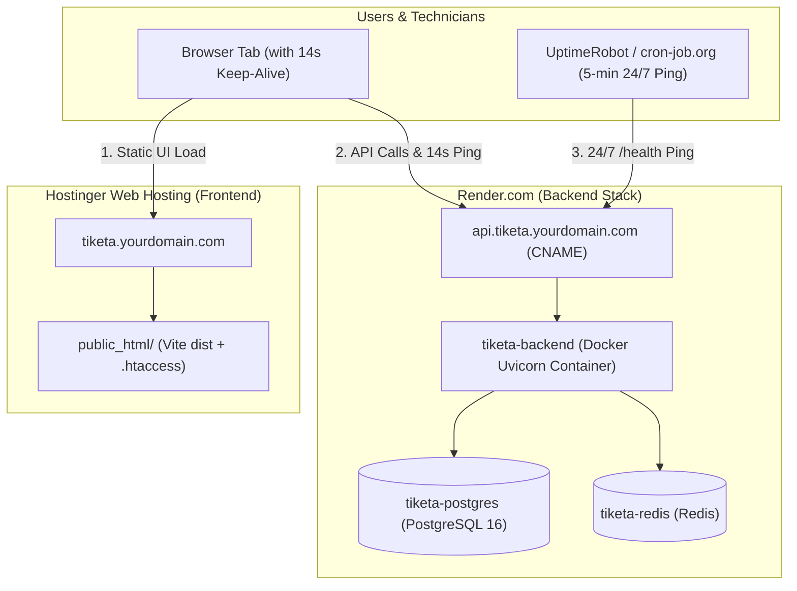

# Production Deployment Runbook: Render (Docker Backend) & Hostinger (Frontend)

**Project:** Tiketa 2.0  
**Stack:**
- **Backend / DB / Cache**: Render.com (Docker Web Service, Managed PostgreSQL 16, Redis)
- **Frontend**: Hostinger Web Hosting (Static React Vite SPA, Apache `.htaccess`)
- **Keep-Alive**: 14-second in-app browser ping + 5-minute external monitor (eliminates cold starts)

---

## 1. System Architecture



---

## 2. Pre-Deployment Code Checklist

### A. Frontend Keep-Alive (Prevents Sleep During Work)
In `frontend/src/App.tsx`, inside the main `useEffect`:

```tsx
    // Keep Render container warm and eliminate cold starts
    const healthUrl = new URL('/health', import.meta.env.VITE_API_BASE_URL || window.location.origin).href;
    const keepAlive = setInterval(() => {
      fetch(healthUrl, { mode: 'cors' }).catch(() => {});
    }, 14000);
    return () => clearInterval(keepAlive);
```

### B. Client-Side Routing for Hostinger (`.htaccess`)
Create `frontend/public/.htaccess` so Apache/LiteSpeed rewrites SPA routes to `index.html`:

```apache
<IfModule mod_rewrite.c>
  RewriteEngine On
  RewriteBase /
  RewriteRule ^index\.html$ - [L]
  RewriteCond %{REQUEST_FILENAME} !-f
  RewriteCond %{REQUEST_FILENAME} !-d
  RewriteRule . /index.html [L]
</IfModule>
```

### C. Backend URL & Port Normalization for Render
1. In `backend/app/core/config.py`, auto-convert `postgres://` to `postgresql+asyncpg://`:
```python
    @field_validator("DATABASE_URL", mode="before")
    @classmethod
    def assemble_db_url(cls, v: Any) -> str:
        if isinstance(v, str):
            if v.startswith("postgres://"):
                return v.replace("postgres://", "postgresql+asyncpg://", 1)
            if v.startswith("postgresql://") and not v.startswith("postgresql+asyncpg://"):
                return v.replace("postgresql://", "postgresql+asyncpg://", 1)
        return v
```
2. In `backend/Dockerfile`, ensure dynamic port binding:
```dockerfile
CMD ["sh", "-c", "uvicorn app.main:app --host 0.0.0.0 --port ${PORT:-8000} --no-proxy-headers"]
```

---

## 3. Tomorrow's Step-by-Step Deployment Guide

### Phase 1: Deploy Backend Stack on Render

1. **Commit & Push Code**:
   ```powershell
   cd C:\Users\Kanor\Documents\FS_Projects\Tiketa
   git add .
   git commit -m "chore: prepare production deployment for Render and Hostinger"
   git push origin main
   ```

2. **Create Render PostgreSQL & Redis**:
   - In [dashboard.render.com](https://dashboard.render.com):
   - **PostgreSQL**: Click **New +** -> **PostgreSQL**.
     - Name: `tiketa-postgres`
     - Database: `tiketa_db`
     - Region: `Singapore`
     - Copy the **Internal Database URL** and **External Database URL**.
   - **Redis**: Click **New +** -> **Redis** (or connect Upstash Redis).
     - Name: `tiketa-redis`
     - Region: `Singapore`
     - Copy the **Internal Redis URL**.

3. **Create Render Docker Web Service**:
   - Click **New +** -> **Web Service**.
   - Connect repository `jfflpz/Tiketa2.0`.
   - Runtime: **Docker**
   - Dockerfile Path: `./backend/Dockerfile`
   - Docker Context: `./backend`
   - Region: `Singapore`
   - **Environment Variables**:
     - `DATABASE_URL`: *(Paste Internal Database URL from Step 2)*
     - `REDIS_URL`: *(Paste Internal Redis URL from Step 2)*
     - `SECRET_KEY`: `openssl rand -hex 32`
     - `APP_FIELD_ENCRYPTION_KEY`: `python -c "import secrets, base64; print(base64.b64encode(secrets.token_bytes(32)).decode())"`
     - `CORS_ORIGINS`: `["https://tiketa.yourcompany.com"]`
     - `PUBLIC_BASE_URL`: `https://tiketa.yourcompany.com`
     - `ENVIRONMENT`: `production`
     - `BUSINESS_TIMEZONE`: `Asia/Manila`
     - `SMTP_STARTTLS`: `true`
     - `PORT`: `8000`

4. **Seed Live Database (1,239 Tickets & Technician Accounts)**:
   - Export your local database:
     ```powershell
     docker compose exec -T db pg_dump -U tiketa_admin -d tiketa_db --no-owner --no-acl > tiketa_dump.sql
     ```
   - Restore into Render PostgreSQL:
     ```powershell
     psql "<RENDER_EXTERNAL_DATABASE_URL>" -f tiketa_dump.sql
     ```

---

### Phase 2: Deploy Frontend on Hostinger

1. **Build Static Bundle with Production API URL**:
   ```powershell
   cd C:\Users\Kanor\Documents\FS_Projects\Tiketa\frontend
   $env:VITE_API_BASE_URL="https://api.tiketa.yourcompany.com/api/v1"
   npm run build
   ```

2. **Upload to Hostinger**:
   - Open **Hostinger hPanel** -> **Websites** -> **File Manager**.
   - Navigate to `public_html/` (or `public_html/tiketa/` if using a subdomain).
   - Upload all files from `frontend/dist/` into this folder.
   - In Hostinger hPanel -> **Security** -> **SSL**: ensure Let's Encrypt SSL is active.

---

### Phase 3: Hostinger DNS Records

In Hostinger hPanel -> **DNS / Nameservers**:

| Type | Name | Content / Points To | TTL | Purpose |
| :--- | :--- | :--- | :--- | :--- |
| **CNAME** or **A** | `tiketa` | Hostinger IP (default) | 300 | Routes frontend UI |
| **CNAME** | `api.tiketa` | `tiketa-backend.onrender.com` | 300 | Routes backend API |

*In Render Web Service -> **Settings** -> **Custom Domains**: Add `api.tiketa.yourcompany.com` (Render verifies and generates free SSL).*

---

### Phase 4: Configure 24/7 Zero-Cold-Start Pinger

1. Register at [cron-job.org](https://cron-job.org) or [uptimerobot.com](https://uptimerobot.com) (free).
2. Create an **HTTP Monitor**:
   - **URL**: `https://api.tiketa.yourcompany.com/health`
   - **Schedule**: Every 5 minutes.
3. *Outcome*: Render receives continuous lightweight traffic, eliminating sleep/cold starts 24 hours a day.

---

## 4. Future Zero-Downtime Migration Back to Hostinger VPS

When VPS budget is approved ($5–$7/mo):
1. Buy Hostinger VPS -> Install Docker.
2. Clone repository: `git clone https://github.com/jfflpz/Tiketa2.0.git`.
3. Backup Render DB: `pg_dump "<RENDER_EXTERNAL_DATABASE_URL>" > prod.sql`.
4. Restore to VPS DB: `docker compose up -d db && docker exec -i tiketa-postgres psql -U tiketa_admin -d tiketa_db < prod.sql`.
5. Start stack: `docker compose up -d`.
6. Change Hostinger DNS `tiketa` and `api.tiketa` to point to VPS IP address.
7. Switch complete in 15 minutes with zero code rewrite.
