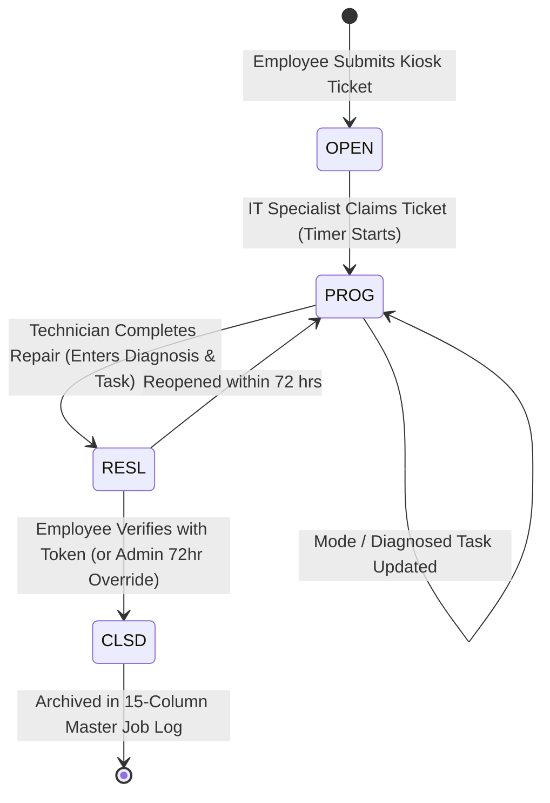
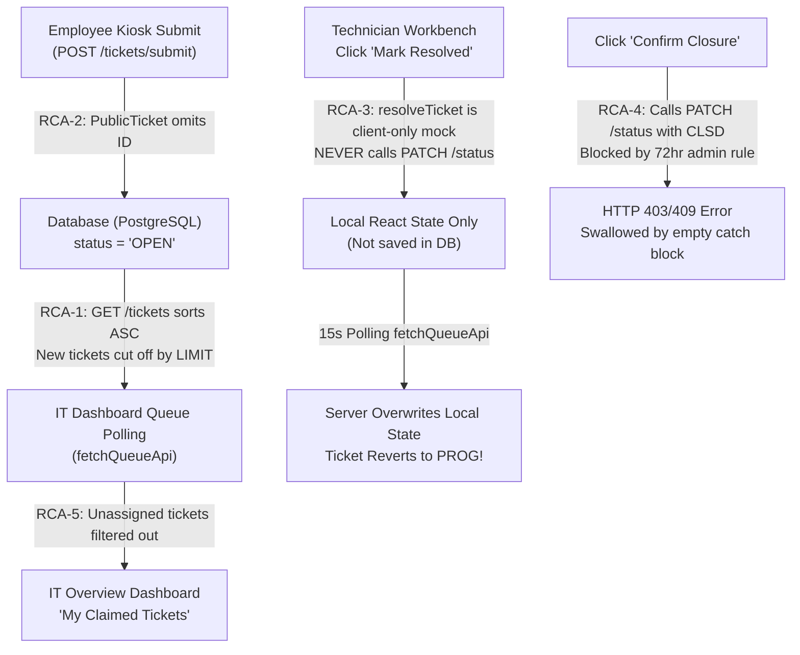
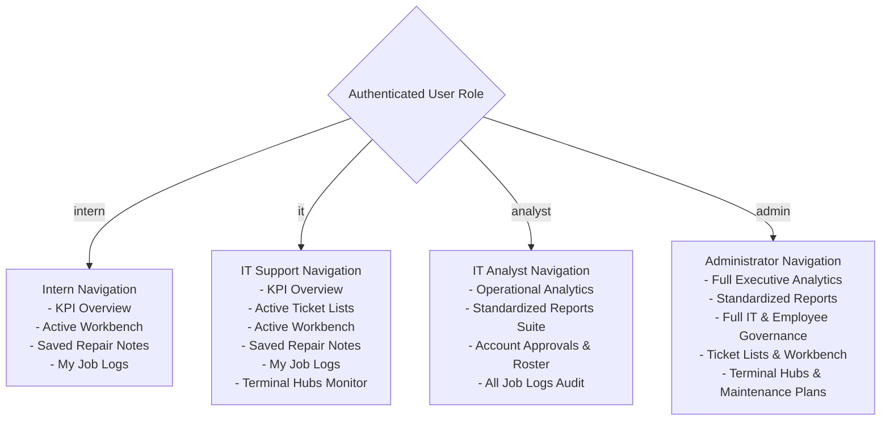
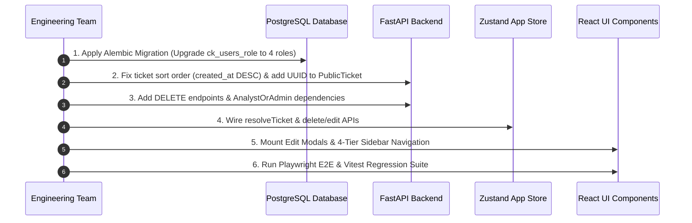

# 🛡️ Tiketa 2.0: Comprehensive Workflow Audit, Root Cause Analysis & 4-Tier RBAC Specification

**Document Version:** 1.0.0  
**Date:** October 24, 2026  
**Author:** Senior Systems Analyst & Lead Full-Stack Architect  
**Classification:** Enterprise Engineering Specification & Quality Assurance Audit  
**Target Systems:** `Tiketa2.0` (FastAPI 0.115+ Async Backend, PostgreSQL 16 3NF, Redis 7.4+, React 18 TypeScript, Tailwind CSS)

---

## Executive Summary

Following our system-wide quality assurance audit and supervisor consultation, this document provides an exhaustive, root-cause diagnostic of the entire IT ticketing lifecycle in **Tiketa 2.0**—tracing data flow from **Ticket Creation**, through **Ticket Processing (Workbench & Diagnosis)**, **Master 15-Column Job Logs**, **Executive Reporting & SLA Metrics**, to **Account Creation & Directory Governance**.

Furthermore, this specification designs a revised, battle-tested **4-Tier Role-Based Access Control (RBAC)** architecture replacing the legacy 2-tier binary model, incorporating explicit permissions, route guards, API contract schemas, and an Account Creation Approval workflow.

---

## Table of Contents

1. [Workflow Walkthrough & Behavior Clarifications](#1-workflow-walkthrough--behavior-clarifications)
   - 1.1 Ticket Creation: Dashboard Details, Locations & Lifecycle States
   - 1.2 Employee Ticket View & Tracking Mechanisms
   - 1.3 Ticket Closure Destination & Downstream Pipelines
   - 1.4 Admin Account Governance: Edit & Delete Capabilities
2. [End-to-End Pipeline Trace & Root Cause Analysis (RCA)](#2-end-to-end-pipeline-trace--root-cause-analysis-rca)
   - RCA-1: Newly Created Tickets Fail to Reflect on IT Dashboard
   - RCA-2: Resolved Tickets Revert Status and Fail to Sync with Backend
   - RCA-3: Ticket Closure Validation Fails Silently Due to Missing Token Flow
   - RCA-4: Dashboard Displays Fallback Terminal Locations Instead of Real DB Names
   - RCA-5: Directory Deletions Are Client-Side Only (Zero Backend Persistence)
3. [Revised 4-Tier RBAC Architecture & Permissions Matrix](#3-revised-4-tier-rbac-architecture--permissions-matrix)
   - 3.1 Role Definition & Operational Objectives
   - 3.2 Granular RBAC Permissions Matrix
   - 3.3 UI Navigation & Component Visibility Matrix
   - 3.4 Route Guards & Screen Resolution Engine
4. [Backend Database & API Contract Changes](#4-backend-database--api-contract-changes)
   - 4.1 PostgreSQL Schema Migration (`ck_users_role` & Account Approvals)
   - 4.2 FastAPI Authorization Dependencies & Role Enforcement
   - 4.3 Pydantic v2 Contract Updates
5. [Frontend Architecture & State Synchronization Remediation](#5-frontend-architecture--state-synchronization-remediation)
   - 5.1 Redux/Zustand Store Refactoring (`ticketQueueSlice`, `ticketOperationsSlice`)
   - 5.2 Reactive Polling & Optimistic Mutation Integrity
   - 5.3 Account Editing & Deletion Modals in Team Administration
6. [Step-by-Step Remediation & Execution Plan](#6-step-by-step-remediation--execution-plan)

---

## 1. Workflow Walkthrough & Behavior Clarifications

### 1.1 Ticket Creation: Dashboard Details, Locations & Lifecycle States

#### What Details Display When an Employee Creates a Ticket?
When an employee submits a ticket through the Kiosk terminal (`KioskIntakeForm`), the system records the authoritative 15-column job log foundation:
- **Authoritative Ticket Code:** Canonical format `T-YYMM-NNNN` (e.g., `T-2610-0042`), generated via PostgreSQL atomic monthly counter.
- **Support Mode:** Default `SITE` (On-site terminal dispatch) or `REM` (Remote AnyDesk support).
- **Task Category Code & Name:** e.g., `PC-NET` ("Network Connectivity / Switch Port Failure"), `POS-TKT` ("POS Ticketing Machine Jam").
- **Initial Description:** Employee-declared symptom description.
- **Requestor Full Name & Department:** Auto-bound from verified employee profile (e.g., `Juan Dela Cruz` • `Operations`).
- **Terminal Location Hub:** Bound from active terminal station (e.g., `Pasay Central Terminal (PSY)`).
- **Priority Badge:** Derived from task category (`Critical`, `High`, `Medium`, `Low`).
- **Date & Time Started:** Timestamp of intake submission.
- **Status Badge:** `OPEN`.
- **Assigned Technician:** Unassigned (`Available to Claim`).

#### Where Does It Display on the IT Dashboard?
1. **IT Overview Dashboard (`/overview` or `/dashboard`):**
   - **Open Pool Counter:** Increments the open pool indicator (*"X in open pool • ready to claim"*).
   - **Ticket Resolution Rate Progress Ring:** Updates the total fleet ticket denominator.
   - *Note on "My Claimed Tickets":* The personal claimed card on the overview dashboard strictly shows tickets assigned to the logged-in technician. An unclaimed `OPEN` ticket will NOT show in the personal claimed card until a technician clicks **Claim**.
2. **Unified Ticket Lists Screen (`/tickets`):**
   - **Table View:** Appears in the **`ALL`** tab and the **`OPEN`** tab.
   - **3-Column Kanban Board:** Displays in the 1st column: **`Open / Pending Claim`** with an orange `Claim & Work` action button.
3. **Bus Terminal Hubs Monitor (`/terminals`):**
   - Appears under the specific terminal modal's **`Active Tickets`** tab.

#### What Are Its States (Lifecycle Finite State Machine)?

1. **`OPEN` (Open / Unclaimed):** Ticket submitted by employee; awaiting technician assignment.
2. **`PROG` (In Progress / Claimed):** Claimed by an IT specialist; technician work timer running; active workbench focused.
3. **`RESL` (Resolved / Awaiting Validation):** Work marked finished; duration and finish timestamps recorded; cryptographic closure token issued to employee via Viber/Email.
4. **`CLSD` (Closed & Verified):** Requester entered valid token confirming equipment is working, or Admin executed 72-hour inactivity override; permanently archived in master Job Log ledger.

---

### 1.2 Employee Ticket View & Tracking Mechanisms

#### How Does the Employee View Their Ticket After Creation?
1. **Immediate Post-Submission Receipt (`TicketSubmissionReceipt`):**
   - Immediately renders ticket code (`T-2610-0042`), submission timestamp, QR code, and a direct button to *"View My Tickets"*.
2. **"My Tickets" Tab on Kiosk (`EmployeeTicketScreen`):**
   - Employee clicks the **`My Tickets`** tab at the top of the kiosk.
   - Displays all tickets created during the current terminal session.
   - Clicking a ticket opens `EmployeeTicketDetails`, showing real-time status (`OPEN`, `In Progress`, `Resolved`), assigned technician name, and a public communication thread (excluding internal IT notes).
3. **"Track Code" Tab (`KioskTrackLookupTab`):**
   - If an employee returns to the kiosk later or uses another station, they enter their ticket code (`T-2610-XXXX`).
   - Hits `GET /api/v1/tickets/track/{code}` to retrieve real-time status and technician updates.
4. **Direct Verification Deep Link:**
   - Link format: `/?verifyTicket=T-2610-XXXX&ticketId={uuid}&token={token}`.
   - Directs the employee straight to the closure validation card to test equipment and sign off.

---

### 1.3 Ticket Closure Destination & Downstream Pipelines

#### When a Ticket is Closed, Where Does It Go?
1. **Master 15-Column Job Log Ledger (`/joblogs`):**
   - Closed tickets are permanently preserved and rendered across all 15 audit columns (Company, Mode, Department, Requestor, Task, Description, Month, Date Started, Time Started, Time Finished, Duration, Date Finished, Status `CLSD`, Location, Worked By).
   - Exportable to CSV via one-click export for supervisor review.
2. **Historical Closed Filter in Ticket Queue (`/tickets`):**
   - Automatically moves out of the active Kanban columns and active queue filters.
   - Preserved under the **`CLSD` (Closed)** tab for historical reference and audit search.
3. **Downstream Reporting & SLA Aggregation (`/reports` & `/analytics`):**
   - Ingested into **Monthly SLA Performance Report** (calculates $<48$ hr resolution compliance).
   - Ingested into **Staff Productivity Report** (tallies technician completed repairs and labor hours).
   - Ingested into **Departmental Demand & Transit Lag Analysis** (calculates transit lag days).
   - Ingested into **PMS Compliance Report** if categorized under `PC-PMS` or `PRN-PMS`.
4. **Terminal Hub Infrastructure History (`/terminals`):**
   - Archived under the terminal's **Resolution History** tab to track recurring hardware failures per terminal station.

---

### 1.4 Admin Account Governance: Edit & Delete Capabilities

#### How Does the Admin Edit or Delete User and Employee Accounts?
- **Confirmed Architectural Decision (Foreign Key & Audit Preservation):**
  Per supervisor directive, the system uses **Soft Deactivation (`is_active = False`)** rather than destructive hard deletion (`DELETE FROM`). This guarantees that all foreign keys linking to past closed tickets (`assigned_tech_id`, `creator_id`), technician assignments (`ticket_technicians`), internal comments (`ticket_comments.user_id`), and 15-column master job log history remain 100% intact for future audits and regulatory compliance.
  
- **Operational Implementation:**
  1. **IT Staff Accounts:**
     - **Edit Profile:** Clicking the Edit (`Pencil`) icon opens `EditITStaffModal.tsx`, submitting `PATCH /api/v1/admin/users/{user_id}` to update full name, assigned terminal station, role (`intern`, `it`, `analyst`, `admin`), active status toggle, or reset password.
     - **Deactivate / Remove:** Clicking Deactivate triggers a confirmation modal that calls `PATCH /api/v1/admin/users/{user_id}` with `{ is_active: false }`. The backend increments `token_version` and writes `session-revoked:{sid}` to Redis, instantly terminating any active sessions. Deactivated staff are visually tagged with an "Inactive / Suspended" badge and can be filtered or reactivated by Admins.
  2. **Verified Employee Profiles:**
     - **Edit Profile:** Clicking the Edit icon opens `EditEmployeeModal.tsx`, submitting `PUT /api/v1/admin/employees/{employee_id}` to update employee name, email, company, terminal hub, department, and active status.
     - **Deactivate / Remove:** Clicking Deactivate submits `PUT /api/v1/admin/employees/{employee_id}` with `{ is_active: false }`, immediately disabling kiosk intake for that employee while preserving historical ticket records.

---

## 2. End-to-End Pipeline Trace & Root Cause Analysis (RCA)



### RCA-1: Newly Created Tickets Fail to Reflect on IT Dashboard
- **Component:** `backend/app/api/tickets.py` (`queue` endpoint)
- **Defect:** 
  ```python
  query = (
      select(Ticket)
      .order_by(Ticket.created_at, Ticket.id)  # <--- CRITICAL BUG: ASCENDING ORDER
      .offset(offset)
      .limit(limit)
  )
  ```
  The database query sorts by `Ticket.created_at` in **ascending** order (oldest tickets first).
  When the backend is seeded with 50+ or 100 historical tickets, newly created tickets have today's timestamp and are placed at the very end of the result set. Because `limit` defaults to 50 (or 100 in frontend), the newest ticket is truncated and never returned to the frontend!
- **Fix:** Change sorting to `Ticket.created_at.desc(), Ticket.id.desc()`.

---

### RCA-2: Public Ticket Submission Omits ID, Causing State Purging
- **Component:** `backend/app/schemas.py` & `frontend/src/store/slices/publicIntakeSlice.ts`
- **Defect:**
  ```python
  class PublicTicket(BaseModel):
      ticket_code: str
      status: str
      created_at: datetime
      # BUG: id (UUID) is missing!
  ```
  When the employee kiosk submits a ticket, the backend returns `PublicTicket` without an `id`. The frontend generates a temporary mock ID (`t-17297...`). When `fetchQueueApi` runs, it maps server tickets by their real database UUIDs (`existingMap.get(m.id)`). Because the mock ID does not match any database UUID, the locally created ticket is discarded and purged on the next sync.
- **Fix:** Include `id: UUID` in `PublicTicket` schema in `backend/app/schemas.py`.

---

### RCA-3: Resolved Tickets Revert Status Because `resolveTicket` is a Client-Only Mock
- **Component:** `frontend/src/store/slices/ticketOperationsSlice.ts#L386-L425`
- **Defect:**
  The `resolveTicket(ticketId)` function only updates local in-memory Zustand state. It **never** invokes `ticketsApi.updateStatus(ticketId, { status: 'RESL', mode, task_code })`.
  All UI components (`JobLogDrawer.tsx`, `TicketListsView.tsx`, `TicketQueueKanbanBoard.tsx`, `TicketQueueTable.tsx`, `ITWorkbenchBoardView.tsx`) call `resolveTicket(id)`.
  When the 15-second polling interval triggers `fetchQueueApi()`, the client fetches the ticket from the database where its status is still `PROG`. The server response overwrites the local state, reverting the ticket back to In Progress!
- **Fix:** Connect `resolveTicket` directly to `updateTicketStatusApi` with proper payload (`status: 'RESL'`, `mode`, `task_code`).

---

### RCA-4: Ticket Closure Fails Silently Due to Strict Inactivity Guard & Swallowed Errors
- **Component:** `backend/app/api/tickets.py#L157-L165` & `frontend/src/store/slices/ticketOperationsSlice.ts#L462-L487`
- **Defect:**
  In `backend/app/api/tickets.py`:
  ```python
  elif row.status == "RESL" and body.status == "CLSD":
      if user.role != "admin":
          raise HTTPException(403, "Requester confirmation or administrator override required")
      if now() - row.updated_at < timedelta(hours=72):
          raise HTTPException(409, "Override requires 72 hours of inactivity")
      row.status = "CLSD"
  ```
  The backend strictly forbids technicians (`role: 'it'`) from directly closing a ticket via `PATCH /tickets/{id}/status`, requiring either employee cryptographic token validation (`POST /tickets/{id}/confirm-closure`) or an Admin override after 72 hours of inactivity.
  However, in `ticketOperationsSlice.ts`, `confirmClosure` attempts to call `PATCH /tickets/{id}/status` with `{ status: 'CLSD' }`, fails with 403 or 409, and silently swallows the error in an empty `catch` block.
- **Fix:** 
  1. For employee verification: execute `POST /tickets/{id}/confirm-closure` using the closure token.
  2. For staff: provide a dedicated "Administrator Override Closure" modal for tickets inactive $>72$ hours, with explicit error handling and error toasts.

---

### RCA-5: Directory Deletions & Edits Are Not Wired to Backend APIs
- **Component:** `frontend/src/store/slices/teamSlice.ts` & `frontend/src/features/team/TeamAdministrationView.tsx`
- **Defect:**
  `deleteITMember` and `deleteEmployee` perform simple `Array.filter` operations on local state. Neither calls `apiClient.delete` or `apiClient.patch`.
  Additionally, `ITStaffTable` and `VerifiedEmployeeTable` lack edit buttons, edit modals, or mutation hooks.
- **Fix:** 
  1. Add backend `DELETE /admin/users/{user_id}` and `DELETE /admin/employees/{employee_id}` (or soft-deactivation endpoints).
  2. Implement `EditITStaffModal.tsx` and `EditEmployeeModal.tsx`.
  3. Wire API calls in `teamSlice.ts` (`updateITMemberApi`, `deleteITMemberApi`, `updateEmployeeApi`, `deleteEmployeeApi`).

---

## 3. Revised 4-Tier RBAC Architecture & Permissions Matrix

Based on our consultation, the access model is upgraded from a 2-tier model (`it`, `admin`) to a **4-tier enterprise RBAC model**:

```
┌────────────────────────────────────────────────────────────────────────┐
│                        TIKETA 2.0 4-TIER RBAC                         │
├───────────────────┬───────────────────┬─────────────────┬──────────────┤
│  Intern / Part-time │    IT Support     │   IT Analyst    │    Admin     │
│  (Trainee Tech)   │ (Field & Desk)    │ (Data & Audit)  │ (Superuser)  │
└───────────────────┴───────────────────┴─────────────────┴──────────────┘
```

### 3.1 Role Definition & Operational Objectives

| Role Code | Role Label | Description & Primary Responsibilities |
| :--- | :--- | :--- |
| **`intern`** | **Intern / Part-time** | Restricted support trainee. Focuses on personal KPI tracking, executing assigned repairs in the Active Workbench, referencing repair notes, and maintaining their personal 15-column job log. **Cannot see pending fleet tickets or access the Active Tickets (`/tickets`) queue screen. Can strictly receive and work on tickets only if an Admin or IT Support Specialist explicitly assigns it to them.** |
| **`it`** | **IT Support Specialist** | Full operational technician. Operates the active ticket queue across all 15 bus terminals, claims tickets, performs on-site and remote repairs, manages terminal hubs, communicates with employees, and requests closure validation. |
| **`analyst`** | **IT Systems Analyst** | Scoped operational audit, reporting, and governance role. Accesses the full 8-report standardized suite, executive analytics, fleet KPI metrics, and **serves as the approval authority for pending account creation requests**. Does not perform ticket repairs or claim tickets. |
| **`admin`** | **System Administrator** | Full superuser access across all modules, system configurations, user directory CRUD, terminal management, maintenance plans, and 72-hour closure overrides. |

---

### 3.2 Granular RBAC Permissions Matrix

| Module / Operation | Intern / Part-time (`intern`) | IT Support (`it`) | IT Analyst (`analyst`) | Admin (`admin`) |
| :--- | :---: | :---: | :---: | :---: |
| **IT Overview Dashboard (`/overview`)** | ✅ View Personal | ✅ View Personal | ✅ View Fleet Metrics | ✅ View All |
| **Ticket Lists & 3-Col Kanban (`/tickets`)** | ❌ Forbidden | ✅ View & Filter | ❌ Forbidden (Audit only) | ✅ View & Filter |
| **Claim Unassigned Tickets** | ❌ Forbidden | ✅ Permitted | ❌ Forbidden | ✅ Permitted |
| **Active Workbench (`/workbench`)** | ✅ Assigned Only | ✅ Full Workbench | ❌ Forbidden | ✅ Full Workbench |
| **Repair Notes Library (`/notes`)** | ✅ View & Create | ✅ View & Create | 👁️ Read-Only | ✅ Full CRUD |
| **Personal Job Logs (`/joblogs`)** | ✅ Personal Logs | ✅ Personal Logs | 👁️ All Staff Logs | ✅ All Staff Logs |
| **Bus Terminal Hubs Monitor (`/terminals`)** | ❌ Forbidden | ✅ Full Monitor | 👁️ Read-Only | ✅ Full CRUD |
| **Executive Analytics (`/analytics`)** | ❌ Forbidden | ❌ Forbidden | ✅ Full Access | ✅ Full Access |
| **Standardized Reports Suite (`/reports`)** | ❌ Forbidden | ❌ Forbidden | ✅ Full Suite + CSV | ✅ Full Suite + CSV |
| **Directory: View Roster & Profiles (`/team`)** | ❌ Forbidden | ❌ Forbidden | ✅ View Profiles | ✅ Full Access |
| **Directory: Approve/Reject Accounts** | ❌ Forbidden | ❌ Forbidden | ✅ Approve / Reject | ✅ Direct Create/Approve |
| **Directory: Create/Edit/Delete Accounts** | ❌ Forbidden | ❌ Forbidden | ❌ Request Only | ✅ Full CRUD |
| **Closure Validation Override ($>72$ hrs)** | ❌ Forbidden | ❌ Forbidden | ❌ Forbidden | ✅ Permitted |

---

### 3.3 UI Navigation & Component Visibility Matrix

The dark sidebar (`Sidebar.tsx`) dynamically adapts to the authenticated role:



---

### 3.4 Route Guards & Screen Resolution Engine

In `App.tsx` and `routeUtils.ts`, incoming routes are validated against role allow-lists:

```typescript
export const ROLE_ALLOWED_VIEWS: Record<StaffRole, ActiveView[]> = {
  intern: ['overview', 'workbench', 'notes', 'joblogs'],
  it: ['overview', 'tickets', 'workbench', 'notes', 'joblogs', 'terminals'],
  analyst: ['overview', 'analytics', 'reports', 'team', 'joblogs'],
  admin: [
    'overview',
    'tickets',
    'workbench',
    'notes',
    'joblogs',
    'terminals',
    'analytics',
    'reports',
    'team',
  ],
};
```

If a user navigates to an unauthorized view (e.g., an `intern` entering `/team` or `/analytics`), the route guard automatically redirects them to their canonical home screen (`/overview`).

---

## 4. Backend Database & API Contract Changes

### 4.1 PostgreSQL Schema Migration (`ck_users_role`)

The PostgreSQL `users` table constraint must be altered to support the four roles:

```sql
-- Migration: Upgrade ck_users_role to 4-tier RBAC
ALTER TABLE users DROP CONSTRAINT IF EXISTS ck_users_role;
ALTER TABLE users ADD CONSTRAINT ck_users_role 
    CHECK (role IN ('intern', 'it', 'analyst', 'admin'));

-- Add Account Approval workflow fields for employees/users
ALTER TABLE employees ADD COLUMN IF NOT EXISTS approval_status VARCHAR(20) DEFAULT 'approved';
ALTER TABLE employees ADD COLUMN IF NOT EXISTS approved_by UUID REFERENCES users(id);
ALTER TABLE employees ADD COLUMN IF NOT EXISTS approved_at TIMESTAMPTZ;
```

### 4.2 FastAPI Authorization Dependencies & Role Enforcement

In `backend/app/api/deps.py`:

```python
from typing import Annotated
from fastapi import Depends, HTTPException
from app.models import User

# Role definition literal
STAFF_ROLES = ("intern", "it", "analyst", "admin")

async def require_roles(*roles: str):
    async def role_checker(user: CurrentUser):
        if user.role not in roles:
            raise HTTPException(
                status_code=403, 
                detail=f"Access forbidden: requires one of {roles}"
            )
        return user
    return role_checker

# Predefined role dependencies
AdminOnly = Annotated[User, Depends(require_roles("admin"))]
AnalystOrAdmin = Annotated[User, Depends(require_roles("analyst", "admin"))]
SupportOrAdmin = Annotated[User, Depends(require_roles("it", "admin"))]
TechnicianRoles = Annotated[User, Depends(require_roles("intern", "it", "admin"))]
AllStaff = Annotated[User, Depends(require_roles("intern", "it", "analyst", "admin"))]
```

### 4.3 Pydantic v2 Contract Updates

In `backend/app/schemas.py`:

```python
from typing import Literal

StaffRoleLiteral = Literal["intern", "it", "analyst", "admin"]

class UserCreate(Input):
    username: str = Field(min_length=3, max_length=50, pattern=r"^[a-zA-Z0-9_.-]+$")
    email: EmailStr = Field(max_length=150)
    full_name: str = Field(min_length=2, max_length=150)
    role: StaffRoleLiteral
    password: str = Field(min_length=12, max_length=128)

class UserUpdate(Input):
    full_name: str | None = Field(default=None, min_length=2, max_length=150)
    role: StaffRoleLiteral | None = None
    is_active: bool | None = None
    password: str | None = Field(default=None, min_length=12, max_length=128)

class UserOut(BaseModel):
    model_config = ConfigDict(from_attributes=True)
    id: UUID
    username: str
    email: str
    full_name: str
    role: StaffRoleLiteral
    is_active: bool

# PublicTicket includes ID for client-side reconciliation
class PublicTicket(BaseModel):
    id: UUID
    ticket_code: str
    status: str
    created_at: datetime
```

---

## 5. Frontend Architecture & State Synchronization Remediation

### 5.1 Redux/Zustand Store Refactoring

1. **`ticketQueueSlice.ts`:**
   - Invert database query sorting to `.order_by(Ticket.created_at.desc(), Ticket.id.desc())`.
   - Update `fetchQueueApi` merging algorithm: match tickets by `id` or fallback to `ticketCode` to prevent temporary tickets from vanishing before server sync.
2. **`ticketOperationsSlice.ts`:**
   - Wire `resolveTicket` to call `updateTicketStatusApi(ticketId, 'RESL', mode, task_code)` asynchronously with an optimistic UI transition and rollback on failure.
   - Refactor `confirmClosure` to require token execution via `ticketsApi.confirmClosure(ticketId, { token })`.
   - Add `adminOverrideClosureApi(ticketId: string)` with explicit confirmation dialog and 72-hour inactivity feedback.
3. **`teamSlice.ts`:**
   - Add real backend API calls:
     - `updateITMemberApi(userId, payload)` -> `PATCH /api/v1/admin/users/{userId}`
     - `deleteITMemberApi(userId)` -> `DELETE /api/v1/admin/users/{userId}`
     - `updateEmployeeApi(empId, payload)` -> `PUT /api/v1/admin/employees/{empId}`
     - `deleteEmployeeApi(empId)` -> `DELETE /api/v1/admin/employees/{empId}`
     - `approveEmployeeApi(empId)` -> `POST /api/v1/admin/employees/{empId}/approve`

### 5.2 Account Editing & Deletion Modals in Team Administration

1. **`EditITStaffModal.tsx`:** Form modal allowing Admin to update full name, assigned terminal station, role (`intern`, `it`, `analyst`, `admin`), active status toggle, and optional password reset.
2. **`EditEmployeeModal.tsx`:** Form modal allowing Admin to edit employee details (ID, name, email, company, terminal hub, department, active status).
3. **`AccountApprovalQueue.tsx`:** Tab in `TeamAdministrationView` visible to `analyst` and `admin` showing pending employee profile requests with **Approve** and **Reject** controls.

---

## 6. Step-by-Step Remediation & Execution Plan



### Phase 1: Backend Synchronization Fixes & Database Migration
- [ ] **Step 1.1:** Create Alembic migration script altering `ck_users_role` to include `intern`, `it`, `analyst`, `admin`.
- [ ] **Step 1.2:** Update `backend/app/api/tickets.py`: change `order_by(Ticket.created_at, Ticket.id)` to `order_by(Ticket.created_at.desc(), Ticket.id.desc())`.
- [ ] **Step 1.3:** Update `backend/app/schemas.py`: add `id: UUID` to `PublicTicket`, update `role: StaffRoleLiteral`.
- [ ] **Step 1.4:** Update `backend/app/api/deps.py`: implement `require_roles`, `AnalystOrAdmin`, `TechnicianRoles`.
- [ ] **Step 1.5:** Update `backend/app/api/reports.py`: change dependency on `GET /reports/{report_name}` from `Admin` to `AnalystOrAdmin`.
- [ ] **Step 1.6:** Add `DELETE /admin/users/{user_id}` and `DELETE /admin/employees/{employee_id}` in `backend/app/api/directory.py`.

### Phase 2: Frontend State Management & API Wiring
- [ ] **Step 2.1:** Update `types/index.ts` & `uiSlice.ts`: set `StaffRole = 'intern' | 'it' | 'analyst' | 'admin'`.
- [ ] **Step 2.2:** Update `ticketOperationsSlice.ts`: make `resolveTicket` call `updateTicketStatusApi` with backend sync.
- [ ] **Step 2.3:** Update `ticketQueueSlice.ts`: improve ticket deduplication to reconcile temporary client IDs with authoritative server UUIDs.
- [ ] **Step 2.4:** Update `teamSlice.ts`: add `updateITMemberApi`, `deleteITMemberApi`, `updateEmployeeApi`, `deleteEmployeeApi`.
- [ ] **Step 2.5:** Update `api/client.ts`: add directory update and delete endpoint methods.

### Phase 3: UI Components & 4-Tier RBAC Guards
- [ ] **Step 3.1:** Update `Sidebar.tsx`: build distinct navigation sections for `intern`, `it`, `analyst`, `admin`.
- [ ] **Step 3.2:** Update `App.tsx`: enforce route allow-lists using `ROLE_ALLOWED_VIEWS`.
- [ ] **Step 3.3:** Create `EditITStaffModal.tsx` and wire to `ITStaffTable.tsx`.
- [ ] **Step 3.4:** Create `EditEmployeeModal.tsx` and wire to `VerifiedEmployeeTable.tsx`.
- [ ] **Step 3.5:** Update `StaffLoginModal.tsx` to support 4-role switcher for seamless QA testing.
- [ ] **Step 3.6:** Add an unassigned open tickets view/badge on `ITOverviewDashboard.tsx` to surface newly created tickets immediately.

### Phase 4: Automated Verification & QA Acceptance
- [ ] **Step 4.1:** Run `npm run type-check` across frontend (0 errors).
- [ ] **Step 4.2:** Run `npm run build` production bundle verification.
- [ ] **Step 4.3:** Run `pytest backend/tests` to verify backend routes and auth dependencies.
- [ ] **Step 4.4:** Perform manual E2E scenario testing:
  1. Employee submits ticket on Kiosk -> verify immediate reflection in IT Dashboard under `OPEN` queue and Kanban.
  2. Technician marks ticket resolved -> verify `RESL` status persists across page reload.
  3. Admin edits employee profile -> verify change persists in DB and table.
  4. Log in as `intern` -> verify restricted access to only KPI, Workbench, Notes, Job Logs.
  5. Log in as `analyst` -> verify access to Reports, Analytics, and Account Approvals.
- [ ] **Step 4.5:** Run `graphify update .` to keep knowledge graph current.

---

*End of Specification Document.*
